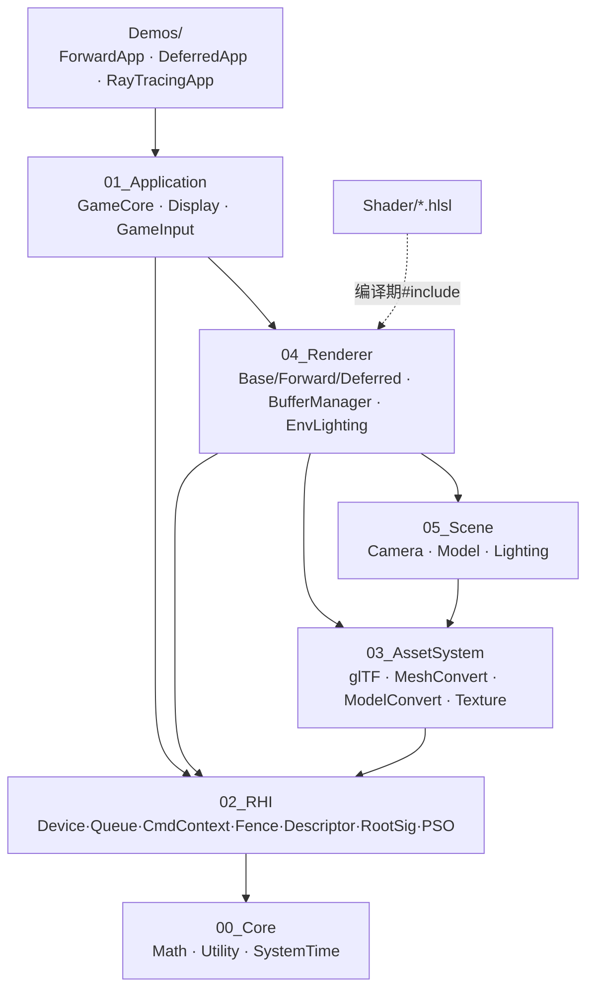
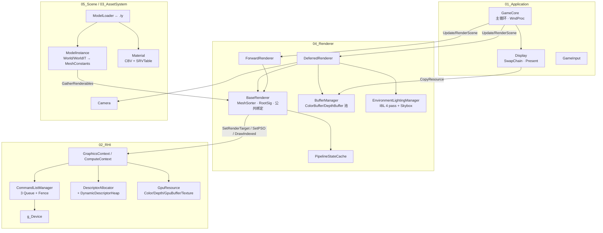
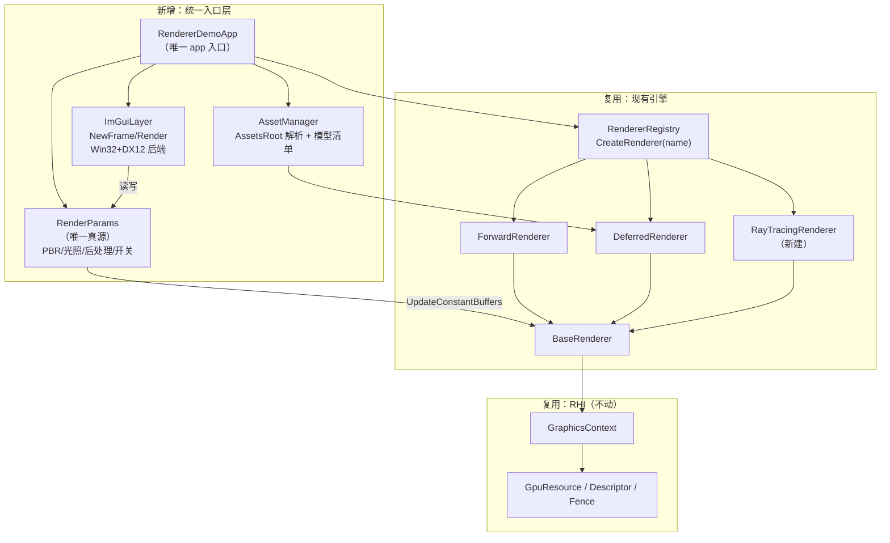

# TooiyumeRender 审计总报告（第一阶段）

> 项目根：`D:\CS-Self-Study\Computer_Graphics\DX12\TooiyumeRender`
> 审计日期：2026-10-24 ｜ 阶段：**只读审计 + 方案设计，未修改任何源码**
> 证据分级：**DONE / PARTIAL / ORPHAN（有码无调用者）/ STUB（空壳）/ MISSING / BUG / UNKNOWN**
> 全部结论附 `文件:行号`。凡未实测运行的一律标注，不臆测画面正确性。

## 0. 阅读指引

本报告是**总控文档**，不重复铺陈证据。五个专项证据包在 `docs/01_Audit_2026-10-24/raw/`：

| 文件 | 覆盖范围 | 规模 | 关键产出 |
|---|---|---|---|
| [03_RHI.md](raw/03_RHI.md) | Engine/02_RHI + 00_Core/01_Application 概览 | 317 行 | 帧循环·Barrier·Descriptor·SwapChain·DXR·矩阵约定·资源生命周期 |
| [04_Asset_Scene.md](raw/04_Asset_Scene.md) | Engine/03_AssetSystem + 05_Scene + 材质/PSO | 369 行 | glTF 管线·离线烘焙·顶点布局·材质三方对照·sRGB·相机·光照 |
| [05_Renderer_Shader.md](raw/05_Renderer_Shader.md) | Engine/04_Renderer + Engine/Shader | 331 行 | Forward/Deferred 实现度·PBR 数学·IBL·后处理·TAA·着色器编译链 |
| [06_App_Build_Docs.md](raw/06_App_Build_Docs.md) | Demos/ + 构建系统 + Assets + 文档 | 574 行 | 三 Demo 重复度·DXR 假旗子·硬编码路径·imgui 接入清单·文档失效 |
| [07_BuildVerify.md](raw/07_BuildVerify.md) | **实际构建实证** | 413 行 | 83/83 全绿、PCH 事故、DXR 签名实证、5 条真实警告 |

**有三项结论我（Lead）独立复核过并写进本报告**，与专项报告可能不同处，以本报告为准并在 §9 注明。

---

## 1. 项目总体结构

### 1.1 真实目录与规模（实测）

```
Engine/          55 个 .cpp / 77 个 .h+.hpp / 15 个 .hlsl，合计 52,025 行
├── 00_Core/            数学(Matrix4/Frustum/Transform) + Utility(断言/Hash/文件) + SystemTime   2,551 行
├── 01_Application/     GameCore(窗口+主循环) / Display(SwapChain+Present) / GameInput           1,269 行
├── 02_RHI/             Device·CommandQueue·CommandList·Allocator·Fence·Descriptor·RootSig·PSO
├── 03_AssetSystem/     glTF 解析 → MeshConvert → ModelConvert(.ty 烘焙) + Texture(.dds 烘焙)
├── 04_Renderer/        BaseRenderer/MeshSorter + Forward + Deferred + BufferManager + EnvironmentLightingManager
├── 05_Scene/           Camera(+ShadowCamera) / Model(+ModelInstance/ModelLoader) / LightingSystem
└── Shader/             01_Default(死) 02_Deferred(活) 04_PostProcess(TAA 未接) 05_BRDF(死) 06_Environment(活)
Demos/           3 个入口，合计 1,380 行（ForwardApp/Tooiyume.cpp 103 非空行、DeferredApp 100、RayTracingApp 101）
Assets/          仅 3 个文件，**不含任何模型**
```

### 1.2 分层与依赖方向



- **依赖是单向的**：Application → Renderer → Scene/Asset → RHI → Core，没有反向环（DONE）。
- `04_Renderer` 直接依赖 `05_Scene`（`BaseRenderer.h` 引入 Model），这一层耦合是后续做 Renderer 切换时要处理的点。
- **注意**：`Engine/*.md` 里描述的 `09_Renderer / 10_Scene / 05_ResourceSystem / 04_GPUInfrastructure / RenderGraph` 这些模块**在磁盘上全部不存在**，是废弃编号（见 §2 文档行）。

### 1.3 两条主调用链（实际追踪，非头文件推测）

**渲染链**
```
.gltf/.glb → glTF::Asset::Parse (glTF.cpp:622-755)
           → MeshConvert (顶点/索引/深度VB 生成)
           → ModelConvert::BuildModel (ModelConvert.cpp:242-454) → .ty 二进制
运行期:      ModelLoader::LoadModel (ModelLoader.cpp:189-357) → ModelData
           → Model::ModelInstance::Update (Model.cpp:106-171) 按场景图算 World/WorldIT
           → GatherRenderables (Model.cpp:19-44) → MeshSorter::AddMesh (排序+分 pass)
           → DeferredRenderer::Render (DeferredRenderer.cpp:167-374)
              → GBufferPass(:204-272) → LightingPass(:287-335) → SkyPass(:337-347)
           → Display::Present (Display.cpp:227-245) → PreparePresentSDR 纯 CopyResource
```

**同步链**
```
GraphicsContext::Begin (借 CommandList+Allocator)
   → 录制命令 → Finish(fence) → CommandListManager::ExecuteCommandList (Signal)
   → 下一次 Begin 时按 fence 复用 allocator / 线性分配器页 / DynamicDescriptorHeap
Present 之后无 fence 空闲等待（Present(0,0) 无 vsync、无 pacing）
```

---

## 2. 功能完成度矩阵

> 状态以**代码实际执行路径**为准，不以文件名、注释、Roadmap 为准。
> 「证据」列给最小充分行号，完整证据见 `raw/`。

### 2.1 主干与构建

| 功能 | 现有实现 | 关键文件 | 主要问题 | 证据 | 建议处理 |
|---|---|---|---|---|---|
| CMake 配置 | DONE | 根/Engine/Demos 三级 CMakeLists | toolchain 写死 `F:/VS/rep/vcpkg` | `CMakePresets.json:16` | P0 改环境变量 |
| 构建产物 | **DONE（实测）** | — | 无 | 干净 83/83 步全绿、3 exe 产出（`07_BuildVerify.md` §3.3） | 保持 |
| 增量构建 | BUG | PCH | 旧 PCH 内嵌 14.44.35225.00 与当前 cl 不符 → C1853 | `07_BuildVerify.md` §4.1-4.2 | P0 脚本化清 PCH |
| `CMakeSettings.json` | BUG | — | **非法 JSON**（缺外层 `{}`，`json.load` 报 Extra data） | `CMakeSettings.json:1-9` | P2 删除或修好 |
| Shader 编译 | PARTIAL | `ShaderCompiler.cmake:30-131` | 10 个 hlsl 全编；但 `DEPENDS` 只有主文件，改 `.hlsli` 不重编 | `ShaderCompiler.cmake:87` | P0 补 hlsli 依赖 |
| 资源分发 | **MISSING（阻塞）** | `Assets/` | `Assets/Model` 不存在且被 gitignore；0 个 gltf/glb/ty | `.gitignore:386`；实测 `ls` 失败 | **P0 阻塞** |

### 2.2 渲染管线

| 功能 | 现有实现 | 关键文件 | 主要问题 | 证据 | 建议处理 |
|---|---|---|---|---|---|
| Forward 渲染 | PARTIAL | `ForwardRenderer.cpp:122-245` | 只有 kZPass+kOpaque；`Update/BeginFrame` 空 | `:104-120` | P1 |
| Forward 着色器来源 | **BUG** | `ForwardRenderer.cpp:16-17` | 用的是**入库的 2026-05-04 旧 .h 字节码**，不在 CMake 编译列表；其内嵌根签名只 2 个 CBV，与 C++ 6 根参数不符 | `DefaultVS.h:341`、`DefaultPS.h:194` | P0 |
| Forward 光照 | MISSING | `DefaultPS.hlsl:51-56` | 只采样 baseColor 就 return | 灯光 SRV 取了却从未写入 | P1 |
| Deferred GBuffer | **DONE** | `DeferredRenderer.cpp:204-272` | 4 RT+Depth 真清真画 | `RendererConfig.h:8-19` | 保持 |
| Deferred Lighting | **DONE** | `:287-335` | 绑 4 GBuffer+Depth+3 IBL+Light/Camera CB，`Draw(3,0)` | `LightingPS.hlsl:7-18` | 保持 |
| Deferred Sky | PARTIAL | `:337-347` | 真绘制，但 UV 当 NDC（见 2.4） | `SkyboxPS.hlsl:25` | P1 |
| **Shadow / SSAO / Transparent / PostProcess / TAA / Tonemap** | **STUB ×6** | `:274-285, 349-371` | 六段全部只有 `PIXBeginEvent`+`PIXEndEvent` 相邻两行，**无任何 GPU 命令** | `:274-279/281-285/349-353/355-359/361-365/367-371` | P2 |
| PBR BRDF | **DONE** | `DeferredCommon.hlsli:58-129` | GGX/Smith(k=(r+1)²/8)/Schlick/能量分配均正确 | — | 保持 |
| Specular 输入 | PARTIAL | `GBufferPS.hlsl:120` | B 通道恒写 0.5 → `F0=0.16*s²` 恒 0.04，glTF specularFactor 未接 | `LightingPS.hlsl:91` | P1 |
| AlphaTest/Blend | MISSING | `GBufferPS.hlsl:88-124` | 无 `clip/discard`；alphaCutoff 是 ORPHAN | `ConstantBuffers.h:55` | P1 |
| IBL 预处理 | PARTIAL | `EnvironmentLightingManager.cpp:147-320` | 4 个 compute pass 真实执行；但 LOD 硬编码 8.0 而实际 5 mip | `LightingPS.hlsl:143` vs `.h:106` | P1 |
| IBL 缓存 | STUB | `EnvironmentLightingManager.cpp:122-125` | `SaveDDS()` **函数体为空** + `m_HDRLoaded` 从不置位 → 每次启动重烘 | `.h:100` | P1 |
| 世界坐标重建 | **BUG** | `LightingPS.hlsl:85` | `float2(1920,1080)` 硬编码，窗口一改全错位 | — | **P0** |
| 色彩/Gamma | BUG | `Display.cpp:29`、`RendererConfig.h:17` | 交换链 UNORM 非 SRGB + Present 纯 Copy + ACES 位置在 Lighting 内（skybox 不过 ACES） | 三处不一致 | P1 |
| TAA | ORPHAN | `TAACS.hlsl`(93行) | `TemporalEffects.cpp:19-20` 两行 include 全注释；6 个函数无定义 | 零调用者 | P2 |
| VelocityBuffer | ORPHAN | `DeferredRenderer.cpp:476` | 建了不写不读 | — | P2 |

### 2.3 资产与场景

| 功能 | 现有实现 | 关键文件 | 主要问题 | 证据 | 建议处理 |
|---|---|---|---|---|---|
| glTF 解析 | DONE | `glTF.cpp:622-755` | .glb 手工解析 GLBHeader/Chunk | — | 保持 |
| 顶点属性 | PARTIAL | `glTF.cpp:207-212` | POSITION/NORMAL/TANGENT/UV0/UV1 有；**JOINTS/WEIGHTS 从不查找 → 蒙皮 MISSING**；COLOR_0 解析但不进 VB | `glTF.h:147` | 说明支持子集 |
| PBR 纹理读取 | DONE | `glTF.cpp:332-365` | 五贴图+alphaMode+doubleSided | — | 保持 |
| `normalTexture.scale` | BUG | `glTF.cpp:346-347` | 查错键名（查顶层 `normalTextureScale`，规范在子对象内）→ 恒 1.0 | — | P2 |
| `alphaCutoff` | ORPHAN | `glTF.cpp:301-305` | 写进位域但没落进 `MaterialConstantData.flags`，HLSL 无 alphaRef | — | P1 |
| 离线烘焙 .ty | DONE | `ModelConvert.cpp:408-454` | 自定义二进制+魔数 TY | `ModelLoader.cpp:189-357` | 保持 |
| **强制重建** | **BUG** | `ModelLoader.cpp:217,242` | demo 写死 `forceRebuild=true` → 每次启动全量重解析，mtime 缓存形同虚设 | `DeferredApp.cpp:77` 等 3 处 | P1 |
| **贴图压缩** | **MISSING** | `TextureConvert.cpp:223` | 材质路径从不传 `kDefaultBC/kQualityBC` → 全 RGBA8，显存是 BC7 的 4-8 倍 | `ModelConvert.cpp:343-351` | P1 |
| 缓存键 | BUG | `TextureConvert.cpp:9-30` | DDS 缓存键只有路径+mtime，不含 flags → 改 sRGB 需求不重转 | — | P2 |
| **材质纹理槽枚举** | **BUG（我已复核）** | `ModelConvert.cpp:343-351` | 用**全局** enum 索引按 **glTF 顺序**排的数组 → Emissive 丢 sRGB、Occlusion 错得 sRGB | `glTF.h:138` vs `ConstantBuffers.h:18-26` | **P0** |
| **默认纹理槽** | **BUG（我已复核）** | `ModelLoader.cpp:97-104` | 下标与 enum 错位：槽3(Occlusion) 拿到 `kBlackTransparent2D`=(0,0,0,0) → **ao 恒 0 → ambient 归零** | `GraphicsCommon.cpp:92-102` | **P0** |
| **深度 VB 偏移** | **BUG（我已复核）** | `ModelConvert.cpp:133` | `curDepthVBOffset` 无 per-draw 增量（VB/IB 都有），多 draw 互相覆盖 | `:131/:134` 对照 | **P0** |
| 顶点布局三方一致 | **DONE** | `MeshConvert.cpp:308-327` / `DeferredRenderer.cpp:509-519` / `StaticMeshVS.hlsl:23-29` | POSITION/NORMAL/TANGENT/UV0/UV1 完全对上 | — | 保持 |
| **UNORM 切线还原** | **BUG（我已复核）** | `StaticMeshVS.hlsl:56` | 第 50 行算了还原后的 `Tangent`，第 56 行却用未还原的 `vsInput.Tangent.xyz` → TBN 错 | 对照 `:55` Normal 用了还原值 | **P0** |
| Scene/Entity/ECS | MISSING | `Engine/05_Scene/` | 只有 Camera/Lighting/Model，无 Scene 类 | 对比 `Scene.md` 描述 | 明确不做 ECS |

### 2.4 相机 / 光照 / 坐标

| 功能 | 现有实现 | 关键文件 | 主要问题 | 证据 | 建议处理 |
|---|---|---|---|---|---|
| 坐标系约定 | **DONE** | `Camera.h:3-5` | 右手系 / Forward=-Z / 行向量 v*M / 行主序 / 深度[0,1] / 非 ReverseZ，**CPU 与 HLSL 两端一致无转置陷阱** | `DefaultVS.hlsl:2,60-61` | 保持并写入文档 |
| 投影矩阵 | DONE | `Camera.cpp:92-97` | `w'=-z_view` 配合 RH 正确 | — | 保持 |
| **Aspect 更新** | **BUG** | `Camera.h:82` | `SetAspectRatio` **零调用**，resize 后仍 9:16 → 拉伸 | grep 全仓库 | P1 |
| ReverseZ | STUB | `Camera.h:92` | `ReverseZ()` 零调用；深度状态固定 LESS | `GraphicsCommon.cpp:148` | P2 |
| 光源可配置 | MISSING | `LightingSystem.cpp:33-74` | 方向光/点光**硬编码常量**，无 setter、无场景驱动 | — | **P1（ImGui 前提）** |
| 光源数量 | PARTIAL | `LightingSystem.h:50` | `MaxLights=1` | — | P2 |
| LightingSystem 重复视图 | BUG | `LightingSystem.cpp:73` | `CreateLights` 末尾又调一次 `CreateDerivedViews` → StructuredBuffer 再建 counter → 泄漏 | `GpuBuffer.cpp:208` | P2 |
| Forward 灯光 | ORPHAN | `ForwardRenderer.cpp:70` | 绑了 SRV，但 `DefaultPS.hlsl` 无光照代码 | — | P1 |

### 2.5 RHI / 生命周期（决定「能不能稳定跑」）

| 功能 | 现有实现 | 关键文件 | 主要问题 | 证据 | 建议处理 |
|---|---|---|---|---|---|
| Fence 编码队列类型 | **DONE** | `CommandListManager.cpp:14-15,51` | 高8位存 Type，设计巧 | — | 保持 |
| Fence 回写 | BUG | `CommandListManager.cpp:172` | 等待后**无条件回写**（无 max 保护）→ 多线程可回退 | — | P2 |
| Barrier 攒批 | DONE | `CommandContext.cpp:372-410` | 16 个攒批，满自动 flush | — | 保持 |
| UAV barrier 攒批 | BUG(潜) | `CommandContext.cpp:440-451` | 非立即模式下无「满16即 flush」→ 可越界；Release 下 ASSERT 为空 | `Utility.h:91` | P2 |
| 资源生命周期 | **MISSING** | `GpuResource.h:30-35` | 无延迟释放队列，`Destroy` 立即置空 ComPtr | — | P2 |
| **描述符句柄复用哨兵** | **BUG（潜在）** | `ColorBuffer.cpp:67-71` | 靠 `ptr==UNKNOWN` 判断是否要分配，但 `Destroy` **不重置句柄** → 同对象二次 Create 沿用旧描述符 | `GpuBuffer.cpp:171-172` 同源 | P1 |
| 描述符堆只增不减 | BUG | `DescriptorHeap.cpp:37-54` | resize 每次漏 3 个 RTV；材质堆 4096 长期会耗尽 | — | P1 |
| `DescriptorAllocator::Allocate` | BUG | `DescriptorHeap.cpp:37-54` | **完全无锁**，注释却称线程安全 | — | P2 |
| Sampler 去重 | BUG | `SamplerManager.cpp:20-32` | `find` 后**从不 insert** → 去重失效 | — | P2 |
| **Resize 通知渲染器** | **MISSING（必现崩溃）** | `Display.cpp:167` | `OnResize` 有实现但**零调用者**；`ResizeDisplayDependentBuffers` 被注释 | 全仓库 grep | **P0** |
| **SceneColorBuffer 跟随 resize** | **BUG（必现）** | `Display.cpp:230` | 全工程仅 3 处赋值，**全在 Startup**，resize 路径无一处重赋值 → CopyResource 尺寸不一致 | 实测 grep | **P0** |
| 最小化 0 尺寸 | BUG | `GameCore.cpp:144` | WM_SIZE 不滤 0 → `ResizeBuffers(0,0)` 必败；`CreateForwardBufferTargets` 0 尺寸直接 return 而 `Destroy...` 不判空 | `ForwardRenderer.cpp:313,325-329` | P0 |
| BackBuffer 索引 | BUG(潜) | `Display.cpp:234` | 手动 `+1 %3`，未用 `GetCurrentBackBufferIndex`（全仓库 0 调用） | — | P1 |
| 每帧 CB 内存 | DONE | `CommandContext.h:486-494` | 从 `m_CpuLinearAllocator`(UPLOAD 堆) 分配，CPU 写 GPU 读，**写法正确** | — | 保持（注意别改成 Gpu 版） |

### 2.6 DXR（核心目标，当前进度 ≈ 0%）

| 功能 | 现有实现 | 关键文件 | 主要问题 | 证据 | 建议处理 |
|---|---|---|---|---|---|
| 能力探测 | **DONE** | `GraphicsCore.cpp:171-208` | OPTIONS5 + RaytracingTier + QueryInterface<Device5> | — | 保持 |
| 对外暴露 | ORPHAN | `GraphicsCore.h:26-38` | `g_DeviceDXR`/`g_bRaytracingSupported` **未导出**，仅本 cpp 可见 | — | P1 |
| **DXR 请求生效** | **BUG** | `RayTracingApp.cpp:34,64` | 少了 `const` → 不构成 override（基类 `GameCore.h:26` 带 const）→ **恒调基类返回 false** → DXR 永不启用 | 构建实证复现 | **P0（DXR 第一块多米诺）** |
| RTPSO / SBT / AS / DispatchRays | **MISSING** | — | `DispatchRays` 全仓库 **0 命中**；`RayTracingRenderer` 目录不存在 | — | P1 从零建 |
| RayTracingApp | ORPHAN | `RayTracingApp.cpp:55,73` | 实际是 **DeferredApp 换模型副本**（96/100 行相同） | — | P1 并入统一入口 |
| CommandList 类型 | DONE | `CommandContext.h:189` | 已是 `ID3D12GraphicsCommandList4`，满足 DXR 要求，**不用改** | — | 保持 |

### 2.7 ImGui / 文档 / 工程卫生

| 功能 | 现有实现 | 关键文件 | 主要问题 | 证据 | 建议处理 |
|---|---|---|---|---|---|
| Dear ImGui | **MISSING** | — | vcpkg.json 无；全仓库 0 命中 | 接入清单见 `06_App_Build_Docs.md` §7.2 | **P1** |
| `RenderUI` 钩子 | ORPHAN | `GameCore.h:24` | 已声明，**帧循环无调用点** | `GameCore.cpp:50-54` | P1 在此插入 |
| BackBuffer 对外暴露 | MISSING | `Display.h:16-25` | 只暴露 `SceneColorBuffer`；`g_DisplayPlane[]` 在匿名命名空间 → ImGui DX12 后端拿不到 RTV | `Display.cpp:131` | **P1（ImGui 前置）** |
| WndProc 键鼠 | MISSING | `GameCore.cpp:139-157` | 只处理 WM_SIZE/WM_DESTROY → ImGui 无法交互 | — | P1 |
| RendererRegistry | ORPHAN | `RendererRegistry.cpp:16` | 已实现自注册，`CreateRenderer` **零调用** | 三 Demo 都直接 new | P1 复用它做切换 |
| 三 Demo 重复 | BUG(可维护性) | 三份入口 | Deferred 与 RT 96/100 行相同；都越界写 `Models[2]` 却只加载 2 个 | `:137/:132/:132` | P1 合并 |
| 硬编码绝对路径 | **BUG** | 18 处 | 全指 `D:/CS-Self-Study/...`，含 1 处引擎层 | `DeferredRenderer.cpp:40` | **P0** |
| README | MISSING | `README.md:16-20` | `# Project Structure` 之后是空的；引用不存在的 `docs/Architecture.md` | — | P1 |
| Showcase | BUG | `Showcase.md:3-26` | 以 `</td>` 开头 `</table>` 结尾的坏 HTML 片段；宣传 TAA 但代码全注释 | — | P2 |
| 模块 md | ORPHAN | `Engine/*/*.md` | 全用废弃编号并引用不存在目录 | 见 §9 风险 | P2 |
| 生成头符全性 | BUG(潜) | `BinToHeader.cmake:9-28` | 无 `#pragma once`、非 `static/inline` → 第二个 include 者必 LNK2005 | 当前各 1 个 include 者 | P2 |
| `RELEASE` 宏 | **BUG** | `Utility.h:89` | 全仓库无 `#define RELEASE` → Release 构建里 ASSERT 仍生效（`__debugbreak`） | 我已实测 grep | P1 |
| PIX dll | BUG(阻塞) | `.gitignore:30` | `[Bb]in/` 忽略 `ThirdParty/PIX/bin/*.dll` → clean clone POST_BUILD 必失败 | — | **P0 阻塞** |
| 空文件/死目录 | ORPHAN | — | `ShaderLibrary.h/.cpp`=0行、`PSOBuilder.h/.cpp`=0行、`MaterialFlags.h`=0行、`RenderGraph/` 空目录 | 实测 `wc -l` | P2 删除或标注 |

---

## 3. 当前架构图

### 3.1 运行期对象与数据流



### 3.2 一帧的真实时序（Deferred）

```mermaid
sequenceDiagram
    participant Loop as 主循环 GameCore
    participant App as IGameApp(Demo)
    participant Ren as DeferredRenderer
    participant Ctx as GraphicsContext
    participant Q as CommandQueue
    participant Disp as Display

    Loop->>App: Update(dt)
    App->>Ctx: Begin("Scene Update")
    App->>Ren: Update(desc) — 遍历 Models 的 IsDirty
    Ren->>Ren: ModelInstance::Update + ModelSort（仅 dirty 时）
    Ren->>Ren: BakeEnvironmentTextures（每帧调用，靠 m_Baked 短路）
    App->>Ctx: Finish() → Execute → Signal(fence)

    Loop->>App: RenderScene()
    App->>Ctx: Begin("Scene Deferred")
    App->>Ren: Render(desc, kOpaque)
    Ren->>Ctx: GBufferPass → LightingPass → SkyPass
    App->>Ren: EndFrame() — ClearDirty（**无 Sorter.Reset**）
    App->>Ctx: Finish() → Execute → Signal

    Loop->>Disp: Present()
    Disp->>Ctx: Begin("Present") → CopyBuffer(SceneColor→BackBuffer)
    Disp->>Disp: SwapChain->Present(0,0)
```

**这张图暴露三个结构性问题**：
1. `BakeEnvironmentTextures` 每帧都在 Update 里调，且内部 `Finish(true)` **同步阻塞** → 一旦 `m_Baked` 被重置或有第二个环境图，会直接卡住。IBL 烘焙应只做一次（启动或换环境图时）。
2. `EndFrame` 不 `Reset()` sorter，而 `Update` 里 `IsDirty` 使 ModelSort 只在 dirty 时跑 → 首次 dirty 后 sorter 累积，第二次 dirty 会**叠加**（`ForwardRenderer.cpp:251` 有 Reset，Deferred 漏了）。
3. Present 无 vsync、无 pacing、无 fence 等待，且 `Display::SceneColorBuffer` 不跟随 resize。

---

## 4. 目标架构设计

### 4.1 设计约束（为什么不推倒重来）

审计已证明：**RHI 主干是成链可用的（DONE）**，Deferred 的 GBuffer+Lighting 是真跑的，PBR 数学是对的，构建是 83/83 全绿的。所以目标架构的出发点是「在现有骨架上补三个缺口」，而不是重写：

| 缺口 | 本质 | 现有可复用资产 |
|---|---|---|
| ① 运行时切换 | 三个 Demo 各自 new 一个 Renderer，`RendererRegistry` 是死的 | `BaseRenderer` 抽象完整、`RendererRegistry` 已实现自注册 |
| ② 实时调参 | 没有 UI 层，也没有「参数 → CB → Shader」的可变通道 | `GlobalConstants`/`MaterialConstants`/`LightData` 结构已在 |
| ③ DXR | 只有设备探测，零管线 | `ID3D12GraphicsCommandList4` 已满足、BLAS 素材（Model 的 VB/IB）已在 |

**明确不引入**：ECS、完整 RenderGraph、新的抽象层。现有 `MeshSorter` + `PipelineStateCache` 已够用。

### 4.2 目标架构图



### 4.3 关键新增/修改点（逐文件）

**A. 统一入口 + Renderer 切换**（复用 > 新建）

| 项 | 动作 | 理由 |
|---|---|---|
| `Demos/RendererDemoApp/` | **新建**，吸收三 Demo 的 96% 重复逻辑 | 不动原 Demo，符合「不破坏现有实现」 |
| `RendererRegistry::CreateRenderer` | **接通**（当前零调用，`RendererRegistry.cpp:16`） | 已有自注册机制，切换只需换名字 |
| `ForwardRenderer` 注册名 | 修掉 **尾随空格** `L"ForwardRenderer "`（`ForwardRenderer.cpp:27`） | 否则按名查找必失配 |
| `IGameApp` | 增 `virtual void OnResize(w,h)`；`Display::Resize` 末尾转发 | 修 **必现崩溃** 的 resize 断链 |
| `Display` | 增 `GetCurrentBackBuffer()` 返回 RTV+索引 | ImGui DX12 后端的硬前置 |

**切换时序**（必须按此顺序，否则崩）：
```
旧 Renderer.IdleGPU()             // 等 GPU 完成
旧 Renderer.Shutdown()
Display::SceneColorBuffer.reset() // 断开旧 buffer 引用
RendererRegistry::CreateRenderer(newName)
新 Renderer.Initialize(desc)      // 内部用当前 g_DisplayWidth/Height
Display::SceneColorBuffer = 新 Renderer 的输出 buffer  // ← 当前 3 处赋值全在 Startup，必须重做
```

**B. ImGui 集成**（按现有 CMake 结构，最小改动）

| # | 文件 | 改动 |
|---|---|---|
| 1 | `vcpkg.json` | 加 `{"name":"imgui","features":["dx12-binding","win32-binding"]}` |
| 2 | 根 `CMakeLists.txt` | `find_package(imgui CONFIG REQUIRED)` |
| 3 | `Engine/CMakeLists.txt` | `target_link_libraries(TooiyumeEngine PUBLIC imgui::imgui)` |
| 4 | `Engine/01_Application/ImGuiLayer.{h,cpp}` | 新建：CreateContext + ImplWin32_Init(g_hWnd) + ImplDX12_Init |
| 5 | `Display.h/.cpp` | **先加** `GetCurrentBackBuffer()`（`g_DisplayPlane[]` 现在在匿名命名空间，外部拿不到） |
| 6 | `GameCore.cpp:139-157` | WndProc 加 `ImGui_ImplWin32_WndProcHandler` 转发 |
| 7 | `GameCore.cpp:50-54` | 在 Present 前调 `game.RenderUI(ctx)`（当前**零调用点**） |

**ImGui 生命周期三个坑（审计已确认）**：
1. ImGui 有自己的 shader-visible descriptor heap，**不能**复用引擎的 `s_TextureHeap`（`DeferredRenderer.cpp:390` 容量 4096，ImGui 会把它撑爆）；
2. 必须在 `Present` 的 CopyBuffer **之前**画，否则画在旧 backbuffer 上；
3. `GameInput` 与 ImGui 抢键盘时，相机要停（`GameInput.cpp:95/201` 是独立系统）。

**C. RenderParams 数据链（防止「改了 UI 但画面不动」）**

```
ImGui SliderFloat ──写──> RenderParams（单例，CPU 端唯一真源）
                              │
                              ├─ 每帧 Update → GlobalConstants（光照/曝光）→ SetGraphicsRootConstantBufferView
                              ├─ 材质编辑 → MaterialConstants[i] → 重新 Map/写 CBV
                              └─ DebugView 枚举 → 作为 CB 字段传入，LightingPS 按 switch 输出
```

**关键**：`GlobalConstants`（`ConstantBuffers.h:60-66`）当前只有 ViewProj/CameraPos/SunDirection/SunIntensity，**必须扩字段**（Exposure、DebugViewMode、TonemapMode、flags），且要同步改 `StaticMeshVS.hlsl:15-19` 与 `GBufferPS.hlsl:27-31` 的 cbuffer 声明——审计已发现这两处 HLSL 的 GlobalConstants **只有 ViewProjMatrix+ViewerPos**，比 C++ 少字段（偏移 0 相同所以暂未爆）。

**D. DXR 接入**（三步走，每步可独立验证）

| 步 | 内容 | 验收 |
|---|---|---|
| D0 | 修 `RequiresRaytracingSupport` 加 `const override`；把 `g_DeviceDXR`/`g_bRaytracingSupported` 导出到 `GraphicsCore.h` | 加 override 后编译通过；启动日志出现 RaytracingTier |
| D1 | BLAS（每 Mesh，从 VB+IB 建）+ TLAS（每帧，从 World 矩阵建）+ AS 的 UAV→GENERATED→SRV 状态链 | PIX 能看到 BuildRaytracingAccelerationStructure |
| D2 | RTPSO（DXIL lib `raytracing` profile，需扩 `ShaderCompiler.cmake` 支持 `lib_6_4`）+ SBT + `DispatchRays` + 输出到 SceneColor | 屏幕出现「命中=法线色，未命中=黑」 |

**DXR 三个真实阻碍（必须先解决，否则 D1 卡死）**：
1. `ShaderCompiler.cmake` **只支持 vs/ps/cs_6_4**，无 `lib_*` 分支 → RTPSO 拿不到 DXIL library；
2. `PipelineStateCache` 只缓存 `D3D12_GRAPHICS_PIPELINE_STATE_DESC`，DXR 的 `D3D12_STATE_OBJECT_DESC` 需另开缓存；
3. 模型资产缺失 → **没有 BLAS 可建**（回到 §2.1 的 P0 阻塞）。

### 4.4 与现有抽象的复用判断

| 现有抽象 | 判定 | 处理 |
|---|---|---|
| `BaseRenderer` + `MeshSorter` | **复用** | 只需补 `Reset()` 一致性 |
| `RendererRegistry` | **复用** | 接通 `CreateRenderer`，修空格 |
| `PipelineStateCache` | **复用** | DXR 另开一条 |
| `EnvironmentLightingManager` | **复用 + 修** | Bake 提前到初始化，补 SaveDDS |
| `BufferManager` | **改** | 补 `DestroyColorBuffer` 调用（现 ORPHAN） |
| `TemporalEffects`（73 行死文件） | **删除后重建** | 6 个函数无定义，一旦被调即链接失败 |
| `ShaderLibrary.h/.cpp`（0 行） | **删除或实现** | 现在是空文件 |
| `RenderGraph/`（空目录） | **暂不实现** | 按约束不引入 |

---

## 5. 具体任务清单

> 分组：**【必须】= 不修则后续全部卡住或必崩**；**【建议】= 影响正确性/可调试性**；**【后续】= P2 扩展**。
> 每项给：目标 · 依赖 · 涉及文件 · 修改范围 · 验收条件 · 失败风险。

### 5.1 【必须】P0 基线修复（第 1 批）

| # | 任务 | 依赖 | 涉及文件 | 修改范围 | 验收条件 | 失败风险 |
|---|---|---|---|---|---|---|
| T0.1 | **补资产**：`.gitignore` 加 `!Assets/Model/` 或写 `fetch_assets.ps1` + README 下载说明 | 无 | `.gitignore:386`、`README.md` | 配置 + 文档 | 新机器 clone 后 `Assets/Model/*.gltf` 存在 | 模型版权/体积；**这是全项目最大阻塞** |
| T0.2 | **PIX dll 入库** | 无 | `.gitignore:30`、`ThirdParty/PIX/bin/` | 一行 gitignore | `git ls-files` 可见 dll | 二进制入库需团队认可 |
| T0.3 | **toolchain 去绝对路径** | 无 | `CMakePresets.json:16`、`CMakeSettings.json` | 改 `$env{VCPKG_ROOT}` | 换机 configure 成功 | 需团队统一 VCPKG_ROOT |
| T0.4 | **18 处硬编码路径 → AssetsRoot** | T0.1 | 3 个 Demo + `DeferredRenderer.cpp:40` | 全局 `AssetRoot` + 相对路径 | 移动项目目录后仍能加载 | 相对路径基准（exe 目录 vs 项目根）需定标准 |
| T0.5 | **修 DXR 签名** `const override` | 无 | `RayTracingApp.cpp:34,64` | 2 行 | 编译通过且启动日志出现 tier | 加 override 后暴露其他签名不符 |
| T0.6 | **Shader DEPENDS 补 .hlsli** | 无 | `ShaderCompiler.cmake:87` | `file(GLOB)` 加依赖 | 改 `.hlsli` 触发重编 | 全量重编变慢（可接受） |
| T0.7 | **PCH 失效脚本化** | 无 | 构建脚本 | 比对 PCH 内嵌版本 | 工具集升级后构建不再 C1853 | 需解析 PCH 二进制头 |

### 5.2 【必须】P0 确定性 Bug（第 2 批，全部我已复核）

| # | 任务 | 证据 | 修法 | 验收 |
|---|---|---|---|---|
| T1.1 | **材质纹理槽 sRGB 错配** | `ModelConvert.cpp:343-351` 用全局 enum 索引 glTF 顺序数组 | 改用 `glTF::Material::` 限定作用域枚举 | 改后 Emissive 走 sRGB、Occlusion 不走 |
| T1.2 | **默认纹理槽错位（ao 恒 0）** | `ModelLoader.cpp:97-104` | 按 `ConstantBuffers.h:18-26` 顺序重排；槽3 应为 `kWhiteOpaque2D`（ao=1） | 无 AO 贴图模型 ambient 正常 |
| T1.3 | **深度 VB 偏移不递增** | `ModelConvert.cpp:133` | per-draw 加 `curDepthVBOffset` 增量 | 多 draw mesh 的 depth pass 正确 |
| T1.4 | **分辨率硬编码 1920×1080** | `LightingPS.hlsl:85` | 传入 CB 或用 `GetDimensions` | 任意窗口尺寸光照正确 |
| T1.5 | **UNORM 切线未还原** | `StaticMeshVS.hlsl:56` 用了未还原的 `vsInput.Tangent` | 改用第 50 行算好的 `Tangent` | TBN 正交、法线贴图方向正确 |
| T1.6 | **resize 断链（必崩）** | `Display.cpp:167` OnResize 零调用 + `SceneColorBuffer` 不重赋值 | 见 §4.3 A | 拖动窗口不崩、不拉伸 |
| T1.7 | **最小化 0 尺寸** | `GameCore.cpp:144` | 过滤 0 尺寸 | 最小化/还原不崩 |
| T1.8 | **`RELEASE` 宏缺失** | 全仓库无 `#define RELEASE` | CMake 加 `$<$<CONFIG:Release>:RELEASE>` | Release 构建 ASSERT 失效 |
| T1.9 | **Forward 用入库旧 .h** | `ForwardRenderer.cpp:16-17` | 把 01_Default 纳入 compile_shader + 改 include 到 ShaderCache | 改 `DefaultVS.hlsl` 生效 |
| T1.10 | **`forceRebuild=true` 写死** | 3 个 Demo | 改 false 或命令行开关 | 二次启动秒开 |

### 5.3 【建议】P1 功能打通（第 3-5 批）

| # | 任务 | 依赖 | 交付 | 验收 |
|---|---|---|---|---|
| T2.1 | **统一入口 RendererDemoApp** | T0.3, T0.4, T1.6 | 单 exe，保留三原 Demo | 三模式都能起画面 |
| T2.2 | **ImGuiLayer + 6 面板** | T2.1 | Performance/Scene/Renderer/Material/DebugView/DevTools | 面板可拖动、数值真实生效 |
| T2.3 | **Display 暴露 backbuffer + WndProc 键鼠** | 无 | ImGui 前置 | ImGui 可交互 |
| T2.4 | **RenderParams 数据链** | T2.2 | 唯一真源 → CB → Shader | 拖 Metallic 画面实时变化 |
| T2.5 | **Debug View 6 档** | T2.4 | Final/BaseColor/Normal/Metallic/Roughness/Depth | 每档输出对应 GBuffer |
| T2.6 | **光源可配置** | T2.4 | `LightingSystem` 加 setter | UI 改光方向/强度真实生效 |
| T2.7 | **Deferred sorter Reset** | 无 | `DeferredRenderer.cpp:375-386` 补 `DefaultSorter.Reset()` | 多模型切换不重复画 |
| T2.8 | **AAO/AlphaTest 接入** | 无 | `GBufferPS.hlsl` 加 clip；`flags` 透传 alphaCutoff | 树叶镂空正确 |
| T2.9 | **IBL LOD 修正** | 无 | `maxPrefilterMip = 5`（或从 CB 取） | 粗糙表面不再糊 |
| T2.10 | **IBL 缓存** | 无 | 实现 `SaveDDS` + `m_HDRLoaded` | 二次启动不重烘 |

### 5.4 【后续】P2 扩展

| # | 任务 | 说明 |
|---|---|---|
| T3.1 | Shadow Map | `ShadowCamera`/`ShadowBuffer` 已有骨架，需接进 sorter 的 `kShadows` 分支 |
| T3.2 | SSAO | 六段空壳之一 |
| T3.3 | TAA | `TAACS.hlsl` 已写，需重写 `TemporalEffects`（现 6 函数无定义） |
| T3.4 | Tonemap + HDR 输出 | 交换链换 `R10G10B10A2`/`R16G16B16A16_FLOAT`，ACES 移出 Lighting |
| T3.5 | 透明 Pass | STUB 段 |
| T3.6 | Shader 热重载 | 需先把 `ShaderLibrary`（0 行）实现出来 |
| T3.7 | 文档重建 | `Architecture.md`/`RenderingPipeline.md`/`DearImGui.md`/`RayTracing.md`/`DevelopmentGuide.md` |

**依赖关系一句话**：T0.1（资产）是一切的前提 → T1.x（确定性 bug）保证「看到的画面是对的」→ T2.1/T2.2（统一入口+ImGui）是调试基座 → T3 才有意义。**DXR 必须在 T0.1 之后**（无模型即无 BLAS）。

---

## 6. 下午 AI 编程执行顺序

> 原则：**每个批次都能独立编译+运行+观察**，纵向切片，不留到最后集成。
> 每批结束都要「构建绿 + 画面有可观察变化」才算完成。

| 批次 | 前置条件 | 交付物 | 构建验证 | 「未完成」判据 |
|---|---|---|---|---|
| **B0** 基线归零 | 无 | 三 exe 能编能跑、模型能加载 | `ninja` 全绿；启动后**看到模型** | 黑屏 / 静默 nullptr |
| **B1** 修确定性 Bug | B0 | T1.1–T1.5 五条 | 编译绿；Debug View 下各 GBuffer 合理 | 任一 GBuffer 全黑/全白/NaN |
| **B2** 生命周期加固 | B1 | T1.6–T1.8 | 拖窗口/最小化 30s 不崩 | 任何调试层 RESOURCE_DIMENSION_MISMATCH |
| **B3** 统一入口 | B2 | T2.1 | 单 exe 切三模式 | 切换时崩溃/黑屏 |
| **B4** ImGui 骨架 | B3 | T2.2, T2.3 | 面板出现，可交互 | 面板不刷新/无响应 |
| **B5** 参数数据链 | B4 | T2.4, T2.5, T2.6 | 拖滑块画面实时变 | 数值变但画面不动 = 链路未通 |
| **B6** PBR 补全 | B5 | T2.7–T2.10 | 对比截图 | 粗糙度/IBL 与参考差异大 |
| **B7** DXR 最小链路 | B6, **T0.1** | D0→D1→D2 | 屏幕出现光线命中结果 | 只有光栅化 = 未完成 |

**时间估算**（按 07_BuildVerify 实测：干净全量 31s、增量 <5s，**构建不是瓶颈**）：
- B0–B2：约 2-3 h（bug 都是点状小改）
- B3–B5：约 3-4 h（ImGui 接入是新代码量最大的一块）
- B6：约 1-2 h
- B7：**不建议压在今天**——RTPSO+SBT+AS 是全新子系统，且卡在资产缺失

---

## 7. 学习文档规划

每篇统一按 9 段结构：**要解决的问题 → 算法原理 → 所在模块/关键类 → 关键数据结构 → CPU→GPU 数据传递 → Shader 与 C++ 对应 → 资源绑定/状态/同步 → 实现步骤 → 如何验证 / 限制 / 扩展**。

| 文档 | 必写内容（对应真实文件） | Mermaid 图 |
|---|---|---|
| `Architecture.md` | 七层职责与单向依赖；`Engine.md` 的坐标系约定（右手/行向量/行主序/[0,1]）应提升到 README | 分层依赖图（本报告 §1.2/§3.1 可直接用） |
| `RenderingPipeline.md` | Forward vs Deferred 全流程；GBuffer 四通道格式与写入/读取对应（`GBufferPS.hlsl:117-121` ↔ `LightingPS.hlsl:76-92`）；BRDF 逐项推导（GGX/Smith k=(r+1)²/8/Schlick/能量分配）；IBL 四 pass 尺寸/mip/LOD | 一帧时序图（§3.2） |
| `DearImGui.md` | Descriptor Heap 隔离原因；`NewFrame→Render` 与 Present 的顺序；参数从 Slider 到 CB 到 Shader 的完整链路 | ImGui 帧内时序图 |
| `RayTracing.md` | DXR 初始化门槛；BLAS/TLAS 构建与状态链；SBT 布局；`DispatchRays` 与光栅化的资源共存 | DXR 资源状态机图 |
| `DevelopmentGuide.md` | vcpkg/CMake 配置；**PCH C1853 的成因与解法**（07 实测）；5 条真实警告的含义；常见错误 | 构建流程图 |
| `Roadmap.md` | 现有两处 `## Version 1.0` 重复需修；区分「已实测」「已写代码」「仅规划」 | 状态矩阵表 |
| `README.md` / `Showcase.md` | README `# Project Structure` 之后是空的必须补；Showcase 是坏 HTML 且宣传了未接的 TAA | — |

**特别建议**：把审计发现的「**PBR 数学是对的**」写进文档——这是本项目最值得保留的资产（`DeferredCommon.hlsli:58-129` 的 GGX/Smith/能量分配全对），后续重构必须保护。

---

## 8. 第一批开发任务（建议先做 B0+B1）

### 为什么是它

1. **B0 不修，后面全是空谈**：`Assets/Model` 不存在，任何「画面正确」都无法验证（现在连 Deferred 是否真出图都是 UNKNOWN）。
2. **B1 的五条全是确定性 bug，改动小、收益大、风险低**：
   - T1.1/T1.2 是**两套枚举顺序不一致**导致的系统性错配，不改则所有模型材质都错；
   - T1.3 是多 draw 覆盖，不改则复杂模型几何错乱；
   - T1.4 是硬编码分辨率，不改则「调整窗口」这个最基本操作即出错；
   - T1.5 一行改动，直接修 TBN。
3. **它们与后续的依赖关系**：
   - ImGui 的 Debug View（B5）**必须**在 B1 之后才有意义——否则展示的是错的 GBuffer；
   - DXR（B7）**必须**在 B0 之后，否则没有 BLAS 素材。

### 第一批最小可交付

```
交付 1：三 exe 能在干净 clone 上配置+构建+运行，且能看到模型（B0）
交付 2：T1.1–T1.5 五条确定性 bug 修复，每条的「修前/修后」证据（B1）
交付 3：一份「GBuffer 四通道截图对照」，证明 Debug View 的数据源是对的
```

**验收方式**：不靠「我觉得好了」，靠 —— 构建 0 error、启动后模型可见、四张 GBuffer 截图合理、切换分辨率不崩。

---

## 9. 我（Lead）独立复核后的三处修正

专项报告是并行产出的，我在汇总时逐条复核了最关键的结论。**有两处需要修正，一处需要扩大严重程度**——以本节为准。

### 9.1 修正一：默认纹理表不是「只错 AO」，而是 **5 槽错 4 槽**，且最严重的是法线槽

`04_Asset_Scene.md` 结论 2 称「下标与 ConstantBuffers 顺序错位 → 无 AO 贴图模型 ao 恒 0」。方向对，但**低估了影响面**。

`ModelLoader.cpp:97-104` 数组按 **ConstantBuffers 顺序**（0=BaseColor, 1=Normal, 2=Emissive, 3=Occlusion, 4=MetallicRoughness）索引，
但填的内容按 **glTF 顺序**（baseColor, emissive, normal, metallic, roughness）——**注释本身就暴露了作者是照 glTF 顺序写的**：

| 槽位（真实语义） | 实际填入 | 应该是 | 后果 |
|---|---|---|---|
| [0] BaseColor | `kWhiteOpaque2D` | `kWhiteOpaque2D` | ✅ 正确 |
| **[1] Normal** | `kWhiteOpaque2D` = (1,1,1,1) | `kDefaultNormalMap` = (0.5,0.5,1,1) | ❌ **采样后 `*2-1` = (1,1,1)，所有无法线贴图的模型法线全错** |
| [2] Emissive | `kWhiteOpaque2D` = (1,1,1,1) | `kBlackOpaque2D` = (0,0,0,1) | ❌ 若有 emissiveFactor 非零则过曝 |
| [3] Occlusion | `kBlackTransparent2D` = **(0,0,0,0)** | `kWhiteOpaque2D` = (1,1,1,1) | ❌ **ao=0 → `ambient` 归零**（专项报告已指出） |
| [4] MetallicRoughness | `kDefaultNormalMap` = (0.5,0.5,1,1) | `kWhiteOpaque2D` | ❌ **metallic 恒 1、roughness 减半** |

**为何这比报告更严重**：法线槽错位意味着**每个没有法线贴图的模型法线都是垃圾**，其影响覆盖整个 PBR 光照；而 MR 槽错位让「金属度恒 1」——这会把所有非金属材质渲染成金属。这两个比 ao=0 更容易被误判为「作者 PBR 没写对」，从而掩盖真相。

**佐证**：`ModelLoader.cpp:88` 的注释写的是第三种顺序 `(BaseColor, Emissive, Normal, Metallic, Roughness)`——
即这个工程里存在**三套不一致的纹理槽顺序**：glTF.h:138 / ConstantBuffers.h:18-26 / 注释与默认表。修的时候应**统一到一处**（建议 `ConstantBuffers.h`），其余全部引用。

### 9.2 修正二：`ModelConvert.cpp:343-351` 的枚举确实错配（此项报告正确，补充量化）

`kBaseColor` 等未限定名解析到**全局 enum**（`ConstantBuffers.h:18`），而 `srcMat.textures[]` 是 **glTF 顺序**数组。逐行代入后：

| 代码行 | 实际取的 `srcMat.textures[i]` | 应为 | 判定 |
|---|---|---|---|
| `:343` `kBaseColor`(=0) | [0] BaseColor | BaseColor | ✅ |
| `:345` `kMetallicRoughness`(=4) | [4] **Normal** | MetallicRoughness | ❌ |
| `:347` `kOcclusion`(=3) | [3] **Emissive** | Occlusion | ❌ |
| `:349` `kEmissive`(=2) | [2] **Occlusion** | Emissive | ❌ |
| `:351` `kNormal`(=1) | [1] **MetallicRoughness** | Normal | ❌ |

即：**Emissive 丢了 sRGB、Occlusion 被当成 sRGB 处理、Normal 和 MR 互相串位**。报告结论成立，此处给出逐行代入作补强。

### 9.3 修正三：`curDepthVBOffset` 无增量 —— 成立，但注意「是否真触发」

`ModelConvert.cpp:133` 确实缺 per-draw 增量（`:131` 有 `curVertOffset`、`:134` 有 `curIndexOffset`，唯独 depth 没有）。
**但要诚实标注触发条件**：只有当**同一 Mesh 含 ≥2 个 draw**（`iter.second.size() > 1`）时才互相覆盖；单 draw 场景下 `:133` 的起始偏移恰好正确，所以「一直是坏的」这一说法过强。修复仍必须做，验收时需专门构造多 draw 模型。

### 9.4 复核中确认**成立**的高价值结论

| 结论 | 复核方式 | 结果 |
|---|---|---|
| Deferred 六段 Pass 全空壳 | 亲自读 `:274-285`/`:349-371` | ✅ 确认只有 PIXBegin/EndEvent 相邻两行 |
| `LightingPS.hlsl:85` 硬编码 1920×1080 | 亲自读 | ✅ 确认 |
| `m_HDRLoaded` 从不置位 | 亲自 grep + 读 `.h:100` | ✅ 确认（仅声明处 + `:150` 读，无写） |
| Forward 用入库旧 `.h` | 亲自读 `ForwardRenderer.cpp:16-17` | ✅ 确认，且 `.hlsl` 不在 CMake 编译列表 |
| `RequiresRaytracingSupport` 少 const | 亲自读 `RayTracingApp.cpp:34,64` + `GameCore.h:26` | ✅ 确认，构建实证也复现 |
| `Assets/Model` 不存在 | 亲自 `ls` | ✅ 确认（只有 Skybox 三个文件） |
| `RELEASE` 宏全仓库无定义 | 亲自 grep 全仓库 | ✅ 确认 |
| PIX dll 被 gitignore | 亲自读 `.gitignore:30` | ✅ 确认 |
| `SkyboxPS` 把 `[0,2]` 的 UV 当 NDC | 亲自读 `SkyboxVS.hlsl:19-21` + `SkyboxPS.hlsl:25` | ✅ 确认（VS 输出 UV∈[0,2]，PS 再 `*2-1`） |
| Prefilter LOD 8.0 vs 实际 5 mip | 亲自读 `LightingPS.hlsl:143` + `EnvironmentLightingManager.h:106` | ✅ 确认 |
| `StaticMeshVS.hlsl:56` 切线未还原 | 亲自读 `:49-56` | ✅ 确认（`:50` 算了还原值却没用） |

---

## 10. 风险、遗漏与优化建议

### 10.1 必须立即处理（否则后续全部返工）

| 风险 | 为什么不处理会更贵 | 应对 |
|---|---|---|
| **资产缺失** | 没有模型 → 无法验证任何渲染结论 → 后面所有「修好了」都是自说自话 | T0.1 先行；甚至可先放一个占位测试模型（立方体+球）保证链路可验证 |
| **三套纹理槽顺序** | 不统一到一处，每加一个材质通道就会再错一次 | 统一 enum，其余全引用；加 `static_assert` 校验数量 |
| **resize 断链** | 现在拖动窗口必崩/必错，是「能不能正常用」的门槛 | T1.6 + T1.7 |
| **Forward 旧字节码** | 改 shader 完全无效且无提示，会浪费大量调试时间 | T1.9 |

### 10.2 建议处理（影响正确性）

- **描述符句柄哨兵复用**（`ColorBuffer.cpp:67-71`）：`Destroy` 不重置句柄，同对象二次 Create 会沿用旧描述符。现在靠「每次 make_shared 新对象」绕过，一旦有人复用对象就是悬空视图。**建议在 `GpuResource::Destroy` 里统一重置为 UNKNOWN**，一次性根治。
- **`DescriptorAllocator::Allocate` 无锁**：注释声称线程安全，实际共享可变状态无锁。多线程录制时会静默失效。
- **Sampler 去重失效**（`SamplerManager.cpp:20-32`）：`find` 后从不 `insert`，去重完全没生效。
- **`SaveDDS` 空实现 + `m_HDRLoaded` 死字段**：导致每次启动重烘 4 个 compute pass。修了能显著改善启动体验。
- **`BinToHeader` 生成头无 guard/非 static**：现在每个头只有 1 个 include 者所以没炸，但 TAA（B7/B6）一定会引入第二个 include 者 → **LNK2005 必然发生**。建议在动 TAA 之前先修。

### 10.3 不值得在当前阶段投入（明确不做）

| 项 | 理由 |
|---|---|
| 完整 RenderGraph | `RenderGraph/` 是空目录；当前 3 个 pass 硬编码足够，引入调度器是净负担 |
| ECS / Scene 抽象 | `05_Scene` 只有 Camera/Model/Light，没有 Entity 概念；引入 ECS 与「一个下午出画面」目标冲突 |
| 反转 Z（ReverseZ） | `ReverseZ()` 零调用、深度状态固定 LESS；改成 ReverseZ 要同步改 4 个深度状态+所有 shader 比较，收益（远处精度）在当前场景不明显 |
| 延迟释放队列 | 现在靠 `IdleGPU` 兜底能过；等真正做 per-frame 临时资源时再建 |
| 多线程命令录制 | 单线程现在没有正确性问题；先修无锁分配器即可 |

### 10.4 我主动补充、原需求未提及但会实质影响工程的点

1. **`EndFrame` 的 sorter 不一致**：Forward 有 `Reset()`（`ForwardRenderer.cpp:251`），Deferred 没有（`DeferredRenderer.cpp:375-386`）。因为 `Update` 里有 `IsDirty` 守卫，平时不发作；但**一旦第二次 MarkDirty（例如材质编辑后重排）就会重复累积**——这恰好是 ImGui 材质面板会触发的场景。**必须在 B5 之前修**。
2. **`GlobalConstants` C++ 与 HLSL 字段数不一致**：C++ 有 4 个字段（`ConstantBuffers.h:60-66`），`StaticMeshVS.hlsl:15-19`/`GBufferPS.hlsl:27-31` 只有 2 个。因 ViewProj 在偏移 0 所以暂未爆，但**一旦要为 ImGui 加 Exposure/DebugView 字段，这个坑立刻变成显式错误**。建议先加 `static_assert(sizeof(...)==...)` 把契约钉死。
3. **`emissiveFactor` 的指针判断是 bug**：`ModelConvert.cpp:282` `if (srcMat.emissiveFactor)` 对数组名判空恒为 true，且只包住 `[0]`，`[1][2]` 在 if 外——逻辑上没有实际危害（数组本来就有值），但属于明显的意图错误，顺手修掉。
4. **`normalTexture.scale` 取错键名**（`glTF.cpp:346-347`）：查的是顶层 `normalTextureScale`，而 glTF 规范把它放在 `normalTexture` 子对象里 → **恒为 1.0**，法线强度调节失效。这正好是 ImGui Material 面板要暴露的参数之一。
5. **`alphaCutoff` 是 ORPHAN**：解析了（`glTF.cpp:301-305`）、结构里有位域（`ConstantBuffers.h:55`），但**没进 `MaterialConstantData.flags`，HLSL 也无 alphaRef**。AlphaTest 开关因此无数据支撑。
6. **材质纹理全用 RGBA8，零 BC 压缩**（`TextureConvert.cpp:223` 从不传 `kDefaultBC`）：显存是 BC7 的 4–8 倍。改一行即可省大幅显存，且能顺带让 sRGB 语义变清晰。
7. **`EnvironmentLightingManager::BakeEnvironmentTextures` 每帧调用 + `Finish(true)` 同步**（`DeferredRenderer.cpp:154` + `EnvironmentLightingManager.cpp:164`）：IBL 烘焙在 Update 路径里同步阻塞。虽然 `m_Baked` 会短路，但这是**架构层面的错位**——烘焙属于初始化，不属于每帧 Update。
8. **`CommandListManager.cpp:172` fence 无 max 保护**：多线程下 `m_LastCompletedFenceValue` 可被回写倒退。改一行 `std::max` 即可。
9. **`WM_SIZE` 不滤 0 尺寸**（`GameCore.cpp:144`）：最小化时以 0 调 `ResizeBuffers` 必败；配合 `CreateForwardBufferTargets` 0 尺寸直接 return 而 `DestroyForwardBufferTargets` 不判空 → 还原时崩。
10. **`Aspect` 不更新**（`Camera.h:82` `SetAspectRatio` 零调用）：即修好了 resize 的 buffer，投影矩阵仍按 9:16，画面照样拉伸。**这条容易和 T1.6 一起漏掉**。

---

## 11. 结论

### 11.1 一句话总结

**这是一个「骨架真实、肌肉不足、神经断线」的 DX12 渲染器**：
- **骨架真实**：RHI 全链路可用、Deferred 的 GBuffer+Lighting 真跑、PBR 数学正确、构建 83/83 全绿——这些不是注释吹的，是代码证据；
- **肌肉不足**：Shadow/SSAO/Transparent/PostProcess/TAA/Tonemap 六个 pass 全是空壳，DXR 只有设备探测零管线，ImGui 完全没有；
- **神经断线**：resize 不通知渲染器、Forward 吃旧字节码、DXR 签名少 const 导致请求被静默丢弃、纹理槽三套顺序互相打架。

### 11.2 三个必须先回答的问题

| 问题 | 答案 | 依据 |
|---|---|---|
| 能构建吗？ | **能**，83/83 全绿，三个 exe 产出 | `07_BuildVerify.md` §3.3 实测 |
| 能运行看到画面吗？ | **无法验证** | `Assets/Model` 不存在，模型加载失败只打一行日志然后黑屏（`ModelLoader.cpp:211-215`） |
| 已有功能有多少是真的？ | Deferred 主链 **3/10 段真实现**；Forward **1.5/2 段**且用旧字节码；DXR **0**；ImGui **0** | §2 矩阵 |

### 11.3 给下一步的硬约束

1. **在 B0（资产到位）之前，不要声称任何画面正确**——包括「修复完成」。
2. **在 T1.x 五条确定性 bug 修完之前，不要做 Debug View**——否则展示的是错的 GBuffer。
3. **在 T2.7（sorter Reset）之前，不要接 ImGui 材质面板**——材质编辑会触发 MarkDirty 从而暴露 sorter 累积。
4. **DXR 放在资产修复之后**，且必须先把 `ShaderCompiler.cmake` 扩到支持 `lib_6_4`。

### 11.4 等待指令

本报告为**第一阶段产出（审计 + 方案）**，**未修改任何源码**（只写了 `docs/` 下的文档）。
按指令要求，此处**等待「开始实施」**再进入 B0。

若批准，建议从 **T0.1（资产）+ T1.1/T1.2（纹理槽两处错配）** 开始——它们是「看不到画面」和「看到画面也是错的」这两件事的最短路径。