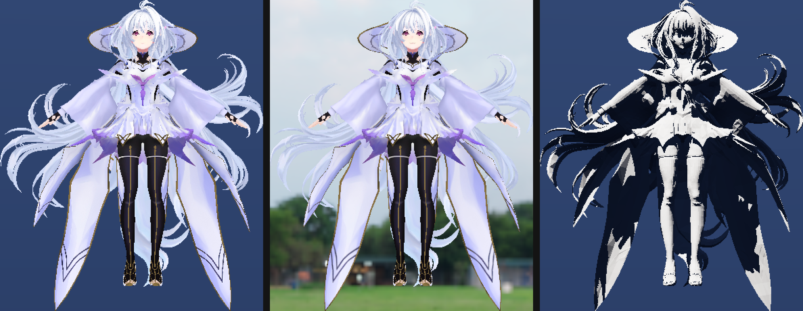

# TooiyumeRender 光追管线教程

> 从「设备支不支持 DXR」一路讲到「为什么这块布料是紫色的」。
> 面向第一次接触实时硬件光追、但已经会写 D3D12 光栅管线的人。

| 项 | 值 |
|---|---|
| 适用代码版本 | `origin/master` @ `38ee444`（R7 / D4 完成） |
| 覆盖阶段 | R5（最小闭环）→ R6（硬阴影 + 反射）→ R7（材质 + GGX） |
| 源码规模 | 光追相关 8 个文件，约 2900 行（不含 Demo 侧 UI 2000 行） |
| 对应施工日志 | `docs/AIWorkLogs/TR-20261027-01_R5-DXR最小闭环.md`、`TR-20261027-03_R6-光追算法.md`、`TR-20261028-01_R7-材质接驳.md` |
| 对应执行表 | `docs/AI/R_执行表.md` §6c / §6e / §6f |

---

## 第 0 章 这份教程怎么用

### 0.1 它想解决什么问题

这个仓库里已经有一条能跑的光追管线：它能打出硬阴影、能做一次反射、能采样 BaseColor 贴图、能用 GGX 着色。但**「能跑」和「懂了」之间隔着一次完整的认知重建** —— 因为 DXR 的概念密度远高于光栅管线：光是「加速结构」「State Object」「SBT」「全局根签名」这四个词，就能让一个写了两年 D3D12 的人卡住一周。

这份教程的目标不是「把代码解释一遍」（注释已经很详细了），而是**把散落在注释、日志、崩溃记录里的因果关系串成一条可复述的线**。读完你应当能回答这类问题：

- 为什么 BLAS 要按「一个 mesh 的 draw」而不是「一个模型」建？
- 为什么 `TraceRay` 的第六个参数是「未命中用哪个函数」？
- 为什么 `BuildRaytracingAccelerationStructure` 不会自动提交屏障？
- 为什么 `DispatchRays` 读的是**计算**根签名？
- 为什么 UV 要用 `Load<uint>` 手动拆半字，而不能 `Load<float2>`？
- 为什么这台机器上不能用 `D3D12_RESOURCE_FLAG_RAYTRACING_ACCELERATION_STRUCTURE`？

### 0.2 读者假设

**你已经会的**（不会就先补）：

- D3D12 的资源、描述符堆、根签名、PSO 这几个概念
- 光栅管线的 stage 顺序（IA → VS → PS → OM）
- HLSL 的 `cbuffer` / `Texture2D` / `SamplerState`
- 本项目的基本构建方式（`scripts\build.bat Debug`）

**你不需要会的**：

- 任何光追数学（Möller–Trumbore 求交算法之类）—— DXR 帮你做了
- 路径追踪 / 蒙特卡洛 —— 本管线只是「硬阴影 + 一次反射」，不是路径追踪器
- Vulkan RT / Metal —— 概念相通，但本教程只讲 D3D12

### 0.3 三种读法

**读法 A：从头顺读（推荐第一次）**
第 1–3 章建立世界观和架构，第 4–6 章是按时间顺序的实现，第 7–8 章是踩坑与调试。前六章不要跳。

**读法 B：带着问题查**
直接跳第 7 章「陷阱大全」，它按**症状**索引 —— 「画面全黑」「贴图一片糊」「Debug Layer 报 #526」都能查到。

**读法 C：只想照着写一遍**
跳到第 9 章「动手练习」，每个练习都指向第 4–6 章对应的实现步骤。

### 0.4 本教程的引用约定

- `路径:行号` 一律相对仓库根目录，例如 `Engine/Shader/07_RayTracing/RayTracing.hlsl:258`
- 所有「实测」后面跟的都是真实跑出来的数字，不是估算
- 所有 md5 都是对 1920×1080 PNG 文件的哈希，用来做逐字节比对

---

## 第 1 章 从光栅到光追：观念转换

### 1.1 光栅化的世界观：把三角形投影到屏幕上

光栅管线的思考起点是**三角形**。你有一个三角形列表，管线把它拆成像素：

```
三角形 → 顶点着色 → 裁剪 → 光栅化成像素 → 像素着色 → 深度测试 → 写 GBuffer
```

这个顺序有一个根本性质：**着色只发生在「被投影到屏幕上、且通过深度测试」的片元上**。

以本项目的 Deferred 路径为例（`Engine/04_Renderer/Renderer/Deferred/DeferredRenderer.cpp`）：

1. 先跑一遍 GBuffer pass，把颜色 / 法线 / 材质参数写进四张 MRT
2. 再跑一遍 Lighting pass，对全屏每个像素读 GBuffer + 读光照常量，算 PBR

注意第二步：**全屏像素 × 一张固定的光照常量表**。光照计算是「屏幕空间」的，每个像素只知道自己，不知道场景。

### 1.2 光追的世界观：从相机往场景发射线

光追把因果关系倒过来：思考起点是**射线**。

```
对屏幕每个像素：
  从相机出发，穿过该像素，射出一条射线
  这条射线在场景里前进，撞到的第一个三角形 → 那个点决定这个像素的颜色
```

这个变化带来一个几乎免费的能力：**射线可以在任意点、朝任意方向再发出去**。所以：

- 「这个点被不被太阳挡住？」→ 从这一点朝太阳射一条线，撞到东西就是被挡了
- 「这个点像不像镜子？」→ 从这一点按反射方向射一条线，撞到的东西就是倒影

这两件事在光栅管线里都要靠**额外的 pass + 屏幕空间近似**（Shadow Map、SSR），而且本质上都只是近似。

### 1.3 为什么光栅做不好阴影和反射

不是「光栅不行」，而是**信息顺序不对**。

光栅管线的每个 pass 只能读「上一个 pass 写在显存里的结果」。因此：

| 效果 | 光栅的做法 | 根本局限 |
|---|---|---|
| 硬阴影 | Shadow Map：从光源视角渲染一张深度图，再从相机视角比较 | 分辨率受贴图限制；会产生 peter-panning（阴影脱离物体）；一个光源一张图 |
| 反射 | SSR：在屏幕空间里做光线步进 | **屏幕外的东西反射不出来**（转身就消失）；掠射角错 |
| 环境光遮蔽 | SSAO：用深度缓冲估 | 只知深度不知几何，角落细节丢失 |

这三者的共同点是：**都是屏幕空间的近似**，因为它们只能看到「已经渲染过、还在屏幕上」的东西。

光追没有这个限制 —— 它查询的是**世界空间的几何**（加速结构），不管那个东西在不在屏幕里。

> **一句话总结**：光栅是「把世界投影到屏幕再算」，光追是「从屏幕问世界」。前者算得快但对「不在屏幕上的东西」一无所知；后者天然知道全世界。

### 1.4 DXR 不是「GPU 上的一个 for 循环」

新手最常见的误解是：以为 DXR 提供了一个「给我一个三角形列表，我帮你求交」的函数库，然后自己写循环。

**实际情况**：DXR 是一套**着色器协作模型**。你不是在写一个循环，而是在写**五个不同角色的回调**，然后由硬件在遍历加速结构的过程中**按需调用**它们。

这五个角色（本管线只用了前三个）：

| 角色 | 触发时机 | 本管线里对应 | 典型用途 |
|---|---|---|---|
| **RayGen** | 你自己 `DispatchRays` 时，一个线程一次 | `RayGen()` | 生成主射线 |
| **Miss** | 射线走完全程没撞到任何东西 | `Miss()`、`ShadowMiss()` | 背景色、环境光 |
| **ClosestHit** | 射线撞到了某个三角形的**最近**交点 | `ClosestHit()` | 着色 |
| **AnyHit** | 射线撞到**任意**三角形（可能多次调用） | **未使用** | Alpha test、透明 |
| **Intersection** | 射线与**自定义图元**求交（非三角形） | **未使用** | 球体、曲线 |

关键理解：**ClosestHit 不是你调用的，是硬件调用的**。硬件遍历 BVH 时，每当发现「这个三角形比当前最近距离更近」，就更新最近距离；等遍历结束，如果最近距离有效，就调用一次 ClosestHit。

这也解释了为什么 ClosestHit 里能拿到 `PrimitiveIndex()`、`RayTCurrent()`、`ObjectToWorld3x4()` 这些**只在命中上下文里才有意义**的函数 —— 它们是硬件遍历时留下的「现场记录」。

### 1.5 本渲染器的数据流总图

先看全景，后面每一章都会回到这张图。

```
                    ┌─────────────────────────────────────┐
                    │  RendererDemoApp（UI / 场景 / 相机）  │
                    │  m_Params : RenderParams（唯一真源）  │
                    └──────────────┬──────────────────────┘
                                   │ RenderFrameDesc
                                   ▼
        ┌──────────────────────────────────────────────────┐
        │  RayTracingRenderer                              │
        │    Initialize()  → 根签名 / RTPSO / 描述符堆       │
        │    Update()      → 建 BLAS / TLAS / SBT           │
        │    Render()      → 绑资源 + DispatchRays          │
        └───────┬──────────────────────────┬───────────────┘
                │                          │
     ┌──────────▼──────────┐    ┌──────────▼──────────┐
     │  RaytracingScene    │    │  RaytracingPSO      │
     │   · 几何聚合          │    │   · State Object     │
     │   · BLAS × N        │    │   · 提供 32B 标识符   │
     │   · TLAS            │    └─────────────────────┘
     │   · 每实例数据         │
     │   · SBT             │
     └──────────┬──────────┘
                │ GPU 资源
                ▼
     ┌──────────────────────────────────────────────┐
     │  RayTracing.hlsl（lib_6_4 编译成 DXIL 库）      │
     │    RayGen → TraceRay → Miss / ClosestHit     │
     │    ClosestHit 内再发：阴影射线 / 反射射线         │
     └──────────┬───────────────────────────────────┘
                │ 写 UAV
                ▼
     ┌──────────────────────────────────────────────┐
     │  m_SceneColorBuffer (R8G8B8A8_UNORM)         │
     │  → Display::PreparePresentSDR 统一 Present    │
     └──────────────────────────────────────────────┘
```

三条值得先记住的线：

1. **`RenderParams` 是唯一的参数真源**。UI、Deferred、RayTracing 都读它，不各自存一份。所以「拨了开关画面不变」这类 bug 一定是**传输链**断了，不是参数没存。
2. **`RaytracingScene` 与 `RayTracingRenderer` 职责严格分离**：前者只管「场景的加速结构」，后者只管「怎么画」。这样加新射线类型（阴影、反射、将来的 AO）时不用碰 AS 逻辑。
3. **输出走统一 Present 路径**：RayTracing 自己建一张与 Deferred 同格式家族的 ColorBuffer，`Display::PreparePresentSDR` 的格式家族比较能通过，因此不需要任何特殊处理。

---

## 第 2 章 DXR 的六个核心概念

这一章是纯概念。**不要跳**，后面所有代码都是这六个概念的展开。

### 2.1 加速结构：BLAS 与 TLAS

#### 为什么需要它

朴素光追要判断「这条射线撞不撞 71803 个三角形」，每条射线都要遍历全部三角形。1920×1080 就是 2073600 条射线 × 71803 次求交 ≈ **1.5×10¹¹ 次**。不可能。

加速结构回答的问题是：**「这条射线上可能有哪些三角形？」**，把候选集从 71803 缩到个位数。

#### BLAS：几何本身的加速结构

**Bottom-Level Acceleration Structure**，描述**一堆三角形在世界里长什么样**（但不描述它在世界的哪个位置）。

本项目的做法：**每个 (实例, mesh, draw) 建一个单几何 BLAS**。merlin 这个模型有 15 个 mesh，所以建了 15 个 BLAS（`docs/AI/R7test2` 的日志里 `BLAS=15`）。

为什么不干脆「一个模型一个 BLAS，里面塞 15 个 geometry」？见 `Engine/04_Renderer/Renderer/RayTracing/RaytracingScene.h:19-25` 的注释：**因为 `GeometryIndex()` 是 DXR Tier 1.1 才有的**。Tier 1.0 设备上，ClosestHit 只有 `InstanceID()` 和 `PrimitiveIndex()` —— 如果 15 个 mesh 塞进一个 BLAS，你无法判断命中的三角形属于哪个 mesh，也就无法定位顶点。

所以本项目的取舍是：**牺牲实例数量，换 Tier 1.0 兼容性**。代价是 15 个 BLAS + 15 个 TLAS 实例，对本项目场景规模完全可接受。

#### TLAS：实例的加速结构

**Top-Level Acceleration Structure**，描述**每个 BLAS 副本在世界里的位置和朝向**。

```
TLAS
 ├─ Instance 0: BLAS[0] × Transform0, InstanceID = 0
 ├─ Instance 1: BLAS[1] × Transform1, InstanceID = 1
 ├─ ...
 └─ Instance 14: BLAS[14] × Transform14, InstanceID = 14
```

这个分层的价值在于：**同一个 BLAS 可以被多个实例复用，只改变换**。所以「同一个模型摆 100 个位置」只需要 1 个 BLAS + 100 个实例描述。

本项目当前只加了 1 个模型实例，所以是 15 BLAS / 15 实例的一一对应；但代码结构已经支持多实例（`Engine/04_Renderer/Renderer/RayTracing/RaytracingScene.cpp:476` 的 `cursor` 按实例递增）。

#### 关键约束：加速结构的状态

这是**最容易崩的地方**，也是本项目花时间最多的地方之一。

普通的 GPU buffer 可以在状态之间转换（`COPY_DEST` → `NON_PIXEL_SHADER_RESOURCE` 之类）。但**加速结构的资源不允许用 ResourceBarrier 转换进 AS 状态**。

必须在 `CreateCommittedResource` 的 `InitialState` 参数里**从一开始就给出 AS 状态**，之后**永远不再发任何 Transition**：

```cpp
// Engine/04_Renderer/Renderer/RayTracing/RaytracingScene.cpp:99-103
// 关键：初始状态直接就是 AS，之后永不转换。
m_UsageState = D3D12_RESOURCE_STATE_RAYTRACING_ACCELERATION_STRUCTURE;

ASSERT_SUCCEEDED(g_Device->CreateCommittedResource(&heapProps, D3D12_HEAP_FLAG_NONE,
    &desc, m_UsageState, nullptr, TY_IID_PPV_ARGS(&m_pResource)));
```

违反这条的后果（实测）：Debug Layer 报 `ERROR #526 RESOURCE_BARRIER_INVALID_COMBINATION: Resources cannot be transitioned into state D3D12_RESOURCE_STATE_RAYTRACING_ACCELERATION_STRUCTURE`，进程以 `0x87a` 异常终止。

#### 又一个约束：资源标志位

在**这台机器**上，`desc.Flags` 只能用 `D3D12_RESOURCE_FLAG_ALLOW_UNORDERED_ACCESS`。三个选项都试过（`Engine/04_Renderer/Renderer/RayTracing/RaytracingScene.cpp:76-90` 的注释记录了全过程）：

| Flags | 结果 |
|---|---|
| `D3D12_RESOURCE_FLAG_RAYTRACING_ACCELERATION_STRUCTURE` (0x100) | `ERROR #719 CREATERESOURCE_UNRECOGNIZEDLAYOUT` —— 本机 D3D12 运行时是 Win10 19041，不认识这个位（它是 Agility SDK 1.7xx 之后才引入的） |
| `D3D12_RESOURCE_FLAG_NONE` | `ERROR #524 RESOURCE_BARRIER_MISMATCHING_MISC_FLAGS` —— 「初始状态是 AS」要求资源具备 UAV 能力 |
| `D3D12_RESOURCE_FLAG_ALLOW_UNORDERED_ACCESS` | ✅ 可用，且与微软官方 D3D12 Raytracing 样例一致 |

> **教训**：官方样例里写 `RAYTRACING_ACCELERATION_STRUCTURE` 标志的版本要求 Agility SDK；用系统自带的 d3d12.dll 时，`ALLOW_UNORDERED_ACCESS` + 初始 AS 状态就是正确写法。

### 2.2 State Object（RTPSO）：把着色器打包成可调用对象

光栅管线用 PSO 描述「这个 pass 用哪些着色器」。光追用 **State Object**（也叫 RTPSO），但它更复杂，因为：

- 光追着色器是**一个库里的一组入口**，不是「VS + PS 配对」
- 需要声明「载荷多大」「属性多大」「最多递归几层」
- 需要声明「命中组由哪几个着色器组成」

本项目的实现（`Engine/02_RHI/Pipeline/RaytracingPSO.cpp:86-126`）：

```cpp
CD3DX12_STATE_OBJECT_DESC stateObjectDesc(D3D12_STATE_OBJECT_TYPE_RAYTRACING_PIPELINE);

// 1) DXIL 库 + 导出哪些入口
auto* dxilLib = stateObjectDesc.CreateSubobject<CD3DX12_DXIL_LIBRARY_SUBOBJECT>();
dxilLib->SetDXILLibrary(&libBytecode);       // 整份 lib_6_4 编译结果
for (const wchar_t* name : desc.Exports)
    dxilLib->DefineExport(name);             // RayGen / Miss / ShadowMiss / ClosestHit

// 2) Hit Group：把 ClosestHit 打包成一个可被 SBT 寻址的组
auto* hitGroup = stateObjectDesc.CreateSubobject<CD3DX12_HIT_GROUP_SUBOBJECT>();
hitGroup->SetHitGroupExport(L"HitGroup");
hitGroup->SetHitGroupType(D3D12_HIT_GROUP_TYPE_TRIANGLES);
hitGroup->SetClosestHitShaderImport(L"ClosestHit");

// 3) 载荷/属性大小（必须与 HLSL 结构体一致）
shaderConfig->Config(32, 8);

// 4) 最大递归深度
pipelineConfig->Config(2);

// 5) 全局根签名
globalRootSig->SetRootSignature(desc.GlobalRootSignature);
```

#### 为什么要「导出」两次

注意这里出现了两处名字：

- `DefineExport(L"RayGen")` —— 告诉状态对象「DXIL 库里这个符号是可见的」
- `SetClosestHitShaderImport(L"ClosestHit")` —— 告诉命中组「用库里这个符号」

如果漏了 `DefineExport`，`GetShaderIdentifier` 会返回 `nullptr`，SBT 里对应记录就是全零标识符。**全零标识符不会报错**，但那个着色器永远不会被调用 —— 这是本项目踩过的坑（`Engine/04_Renderer/Renderer/RayTracing/RayTracingRenderer.cpp:336-339` 的注释专门写了 ShadowMiss 漏导出的后果：整个场景全黑）。

#### MaxPayloadSizeInBytes / MaxAttributeSizeInBytes

这两个数字**必须与 HLSL 结构体的 `sizeof` 严格一致**，否则 `TraceRay` 会越界写载荷：

```hlsl
// Engine/Shader/07_RayTracing/RayTracing.hlsl:183-190
struct RayPayload
{
    float3 Color;         // 12
    float  HitDistance;   // 4
    uint   Depth;         // 4
    uint   _pad0;         // 4
    float2 _pad1;         // 8
};                        // = 32 B
```

R5 时这个结构只有 `Color + HitDistance` = 16 B。R6 加 `Depth` 后**必须**同步把 `desc.MaxPayloadSizeInBytes` 从 16 改成 32，否则 Debug Layer 报 `Payload is larger than the size specified in the shader config`。

> **经验**：改动 payload 结构时，永远同时改三处 —— HLSL 结构体、RTPSO 的 `MaxPayloadSizeInBytes`、以及 C++ 侧的注释。这三处没有编译器帮你检查。

#### MaxTraceRecursionDepth

DXR 的「递归」不是你函数调用自己，而是**着色器里发新射线**。深度算的是「射线嵌套层数」：

```
深度 0：RayGen 的主射线
深度 1：ClosestHit 里发出的阴影射线 / 反射射线
深度 2：那些射线的 ClosestHit 又发射线 ← 本项目不允许
```

本项目要发二级射线（深度 1），所以 `MaxTraceRecursionDepth` 必须 ≥ 2。

**如果写 1 但代码里发二级射线**：不报错、不崩溃、DEBUG LAYER 可能什么都不说 —— **设备直接把进程移除**（`DEVICE_REMOVED` / `0x887A0005`）。这是最难归因的失败模式之一，因为它看起来像「显卡驱动崩了」。

对应地，HLSL 里必须有闸门（`Engine/Shader/07_RayTracing/RayTracing.hlsl:586`）：

```hlsl
// 反射射线的 ClosestHit 也走这个函数。如果这里不早退，它会再发一条反射射线
// （深度 3），而 State Object 的 MaxTraceRecursionDepth = 2 —— 越界不会报错，
// 设备会直接把整个进程移除（DEVICE_REMOVED 0x887A0005）。
if (payload.Depth >= 1u)
{
    /* 只做本地面着色，立即 return */
}
```

**硬件深度限制**和**软件闸门**是同一个约束的两面，必须同时满足。

### 2.3 Shader Binding Table：谁去调用哪个着色器

SBT 回答的问题是：**「这次 TraceRay 该用哪个 RayGen / Miss / ClosestHit？」**

它是一个**字节数组**，每 32 字节一条记录（`D3D12_SHADER_IDENTIFIER_SIZE_IN_BYTES`），记录的内容是状态对象给出的**着色器标识符**。

本项目的 SBT 布局（`Engine/04_Renderer/Renderer/RayTracing/RaytracingScene.cpp:644-673`）：

```
偏移 0   ┌──────────────────────────┐
         │ RayGen 标识符  (32 B)     │  RayGenerationShaderRecord
偏移 64  ├──────────────────────────┤
         │ Miss[0] 标识符  (32 B)    │  ┐ MissShaderTable
偏移 96  │ Miss[1] 标识符  (32 B)    │  ┘  SizeInBytes = 64, Stride = 32
偏移 128 ├──────────────────────────┤
         │ HitGroup 标识符 (32 B)    │  HitGroupTable
         └──────────────────────────┘
              总 192 字节
```

**几个必须记牢的数字**：

- 每条记录 **32 字节**（`D3D12_SHADER_IDENTIFIER_SIZE_IN_BYTES`）
- 每个 section 的起始地址必须 **64 字节对齐**（`D3D12_RAYTRACING_SHADER_TABLE_BYTE_ALIGNMENT`）
- 所以 RayGen 在 0、Miss 在 64、HitGroup 在 128 —— 不是 0/32/64

#### Miss 表的两条记录

这是本项目 R6 的一个关键设计：**两种 miss 着色器**。

```
Miss[0] = MainMiss    ← 主射线 / 反射射线打空 → 返回天空色（SkyColor）
Miss[1] = ShadowMiss  ← 阴影射线打空 → 表示"受光"（Visible = 1）
```

为什么不能共用一个？因为**载荷类型不同**。主射线的 miss 收 `RayPayload`（32 B），阴影射线的 miss 收 `ShadowPayload`（8 B）。如果让阴影射线也走 `MainMiss`，`MainMiss` 会把 8 字节的载荷当成 32 字节的 `RayPayload` 写 —— 越界写显存。

这也解释了 `BuildShaderBindingTable` 里那句「不能静默降级」（`Engine/04_Renderer/Renderer/RayTracing/RaytracingScene.cpp:699-711`）：拿不到 `ShadowMiss` 的标识符时必须直接失败返回 `false`，而不是「拿 MainMiss 凑一下」。

#### TraceRay 的第 6 个参数就是 Miss 表的下标

```hlsl
// Engine/Shader/07_RayTracing/RayTracing.hlsl:464-472（主射线）
TraceRay(
    g_Scene,
    RAY_FLAG_NONE,
    0xFF,   // InstanceInclusionMask
    0,      // RayContributionToHitGroupIndex
    1,      // MultiplierForGeometryContributionToHitGroupIndex
    0,      // MissShaderIndex = 0 → MainMiss
    ray,
    payload);

// Engine/Shader/07_RayTracing/RayTracing.hlsl:381-388（阴影射线）
TraceRay(
    g_Scene,
    RAY_FLAG_ACCEPT_FIRST_HIT_AND_END_SEARCH | RAY_FLAG_SKIP_CLOSEST_HIT_SHADER,
    0xFF,
    0,
    1,
    1,      // MissShaderIndex = 1 → ShadowMiss
    ray,
    payload);
```

中间两个参数（`RayContributionToHitGroupIndex` / `MultiplierForGeometryContributionToHitGroupIndex`）决定「命中时用 HitGroupTable 里的哪一条记录」。本项目这两个值恒为 0 和 1，配合 `desc.InstanceContributionToHitGroupIndex = 0`，最终命中记录索引恒为 0 —— 也就是说**所有实例、所有几何都共用同一个 HitGroup**。对「只有一种着色逻辑」的管线来说这是最简做法。

### 2.4 全局根签名：一套参数，所有着色器共享

光追的根签名与光栅的根签名有三个关键差别（`Engine/04_Renderer/Renderer/RayTracing/RayTracingRenderer.cpp:27-31`）：

1. **没有 Vertex/Pixel 可见性之分**，所有参数都是 `D3D12_SHADER_VISIBILITY_ALL`
2. **加速结构和几何缓冲用「根级 SRV」**（`ROOT_PARAMETER_TYPE_SRV`）—— 直接传 GPU 虚拟地址，不需要描述符表
3. **只能有描述符表给「必须走描述符」的东西**（UAV、贴图数组）

本项目的 6 个根参数（`Engine/04_Renderer/Renderer/RayTracing/RayTracingRenderer.cpp:35-44`）：

| 槽 | 类型 | 寄存器 | 内容 | 为什么这样绑 |
|---|---|---|---|---|
| 0 | 根 SRV | `t0` | TLAS | AS 只需要 GPU 地址，给描述符反而多一层 |
| 1 | 根 SRV | `t1` | 聚合几何（VB/IB） | 同上 |
| 2 | 根 SRV | `t2` | 每实例数据 | 同上 |
| 3 | 描述符表（UAV） | `u0` | 输出图 | `RWTexture2D` 必须走描述符 |
| 4 | 根常量 | `b0` | 52 DWORD | 每帧参数 |
| 5 | 描述符表（SRV，无界） | `t3` | 材质贴图数组 | 数量随模型变化 |

> **关键**：`DispatchRays` 读的是**计算根签名**，不是图形根签名。这个坑在下面 4.10 节展开。

### 2.5 Payload 与 Attribute：射线和命中点之间传话的信封

一次 `TraceRay` 调用有几方参与，它们之间靠两个结构体通信：

**Payload（载荷）**：从**调用方**传进去，被**命中着色器 / miss 着色器**改写，最后回到**调用方**。

```hlsl
struct RayPayload { float3 Color; float HitDistance; uint Depth; ... };  // 32 B
struct ShadowPayload { float Visible; ... };                            // 8 B
```

载荷是**双向**的：`inout` 参数。所以 `ClosestHit` 写 `payload.Color = 计算结果`，调用方在 `TraceRay` 返回后就能读到。

**Attribute（属性）**：从**硬件**传给命中着色器，描述「命中点的几何信息」。

```hlsl
// Engine/Shader/07_RayTracing/RayTracing.hlsl:201-204
struct HitAttributes { float2 Barycentrics; };
```

`Barycentrics` 就是三角形的重心坐标 `(b1, b2)` —— 有了它才能在 `ClosestHit` 里**插值顶点属性**（比如 UV）。这是 R7 接贴图的关键（见 6.3 节）。

`MaxAttributeSizeInBytes = 8` 就是 `float2` 的大小。

### 2.6 TraceRay 的六个实参

逐个讲清楚（以主射线为例）：

```hlsl
TraceRay(
    g_Scene,      // ① 用哪个加速结构
    RAY_FLAG_NONE,// ② 射线标志（见下）
    0xFF,         // ③ InstanceInclusionMask：与实例的 InstanceMask 按位与，非零才考虑
    0,            // ④ RayContributionToHitGroupIndex
    1,            // ⑤ MultiplierForGeometryContributionToHitGroupIndex
    0,            // ⑥ MissShaderIndex
    ray,          // ⑦ RayDesc：起点、方向、TMin、TMax
    payload);     // ⑧ 载荷
```

**② 射线标志**，本项目用了三个：

| 标志 | 作用 | 用在哪 |
|---|---|---|
| `RAY_FLAG_NONE` | 正常遍历，找最近交点，调用 ClosestHit | 主射线、反射射线 |
| `RAY_FLAG_ACCEPT_FIRST_HIT_AND_END_SEARCH` | 撞到第一个就停，不再找更近的 | 阴影射线（只要「挡没挡」，不要「最近」） |
| `RAY_FLAG_SKIP_CLOSEST_HIT_SHADER` | 命中时不调用 ClosestHit | 阴影射线 |

后两个标志的组合是硬阴影射线的核心技巧，5.1 节详细展开。

**⑦ RayDesc 的 TMin / TMax**：

- `TMin`：从起点多远开始算命中。**必须 > 0**，否则射线会立刻命中起点所在的那个三角形（自相交）。
- `TMax`：最远找多远。超过就当作未命中。

本项目主射线 `TMin = 0, TMax = 1e4`；阴影射线 `TMin = 0, TMax = 100`（可调）；反射射线 `TMin = normalBias, TMax = 200`（可调）。

> **注意阴影射线的 TMin = 0**：它靠**起点沿法线抬起**（`hitPos + n * normalBias`）来避开自相交，而不是靠 TMin。这个选择的原因见 5.3 节。

---

## 第 3 章 本渲染器的架构分层

### 3.1 为什么拆成五个部分

光追管线的代码天然容易写成一大坨（因为资源之间耦合紧）。本项目的拆分原则是：**按「会一起变的东西」分组**。

| 文件 | 职责 | 什么时候改它 |
|---|---|---|
| `Engine/02_RHI/Pipeline/RaytracingPSO.{h,cpp}` | State Object 的封装 | 改递归深度 / 载荷大小 / 入口名 |
| `Engine/02_RHI/Pipeline/RootSignature.{h,cpp}` | 根签名（通用，光栅光追共用） | 加根参数 |
| `Engine/04_Renderer/Renderer/RayTracing/RaytracingScene.{h,cpp}` | 加速结构、每实例数据、SBT | 改几何组织方式 |
| `Engine/04_Renderer/Renderer/RayTracing/RayTracingRenderer.{h,cpp}` | 根签名实例、绑定、DispatchRays | 加新射线类型 / 新参数 |
| `Engine/Shader/07_RayTracing/RayTracing.hlsl` | 全部光追着色器 | 改着色算法 |

这个拆分的验证方式很简单：**R6 加阴影和反射时，`RaytracingScene.cpp` 只改了 SBT 部分（加第二条 miss），一行几何代码都没动**。R7 加材质时，改的是每实例数据的字段与 HLSL，`RaytracingPSO` 一行没动。

### 3.2 RayTracingRenderer 的职责

它实现 `BaseRenderer` 的纯虚接口，与 `DeferredRenderer` / `ForwardRenderer` 完全平级。核心是三个函数：

```cpp
// Engine/04_Renderer/Renderer/RayTracing/RayTracingRenderer.h:97-104
bool Initialize(const RendererCreateDesc& desc) override;   // 一次性：根签名 / RTPSO / 堆
void Update(const RenderFrameDesc& frame, GraphicsContext&) override;  // 每帧：AS 更新
void Render(GraphicsContext&, const RenderFrameDesc&, DrawPass, BatchType) override;  // 每帧：DispatchRays
```

**Initialize 的顺序不能变**（`Engine/04_Renderer/Renderer/RayTracing/RayTracingRenderer.cpp:79-141`）：

```
0. 设备能力检查（不支持就 return false，不崩溃）
1. 建输出缓冲
2. 建全局根签名
3. 建描述符堆 + 占住 0 号槽作输出 UAV
4. 建 State Object
```

第 3 步必须**在模型加载之前**完成。为什么？因为 `RefreshDescriptorHeap()` 要用 `s_TextureHeap.Alloc(1)` 占住 0 号槽，如果晚于模型加载，0 号槽已经被第一个材质的 BaseColor 抢走了。

**Shutdown 的顺序也不能变**（`:147-176`）：

```
1. IdleGPU()           ← 等 GPU 用完再销毁
2. m_Scene.Destroy()   ← BLAS/TLAS/scratch
3. m_StateObject.Destroy()  ← 它引用根签名，必须早于根签名
4. 描述符堆 + 输出缓冲
```

**Update 的关键设计**：只在几何真的变了时重建 BLAS。

```cpp
// Engine/04_Renderer/Renderer/RayTracing/RayTracingRenderer.cpp:381-402
bool GeometryChanged(models) const
{
    // 签名 = 模型指针 + 数据缓冲版本号 + mesh 数
    signature.push_back((uint64_t)(uintptr_t)model);
    signature.push_back((uint64_t)model->m_DataBuffer.GetVersionID());
    signature.push_back((uint64_t)model->m_NumMeshes);
    return signature != m_GeometrySignature;
}
```

`GetVersionID()` 在 `GpuResource::Destroy` 时会自增，所以「重新加载模型」能被捕捉到。

### 3.3 RaytracingScene 的职责

它只管四件事：几何聚合、BLAS、TLAS、SBT。**不含任何绘制逻辑**。

关键成员（`Engine/04_Renderer/Renderer/RayTracing/RaytracingScene.h:225-243`）：

```cpp
std::vector<std::unique_ptr<RaytracingBuffer>> m_BlasBuffers;  // 15 个
std::unique_ptr<RaytracingBuffer> m_TopLevel;      // TLAS
std::unique_ptr<RaytracingBuffer> m_Scratch;       // 构建期临时
std::unique_ptr<GpuBuffer> m_SceneGeometry;        // 合并后的 VB/IB
std::unique_ptr<GpuBuffer> m_InstanceDataBuffer;   // 每实例数据
UploadBuffer m_InstanceDescsUpload;  // TLAS 的实例描述数组
UploadBuffer m_InstanceDataUpload;   // 每实例数据的上传源
UploadBuffer m_SbtUpload;            // SBT
```

注意三个 `UploadBuffer` 都是**成员变量**而不是局部变量。原因在 `Engine/04_Renderer/Renderer/RayTracing/RaytracingScene.cpp:434-435` 的注释里：

> 上传缓冲必须是成员（活到 GPU 执行完），不能是局部变量 —— 否则命令列表还没提交，源资源就被销毁了。

这是 D3D12 的经典陷阱：CPU 侧函数返回 ≠ GPU 侧执行完。所有 `CopyBufferRegion` 的源资源必须活到 fence 信号之后。

### 3.4 与 Deferred/Forward 的三条硬约束

路线图 §8 的总纲是：

> DXR 要作为新增 Renderer 接入，而不是让现有光栅路径依赖光追。光栅路径始终应可独立构建、运行和回退。

落到代码上就是三条：

1. **不改 Deferred/Forward 的任何行为**。`RayTracingRenderer` 只实现 `BaseRenderer` 接口。
2. **输出格式必须与 Deferred 同家族**。都用 `R8G8B8A8_UNORM`，这样 `Display::PreparePresentSDR` 的格式家族比较能通过，走同一条 Present 路径。
3. **显示编码必须共用同一份函数**。`RayGen` 里调 `ColorPipeline.hlsli` 的 `EncodeDisplayColor`，与光栅的 tonemap + sRGB 传递函数完全一样。

第 3 条的实际价值：R7 的 A6 验收（光栅零回归）能通过，就是因为没碰光栅侧的任何一个字节 —— `docs/AI/R7ctl/screenshot_90.png` 的 md5 与 R5/R6 完全一致（`16c8aeec294844b9e3fedde4df78a349`）。

### 3.5 一次切换渲染器时发生了什么

这是最容易出问题的地方，因为涉及「销毁 + 重建 + 描述符偏移全部失效」。

`RendererDemoApp::SwitchRenderer` 的顺序（`Demos/RendererDemoApp/RendererDemoApp.cpp:354-400`）：

```
1. IdleGPU()                          ← 等 GPU 空闲
2. Display::SceneColorBuffer = nullptr ← 断开输出绑定
3. UnloadModel()                       ← 先卸模型（它持有 TextureRef）
4. 旧 renderer->Shutdown()
5. RendererRegistry::CreateRenderer(新名字)
6. 新 renderer->Initialize()
7. m_RendererName = 新名字
8. BindRendererOutput() + 相机宽高比归位
9. LoadModelByIndex(重新加载模型)
```

**第 3 步为什么必须在第 4 步之前**：`Model` 持有 `TextureRef`，而 `Shutdown()` 会 `s_TextureHeap.Destroy()` 清空纹理缓存。如果模型还活着，它的 `TextureRef` 就悬空了。

**描述符偏移为什么会失效**：`DescriptorHeap::Create` 内部 `++m_Generation`，而 `Destroy()` 刻意不复位游标（`Engine/02_RHI/Descriptor/DescriptorHeap.cpp:259-300`）。切渲染器 → Destroy + Create → 代际号变 → 所有缓存的偏移失效 → 必须重新分配。

`ModelLoader` 已经按代际号校验采样器缓存（`g_SamplerPermutations` 里存 `{generation, offset}`）。光追侧读 `material.SRVTable` 时依赖同一套时序 —— 因为 `SwitchRenderer` 会重新 `LoadModelByIndex`，偏移会被重新分配并重新烘进每实例数据。

对应验收：`docs/AI/R7test2/r7_06_dxr_basecolor_after_switch.png` 的 md5 与 `r7_04_debug_basecolor.png` **完全相同**（`5ce00c38dc9710a97b2be9e4ce5f19b2`）—— 证明切走再切回零漂移。

---

## 第 4 章 R5：最小闭环 —— 先让它动起来

### 4.1 这一阶段的目标（以及为什么它是独立的阶段）

路线图的 D2 阶段目标是一句话：**「DXR 可执行」**。

具体到可验收的标准：

- 设备能力检测通过，不支持时**不崩溃**，光栅路径照常可用
- BLAS / TLAS / SBT / RTPSO 全部建成，日志有证据
- `DispatchRays` 提交，输出图有内容
- Debug Layer 零 ERROR

**刻意不做**：任何光照。命中就输出面法线色 `n * 0.5 + 0.5`。

为什么这个阶段必须单独存在？因为光追的失败模式**全是静默的**。如果一上来就写阴影 + 反射，一旦画面不对，你无法区分是「AS 建错了」「SBT 填错了」「根签名绑错了」还是「光照算法写错了」。先做一个「命中就上色」的最小版本，能把前三类问题隔离掉。

> 这一个决策在 R6 得到了回报：R6 一上来就遇到「全屏纯黑」，但因为 R5 已经验证过 AS / SBT / 根签名，排查范围瞬间缩到「光照参数」和「射线方向」。

### 4.2 设备能力检测（D0）

`Engine/02_RHI/GraphicsCore.cpp` 里实现，暴露成：

```cpp
// Engine/02_RHI/GraphicsCore.h:51-57
struct RaytracingCapability
{
    bool supported;
    D3D12_RAYTRACING_TIER tier;
    bool inlineRaytracing;
};
RaytracingCapability QueryRaytracingCapability();
```

内部逻辑（`Engine/02_RHI/GraphicsCore.cpp:200-228`）：

1. 用 `D3D12CreateDevice` 时的 `g_Device` 去 `QueryInterface` 出 `ID3D12Device5` → 存进 `g_DeviceDXR`
2. 调 `g_DeviceDXR->CheckFeatureSupport(D3D12_FEATURE_DXR_TIER_OPTIONS, ...)` 拿到 tier
3. 查 `D3D12_FEATURE_D3D12_OPTIONS5` 的 `RaytracingTier`

本机实测：`supported=1 tier=0.12 inline=1`。`tier` 打印成 `0.12` 是因为 `D3D12_RAYTRACING_TIER_1_1 = 12` 这个枚举值被直接按整数打了（这是一个既有的日志格式瑕疵，见执行表 §7 遗留表）。

**不支持的优雅降级**（`Engine/04_Renderer/Renderer/RayTracing/RayTracingRenderer.cpp:83-89`）：

```cpp
if (!g_bRaytracingSupported || g_DeviceDXR == nullptr)
{
    LOG_INFO(L"[DXR] RayTracingRenderer::Initialize 中止：设备不支持 DXR"
        L"（supported=%d device=%p）\n", ...);
    return false;   // 而不是崩溃
}
```

返回 `false` 后，`RendererDemoApp::SwitchRenderer` 会 `reset` 掉这个渲染器并保持当前渲染器不变。UI 侧的 `DrawRendererPanel` 会显示 `DXR: not supported on this device`。

### 4.3 几何聚合：为什么必须把所有 VB/IB 复制进一块大缓冲

这是 R5 里最反直觉的一步。先看约束：

**HLSL 无法解引用「运行时才知道的 GPU 虚拟地址」。**

`ClosestHit` 需要按命中三角形反查三个顶点的位置（算面法线）。但 DXR 只给你：

- `InstanceID()` —— 命中哪个实例
- `PrimitiveIndex()` —— 命中该几何里的第几个三角形
- `Barycentrics` —— 重心坐标

它**不给你**「这个实例的顶点缓冲在哪」。你没有任何办法在 shader 里写「请把地址 `0x12345678` 处的数据当顶点读出来」—— 那个地址在编译期未知。

#### 三种解法与取舍

| 方案 | 做法 | 问题 |
|---|---|---|
| A | 每实例一个描述符，shader 里用索引访问 | 需要 `NonUniformResourceIndex` + Tier 1.1 + SM 6.5，超出最小闭环目标 |
| B | 把所有几何复制进**一块** ByteAddressBuffer，每实例记录自己的偏移 | 只需 Tier 1.0；代价是一次 GPU→GPU 复制 |
| C | 把顶点位置直接烤进 payload / 用 `ObjectToWorld` 变换 | payload 会爆炸，且拿不到 UV 等属性 |

**本项目选 B**。选它的理由写在 `Engine/04_Renderer/Renderer/RayTracing/RaytracingScene.h:11-17` 的注释里，核心是「Tier 1.0 兼容」。

#### 实现：按 Model 指针去重 + 256 字节对齐

```cpp
// Engine/04_Renderer/Renderer/RayTracing/RaytracingScene.cpp:161-189
for (Scene::Model::ModelInstance* instance : models)
{
    // ...跳过 null / 空模型...
    liveModels.push_back(instance);

    // 同一个 Model 可以被多个实例共享，几何只复制一份
    const bool alreadyPlaced = std::any_of(placements.begin(), placements.end(),
        [model](const ModelPlacement& p) { return p.Model == model; });
    if (alreadyPlaced) continue;

    ModelPlacement placement;
    placement.Model = model;
    placement.BaseOffset = AlignUp64(totalBytes, kASByteAlignment);  // 256 B
    placement.ByteSize = size;
    placements.push_back(placement);
    totalBytes = placement.BaseOffset + size;
}
```

**为什么 256 字节对齐**：`D3D12_RAYTRACING_ACCELERATION_STRUCTURE_BYTE_ALIGNMENT` 要求 AS 结果与 scratch 按 256 对齐；把几何副本也按 256 对齐，可以保证 BLAS 的顶点/索引地址天然满足对齐要求，省掉一堆手工对齐计算。

#### 为什么用 GPU→GPU 复制而不是回读

`Engine/04_Renderer/Renderer/RayTracing/RaytracingScene.cpp:125-129` 的注释回答了这个问题：

> `Mesh` 元数据（`vbOffset`/`vbSize`/`ibOffset`/`ibSize`/`vbStride`/`ibFormat`/`draw.startIndex`/`baseVertex`/`primCount`）已经完整描述了每个区段的位置与长度，我们不需要知道顶点字节内容就能算偏移。所以只要 `CopyBufferRegion` 就够，省掉一次同步回读（回读必须 `Finish(true)` 等 GPU，代价大且打断录制）。

这是很重要的一课：**「复制」不等于「读出来再写进去」**。D3D12 的 `CopyBufferRegion` 是纯 GPU 操作，不经过 CPU，也不阻塞命令录制。

### 4.4 建 BLAS：把 startIndex / baseVertex 烤进地址

这是本项目一个很关键的设计选择。`Mesh::Draw` 有 `startIndex` 和 `baseVertex` 两个字段，普通光栅渲染时传给 `DrawIndexedInstanced(IndexCountPerInstance, InstanceCount, StartIndexLocation, BaseVertexLocation, StartInstanceLocation)`。

但在光追里没有「draw call」这个概念 —— 没有地方传 `StartIndexLocation`。所以本项目把它们**烘焙进地址**：

```cpp
// Engine/04_Renderer/Renderer/RayTracing/RaytracingScene.cpp:261-266
// 把 startIndex / baseVertex 烘焙进地址，这样每个 BLAS 是自包含的，
// 命中着色器只需 PrimitiveIndex() 就能定位三角形（Tier 1.0 无 GeometryIndex）。
const uint64_t indexAddress = geometryVA + modelBase + mesh.ibOffset
    + (uint64_t)draw.startIndex * indexStride;
const uint64_t vertexAddress = geometryVA + modelBase + mesh.vbOffset
    + (uint64_t)draw.baseVertex * mesh.vbStride;
```

烘焙之后，每实例数据里 `StartIndex = 0`、`BaseVertex = 0`（`Engine/04_Renderer/Renderer/RayTracing/RaytracingScene.cpp:294-295`），shader 里直接 `startIndex + tri * 3` 就是正确的索引位置。

> **副作用**：如果将来一个 mesh 有多个 draw，每个 draw 会建一个独立的 BLAS（因为每个 draw 的 `startIndex` 不同）。本项目所有 mesh 都是 `numDraws = 1`，所以是 15 个 BLAS。

### 4.5 每实例数据：96 字节里装什么

R5 时这个结构只有 32 字节（8 个 uint32），全是几何寻址。R7 扩到 96 字节（`Engine/04_Renderer/Renderer/RayTracing/RaytracingScene.h:80-104`）：

```cpp
struct RaytracingInstanceData
{
    // ---- R5：几何寻址（32 B）----
    uint32_t VertexOffset;       //  0  顶点数据在合并缓冲内的字节偏移
    uint32_t IndexOffset;        //  4  索引数据在合并缓冲内的字节偏移（已烘焙 startIndex）
    uint32_t VertexStride;       //  8  顶点步长
    uint32_t IndexFormat;        // 12  0 = R16_UINT, 1 = R32_UINT
    uint32_t StartIndex;         // 16  恒为 0（已烘焙）
    uint32_t BaseVertex;         // 20  恒为 0（已烘焙）
    uint32_t PrimitiveCount;     // 24  三角形数
    uint32_t InstanceId;         // 28

    // ---- R7：材质与 UV（64 B）----
    uint32_t UvByteOffset;       // 32  UV0 在顶点内的字节偏移；0xFFFFFFFF = 无 UV
    uint32_t VertexFlags;        // 36  Renderer::VertexLayoutFlags 原值
    uint32_t MaterialIndex;      // 40  在 model->m_Materials 里的下标（调试用）
    uint32_t SrvTableIndex;      // 44  5 张贴图在全局贴图表里的相对偏移
    float    BaseColorFactor[4]; // 48
    float    EmissiveFactor[3];  // 64
    float    NormalTextureScale; // 76
    float    MetallicFactor;     // 80
    float    RoughnessFactor;    // 84
    uint32_t MaterialFlags;      // 88
    uint32_t _padding;           // 92
};
static_assert(sizeof(RaytracingInstanceData) == 96, "...");
```

#### 三级数据，三种传法

这个结构的演进过程本身就是一份「DXR 里数据该怎么传」的教材（`Engine/04_Renderer/Renderer/RayTracing/RaytracingScene.h:71-78`）：

| 级别 | 数据 | 在哪 | 怎么访问 |
|---|---|---|---|
| 一级 | 顶点位置 / UV / 法线 | 合并几何缓冲 | 偏移 + `ByteAddressBuffer.Load` |
| 二级 | 材质标量（因子、粗糙度…） | **CPU 副本** | 建 BLAS 时**烘进每实例数据** |
| 三级 | 贴图 | 描述符堆 | 全局根签名表 + 稳定下标 |

**为什么二级数据不能直接读 GPU 常量缓冲**：材质标量本来在 `m_MaterialConstants`（一个 `ByteAddressBuffer` 型常量缓冲）。但 ray shader **无法解引用运行时的 GPU 虚拟地址** —— 这和 4.3 节是同一个约束。所以要么走描述符（次优），要么**在 CPU 侧留一份副本，建 BLAS 时烘进每实例数据**。

这就是 `Engine/05_Scene/Model/Model.h` 里新增 `m_MaterialConstantData` 的原因：

```cpp
// CPU 副本。光栅走 MaterialCBV 常量缓冲、CPU 从不回读；但光追要在建 BLAS 时
// 把这些标量烘进 ByteAddressBuffer 型每实例数据，此时 GPU 常量缓冲在 DEFAULT
// 堆无法 Map，故留 CPU 副本。
std::vector<Scene::Material::MaterialConstantData> m_MaterialConstantData;
```

并在 `ModelLoader.cpp` 的 `LoadMaterials(...)` 之后赋值：`model->m_MaterialConstantData = materialConstantData;`（`materialConstantData` 是加载时的局部 vector，本来读完就丢了）。

### 4.6 TLAS：实例描述与「那个转置 bug」

#### 实例描述的字段

```cpp
// Engine/04_Renderer/Renderer/RayTracing/RaytracingScene.cpp:514-552
D3D12_RAYTRACING_INSTANCE_DESC desc = {};
// Transform[3][4]、InstanceID、InstanceMask、
// InstanceContributionToHitGroupIndex、Flags、AccelerationStructure
desc.InstanceID = cursor;   // == instanceData 的下标
desc.InstanceMask = 0xFF;
desc.InstanceContributionToHitGroupIndex = 0;
desc.Flags = D3D12_RAYTRACING_INSTANCE_FLAG_TRIANGLE_CULL_DISABLE;
desc.AccelerationStructure = m_BlasBuffers[cursor]->GetGpuVirtualAddress();
```

`InstanceID` 是**最关键的字段**：它就是 `ClosestHit` 里 `InstanceID()` 的返回值，也就是 `g_InstanceData` 的下标。所以「填 instanceData 的顺序」与「填实例描述的顺序」必须**完全一致**，否则 shader 会索引到别人的几何。

代码里靠两处使用同样的三层循环（实例 → mesh → draw）+ 同样的跳过条件来保证这一点。两处都有注释提醒（`Engine/04_Renderer/Renderer/RayTracing/RaytracingScene.cpp:473-475`）。

`TRIANGLE_CULL_DISABLE` = 双面。为什么？因为 ClosestHit 里已经按入射方向翻转法线（`Engine/Shader/07_RayTracing/RayTracing.hlsl:568`），所以从背面看也是正确的着色结果，不会出现整片死黑。

#### 转置 bug：一个「全绿但全错」的经典

这是 R5 花时间最多的 bug，值得完整复盘。

DXR 的实例变换是**列向量**约定：

```
worldPos = mul(InstanceTransform, localPos)
```

`Transform` 是 3×4 行主序矩阵，**平移在第 3 列**（`Transform[i][3]`）。

而本项目的 `Math::Matrix4` 是**行向量**约定（`v * M`），平移在第 3 行（`m[3][0..2]`）。两者互为转置。

最初的代码直接按行拷贝：

```cpp
// ❌ 错误写法
desc.Transform[i][j] = rows.m[i][j];
```

后果：`Transform[i][3] = m[i][3]`，而对仿射矩阵 `m[i][3]` 恒为 0 → **平移被整行丢掉**。

**表现极具欺骗性**：
- BLAS / TLAS 全部构建成功
- Debug Layer 零报错
- `DispatchRays` 照常提交
- RayGen 也确实在写 UAV
- 但整屏是 miss 背景色 —— 因为**模型停在未平移的局部坐标系里，相机看不到它**

正确写法（`Engine/04_Renderer/Renderer/RayTracing/RaytracingScene.cpp:533-544`）：

```cpp
// Transform[i][j] = M.m[j][i]  (j < 3)
// Transform[i][3] = M.m[3][i]
desc.Transform[0][0] = rows.m[0][0];
desc.Transform[0][1] = rows.m[1][0];
desc.Transform[0][2] = rows.m[2][0];
desc.Transform[0][3] = rows.m[3][0];   // ← 平移进第 3 列
// 第 1、2 行同构
```

> **教训**：矩阵约定（行向量 vs 列向量）是跨 API 的隐性契约。D3D12 光栅管线里你用 `mul(v, M)`（行向量），但 DXR 的 `INSTANCE_DESC.Transform` 是列向量。**同一个 API 家族里可以有两种约定**，不能凭「D3D12 都是行向量」推断。

### 4.7 建 TLAS 与它的 scratch

```cpp
// Engine/04_Renderer/Renderer/RayTracing/RaytracingScene.cpp:590-641
D3D12_BUILD_RAYTRACING_ACCELERATION_STRUCTURE_INPUTS inputs = {};
inputs.Type = D3D12_RAYTRACING_ACCELERATION_STRUCTURE_TYPE_TOP_LEVEL;
inputs.Flags = D3D12_RAYTRACING_ACCELERATION_STRUCTURE_BUILD_FLAG_PREFER_FAST_TRACE;
inputs.DescsLayout = D3D12_ELEMENTS_LAYOUT_ARRAY;
inputs.NumDescs = instanceCount;
inputs.InstanceDescs = m_InstanceDescsUpload.GetGpuVirtualAddress();

// 问驱动：需要多大结果、多大 scratch
D3D12_RAYTRACING_ACCELERATION_STRUCTURE_PREBUILD_INFO info = {};
g_DeviceDXR->GetRaytracingAccelerationStructurePrebuildInfo(&inputs, &info);

// 结果缓冲尺寸变了就重建
if (m_TopLevel == nullptr || m_TopLevel->GetBufferSize() < info.ResultDataMaxSizeInBytes)
{
    m_TopLevel = std::make_unique<RaytracingBuffer>();
    m_TopLevel->CreateAccelerationStructure(L"Raytracing TLAS", info.ResultDataMaxSizeInBytes);
    m_TopLevelBuilt = false;
}
```

`GetRaytracingAccelerationStructurePrebuildInfo` 这个调用是必须的：AS 的大小由驱动决定，你算不出来（取决于 BVH 的构建策略、三角形分布等）。

#### scratch 的复用技巧

BLAS 和 TLAS 都需要 scratch，但它们**不同时使用**（先建完所有 BLAS，再建 TLAS）。所以 TLAS 的 scratch 可以直接放在 0 号位置复用 BLAS 那一段：

```cpp
// Engine/04_Renderer/Renderer/RayTracing/RaytracingScene.cpp:608-616
// scratch 需要容纳 TLAS 那一段。BLAS 段已在 RebuildGeometry 时用完，
// 这里可以把 TLAS 段直接放在 0 号位置（两者不同时使用）。
const uint64_t tlasScratchSize = AlignUp64(info.ScratchDataSizeInBytes, kASByteAlignment);
if (m_Scratch == nullptr || m_Scratch->GetBufferSize() < tlasScratchSize)
{
    m_Scratch = std::make_unique<RaytracingBuffer>();
    m_Scratch->Create(L"Raytracing Scratch", (uint32_t)tlasScratchSize, 1);
    gfxContext.TransitionResource(*m_Scratch, D3D12_RESOURCE_STATE_UNORDERED_ACCESS);
}
```

#### 为什么 BLAS 的 scratch 要「各段互不重叠」

`RebuildGeometry` 里连续发 15 个 BLAS 构建，全在一条命令列表上。如果两段 scratch 重叠，就有写后写冲突（WAW），必须插 `UAVBarrier`。而如果各段互不重叠，**就不需要任何 barrier**：

```cpp
// Engine/04_Renderer/Renderer/RayTracing/RaytracingScene.cpp:374-386
uint64_t scratchCursor = 0;
for (size_t i = 0; i < blasInputs.size(); ++i)
{
    // ...GetPrebuildInfo...
    scratchCursor = AlignUp64(scratchCursor, kASByteAlignment);
    m_BlasScratchOffsets[i] = scratchCursor;
    scratchCursor += AlignUp64(info.ScratchDataSizeInBytes, kASByteAlignment);
}
```

这是一个很好的「用内存换同步」的例子：多花一点 scratch 显存（本项目实测 1540096 B ≈ 1.5 MB），换来零 barrier。

#### UAV barrier 与「状态转换」的区别

TLAS 被重建或重复构建时，上一帧的 Build 或 DispatchRays 可能还在读它 —— 需要同步。但注意这里用的是 **UAV barrier**，不是 ResourceBarrier：

```cpp
// Engine/04_Renderer/Renderer/RayTracing/RaytracingScene.cpp:618-622
// UAV barrier 是合法的（它不是「状态转换」，不触发 #526）。
if (m_TopLevelBuilt)
    gfxContext.InsertUAVBarrier(*m_TopLevel, true);
```

**关键区别**：
- `ResourceBarrier`（转换状态）→ 对 AS 资源**非法**，报 `#526`
- `UAVBarrier`（只保证写完才读，不改状态）→ **合法**

这个区分很多人会混淆，因为两者都是「barrier」。

### 4.8 那个必须手动 Flush 的屏障

这是 R5 第二个花时间的坑，而且**完全没有 Debug Layer 提示**（只有一个看起来完全不相关的错误码）。

`CommandContext::TransitionResource` 只是把屏障**压进缓冲**：

```cpp
// Engine/02_RHI/Command/CommandContext.h
D3D12_RESOURCE_BARRIER m_ResourceBarrierBuffer[16];
// TransitionResource 往这个数组里塞，不到 16 个不 flush
```

平时你不用担心 —— 因为 `DrawInstanced` / `Dispatch` 内部会先 `FlushResourceBarriers()`。

但 `BuildRaytracingAccelerationStructure` 和 `DispatchRays` 是**我们自己调 `ID3D12GraphicsCommandList4` 的**，那一步不会自动发生。

后果（实测）：

```
D3D12 ERROR: ID3D12CommandList::BuildRaytracingAccelerationStructure:
  Resource state (0x400: D3D12_RESOURCE_STATE_COPY_DEST) of resource
  ('Raytracing Scene Geometry') (subresource: 0) is invalid for use as
  a acceleration structure geometry vertex data.
  Expected State Bits (all): 0x40: D3D12_RESOURCE_STATE_NON_PIXEL_SHADER_RESOURCE
  [ EXECUTION ERROR #538: INVALID_SUBRESOURCE_STATE ]
```

「几何缓冲还停在 COPY_DEST」—— 因为 `CopyBufferRegion` 之后那个 `TransitionResource(..., NON_PIXEL_SHADER_RESOURCE)` 还压在缓冲里没提交。

修复（两处）：

```cpp
// Engine/04_Renderer/Renderer/RayTracing/RaytracingScene.cpp:411  建所有 BLAS 之前
gfxContext.FlushResourceBarriers();

// Engine/04_Renderer/Renderer/RayTracing/RaytracingScene.cpp:633  建 TLAS 之前
gfxContext.FlushResourceBarriers();

// Engine/04_Renderer/Renderer/RayTracing/RayTracingRenderer.cpp:636  DispatchRays 之前
context.FlushResourceBarriers();
```

> **规律**：**凡是你直接调 `ID3D12GraphicsCommandList4` 的方法（Build / DispatchRays / SetPipelineState1），前面都要手动 flush。** 光栅侧不用，是因为那些封装好的方法帮你做了。

### 4.9 SBT 构建

```cpp
// Engine/04_Renderer/Renderer/RayTracing/RaytracingScene.cpp:669-673
constexpr uint32_t kRayGenOffset    = 0;
constexpr uint32_t kMissOffset      = kRayGenOffset + kSbtSectionAlignment;   // 64
constexpr uint32_t kShadowMissOffset= kMissOffset + kSbtRecordSize;           // 96
constexpr uint32_t kHitGroupOffset  = kMissOffset + kSbtSectionAlignment * 2; // 128
constexpr uint32_t kTotalBytes      = kHitGroupOffset + kSbtSectionAlignment; // 192
```

注意 `kShadowMissOffset` 是 `kMissOffset + kSbtRecordSize`（96），**不加 64 对齐** —— 因为它和 `Miss[0]` 是同一张表里的连续两条记录。而 `kHitGroupOffset` 要 `+ 64 * 2`（128），因为它是**新的一个 section**，起始地址必须 64 对齐。

这个细节很容易写错：`96` 不是 64 的倍数，但它是合法的「表内第二条记录」地址。而如果把 HitGroup 也放在 96+32=128 —— 恰好也是 64 的倍数，所以碰巧对。但换一个 section 布局就错了。

SBT 填完之后设 `D3D12_DISPATCH_RAYS_DESC`：

```cpp
// Engine/04_Renderer/Renderer/RayTracing/RaytracingScene.cpp:725-737
const D3D12_GPU_VIRTUAL_ADDRESS base = m_SbtUpload.GetGpuVirtualAddress();
m_DispatchRaysDesc.RayGenerationShaderRecord.StartAddress = base + kRayGenOffset;
m_DispatchRaysDesc.RayGenerationShaderRecord.SizeInBytes = kSbtRecordSize;
m_DispatchRaysDesc.MissShaderTable.StartAddress = base + kMissOffset;
m_DispatchRaysDesc.MissShaderTable.SizeInBytes = kSbtRecordSize * 2;   // 两条记录
m_DispatchRaysDesc.MissShaderTable.StrideInBytes = kSbtRecordSize;
m_DispatchRaysDesc.HitGroupTable.StartAddress = base + kHitGroupOffset;
m_DispatchRaysDesc.HitGroupTable.SizeInBytes = kSbtRecordSize;
m_DispatchRaysDesc.HitGroupTable.StrideInBytes = kSbtRecordSize;
m_DispatchRaysDesc.CallableShaderTable = {};
m_DispatchRaysDesc.Depth = 1;
```

**`SizeInBytes` 与 `StrideInBytes` 的区别**（很常见的困惑）：

- `SizeInBytes` = 整张表的字节数
- `StrideInBytes` = 相邻两条记录的间距

所以 miss 表是「总共 64 字节，每条 32 字节 = 两条」。如果只填 32 就会只有一条，`MissShaderIndex = 1` 越界。

### 4.10 DispatchRays 的六个必做步骤

`Render()` 的主体（`Engine/04_Renderer/Renderer/RayTracing/RayTracingRenderer.cpp:498-639`）：

#### 步骤 1：输出缓冲切 UAV

```cpp
context.TransitionResource(*m_SceneColorBuffer, D3D12_RESOURCE_STATE_UNORDERED_ACCESS);
```

#### 步骤 2：绑计算根签名（不是图形根签名！）

这是 R5 最大的坑之一。

```cpp
// Engine/04_Renderer/Renderer/RayTracing/RayTracingRenderer.cpp:502-513
// 【关键】DispatchRays 读取的是**计算根签名**（compute root signature）槽位，
// 不是图形根签名。D3D12 把光追着色器归到 compute 侧的根参数空间，
// 官方 D3D12RaytracingHelloWorld 也是 SetComputeRootSignature +
// SetComputeRootDescriptorTable + DispatchRays 这一套。
ComputeContext& compute = context.GetComputeContext();
compute.SetRootSignature(m_GlobalRootSig);
```

**误用图形根签名的现象**（注释里记录得极准确）：

> 状态对象能建、SBT 能建、`DispatchRays` 不报任何错、日志一切正常，但所有根参数都是未定义值 —— TLAS 指针为 null（射线打不到任何东西，连 miss 着色器都不跑）、输出 UAV 描述符表为 null（写入被丢弃），最终截图纯黑，连「未命中背景色」都看不到。

**判据**（这是救命的一句话）：
- 整屏 **纯黑 (0,0,0)** → 没派发 / 没写 UAV / 根签名绑错
- 整屏 **深蓝灰 (26,38,69)** → 射线在跑但全打空（背景色经 ACES+sRGB 后的精确值）

这两个数值的对照能在一分钟内把问题范围砍一半。

#### 步骤 3：绑资源

```cpp
// Engine/04_Renderer/Renderer/RayTracing/RayTracingRenderer.cpp:531-556
// 根级 SRV 直接给 GPU 虚拟地址（不是描述符句柄）
compute.GetCommandList()->SetComputeRootShaderResourceView(
    kGlobalRootScene, m_Scene.GetTopLevelBuffer()->GetGpuVirtualAddress());

compute.SetBufferSRV(kGlobalRootSceneData, *m_Scene.GetSceneGeometryBuffer());
compute.SetBufferSRV(kGlobalRootInstanceData, *m_Scene.GetInstanceDataBuffer());

compute.SetDescriptorTable(kGlobalRootOutputTable,
    (D3D12_GPU_DESCRIPTOR_HANDLE)s_TextureHeap[m_OutputUavOffset]);
```

**为什么 TLAS 要用裸的 `SetComputeRootShaderResourceView` 而不是 `SetBufferSRV`**：

```cpp
// Engine/04_Renderer/Renderer/RayTracing/RayTracingRenderer.cpp:525-529
// 加速结构资源的状态是 RAYTRACING_ACCELERATION_STRUCTURE，而 SetBufferSRV 里有
//   ASSERT(m_UsageState & (PIXEL_SHADER_RESOURCE | NON_PIXEL_SHADER_RESOURCE))
// 这个断言是为普通 buffer 准备的，AS 永远不会处于那两个状态
```

#### 步骤 4：填根常量

```cpp
// Engine/04_Renderer/Renderer/RayTracing/RayTracingRenderer.cpp:559-612
RaytracingConstants constants = {};
constants.InvViewProj = frame.Camera->GetInViewProjMatrix();
constants.CameraPosition = Vector4(frame.Camera->GetPosition());
constants.OutputSize = Vector4(width, height, 1/width, 1/height);
constants.DisplayParams = Vector4(params.Exposure, params.EnableTonemap, ...);
// ...LightDirection / LightColor / RTParams / RTParams2 / RTParams3...

compute.SetConstantArray(kGlobalRootConstants, kGlobalRootConstantDwords, &constants);
```

**`InvViewProj` 而不是 `ViewProj`**：RayGen 里要用它把 NDC 反投影回世界空间，所以要的是**逆矩阵**。`Camera::GetInViewProjMatrix()` 直接返回逆矩阵的缓存值（不是现算的逆）。

#### 步骤 5：填 DispatchRays 尺寸 + flush + 提交

```cpp
// Engine/04_Renderer/Renderer/RayTracing/RayTracingRenderer.cpp:617-639
// 关键：DispatchRays 的 Width/Height 必须在这里按输出尺寸填。
// RaytracingScene 只在 BuildShaderBindingTable 时设过 SBT 三段地址，
// RebuildTopLevel 末尾会显式把 Width/Height 清成 0（那是它的占位约定）。
const_cast<D3D12_DISPATCH_RAYS_DESC*>(dispatchDesc)->Width = m_CreateDesc.width;
const_cast<D3D12_DISPATCH_RAYS_DESC*>(dispatchDesc)->Height = m_CreateDesc.height;
const_cast<D3D12_DISPATCH_RAYS_DESC*>(dispatchDesc)->Depth = 1;

context.FlushResourceBarriers();

context.GetCommandList4()->SetPipelineState1(m_StateObject.GetStateObject());
context.GetCommandList4()->DispatchRays(dispatchDesc);
```

**Width/Height 被清成 0 这个坑**（注释里写着「实测踩过」）：

> 若这里不填，`DispatchRays` 派发的是 **0 条射线** —— 没有任何错误、没有任何 Debug Layer 报错、日志也照常打，但 UAV 一个像素都没被写，最终截图是纯黑。

这个 bug 的隐蔽性在于：整个流程「看起来完全正常」。日志有 `[DXR] 首帧 DispatchRays 已提交`，Debug Layer 零 ERROR，但画面纯黑。

#### 步骤 6：切回可读状态

```cpp
// Engine/04_Renderer/Renderer/RayTracing/RayTracingRenderer.cpp:641-645
// Display::PreparePresentSDR 会自己再做一次 COPY_SOURCE 转换，
// 这里给 PIXEL_SHADER_RESOURCE 是为了将来做后处理/UI 叠加时可直接采样。
context.TransitionResource(*m_SceneColorBuffer, D3D12_RESOURCE_STATE_PIXEL_SHADER_RESOURCE);
```

### 4.11 R5 的验收证据

| 项目 | 证据 |
|---|---|
| 设备能力 | `[DXR] capability: supported=1 tier=0.12 inline=1` |
| RTPSO | `[DXR] RTPSO 创建成功：exports=3 payload=16 attr=8 depth=1` |
| 加速结构 | `[DXR] RebuildGeometry 完成：模型=1 唯一几何=1 BLAS=15 三角=71803 scratch=1540096 B` |
| SBT | `[DXR] SBT 构建完成：RayGen=RayGen Miss=Miss HitGroup=HitGroup 记录=32 B` |
| DispatchRays | `[DXR] 首帧 DispatchRays 已提交：1920x1080，SBT RayGen=0x1DD2F000` |
| 画面 | `docs/AI/R5/screenshot_90.png` —— 模型呈法线色（粉紫青蓝），背景深蓝灰 |
| Debug Layer | 零 ERROR |

---

## 第 5 章 R6：硬阴影与反射 —— 第一个真正的光追算法

### 5.1 硬阴影射线：为什么需要这对 flag 组合

阴影的问题很简单：**这个点被太阳挡住了吗？**

用光追回答：从这一点朝太阳射一条线，撞到东西 = 被挡，没撞到 = 受光。

但有个陷阱：如果直接 `TraceRay` 走主射线的 hit group，会调用 `ClosestHit`：

```hlsl
// 主射线的 ClosestHit 签名
void ClosestHit(inout RayPayload payload, in HitAttributes attribs)
```

而阴影射线的载荷是 `ShadowPayload`（8 字节）。**DXR 的命中着色器签名是按载荷类型绑定的** —— 如果它把 `ShadowPayload` 当 `RayPayload`（32 字节）解释，就会写坏 32 字节里的字段。这是**静默的类型混淆，编译期不报错**。

解决方案是**两个 flag 的组合**（`Engine/Shader/07_RayTracing/RayTracing.hlsl:369-391`）：

```hlsl
float TraceShadowRay(float3 origin, float3 direction, float tMax)
{
    RayDesc ray;
    ray.Origin = origin;
    ray.Direction = direction;
    ray.TMin = 0.0f;
    ray.TMax = tMax;

    ShadowPayload payload;
    payload.Visible = 0.0f;    // ← 初值 0 = "被遮挡"

    TraceRay(g_Scene,
        RAY_FLAG_ACCEPT_FIRST_HIT_AND_END_SEARCH   // 撞到第一个就停
      | RAY_FLAG_SKIP_CLOSEST_HIT_SHADER,           // 命中时不调用任何着色器
        0xFF, 0, 1,
        1,      // MissShaderIndex = 1 → ShadowMiss
        ray, payload);

    return payload.Visible;
}
```

**这套逻辑的闭环**：

| 情况 | 会发生什么 | 载荷结果 | 语义 |
|---|---|---|---|
| 命中（有遮挡） | 遍历立即结束，**不调用任何着色器** | 保持初值 `0` | 被遮挡 ✅ |
| 未命中（无遮挡） | 调用 `ShadowMiss` | 被设成 `1` | 受光 ✅ |

关键洞察：**「初值 0 = 被遮挡」这个约定，只是因为命中时不调用任何着色器**。所以不需要第二个 hit group 记录，也不需要 `AnyHit`。

`RAY_FLAG_ACCEPT_FIRST_HIT_AND_END_SEARCH` 是纯性能优化（阴影是布尔量，不需要最近距离），`RAY_FLAG_SKIP_CLOSEST_HIT_SHADER` 才是正确性必需。

### 5.2 阴影射线的两个距离参数

```hlsl
visibility = TraceShadowRay(shadowOrigin, toLight, g_RTParams.y);   // y = 最大距离
```

`g_RTParams.y` 来自 `RenderParams::RTShadowMaxDistance`，默认 100 米。

**为什么要有最大距离**：完全开放场景里，一条 100 米内没被挡的射线就算受光。限制距离能减少遍历量（BVH 遍历时可以提前剪枝）。

### 5.3 偏差策略：为什么只有一个旋钮

自阴影（shadow acne）是光追阴影的经典问题：射线从表面上发出，立刻撞到**自己所在的那个三角形**，于是整个表面都是黑的。

本项目的策略（`Engine/Shader/07_RayTracing/RayTracing.hlsl:606-615`）：

```hlsl
// 偏差策略：唯一偏差是沿**法线**抬起 normalBias 米。
// 为什么必须沿法线而不是沿光线：沿法线抬起保证新起点仍在表面外侧，
// 沿光线抬起在掠射角会把起点推到表面内侧，反而制造更多自遮挡。
const float3 shadowOrigin = hitPos + n * g_RTParams.x;   // x = normalBias
visibility = TraceShadowRay(shadowOrigin, toLight, g_RTParams.y);
```

**只有一个偏差旋钮，是刻意的设计决定**。

常见的做法有两条偏差：

1. 沿法线抬起（normal bias）
2. 沿光线方向抬高 TMin（ray bias）

本项目**只保留第一条**。原因写在执行表 §8 经验第 56 条：**「偏差只留一个旋钮，是为了可归因」**。两个偏差叠加时，如果出现漏光（light leaking）或自遮挡，你无法判断是哪一个过大/过小。一个旋钮 → 调大看出问题、调小看另一个问题，因果关系清晰。

对应验收：`docs/AI/R6test/r6_09_shadow_bias_large.png`（bias 拉到 0.05）与 `r6_02_debug_shadow.png`（bias 0.002）的 md5 不同，且调试通道能看到阴影分布变化。

### 5.4 反射射线与递归闸门

反射射线需要**正常命中着色**（要看到倒影里是什么），所以它走主 hit group：

```hlsl
// Engine/Shader/07_RayTracing/RayTracing.hlsl:402-429
void TraceReflectionRay(float3 origin, float3 direction, float tMax, float tMin,
    out float3 outColor, out float outDistance)
{
    RayDesc ray;
    ray.Origin = origin;
    ray.Direction = direction;
    ray.TMin = tMin;      // ← 用偏差，不是 0
    ray.TMax = tMax;

    RayPayload payload;
    payload.Color = float3(0, 0, 0);
    payload.HitDistance = -1.0f;
    payload.Depth = 1;    // ← 反射射线：禁止再发二级射线

    TraceRay(g_Scene, RAY_FLAG_NONE, 0xFF, 0, 1,
        0,      // MissShaderIndex = 0 → 主 Miss（要天空色）
        ray, payload);

    outColor = payload.Color;
    outDistance = payload.HitDistance;
}
```

**TMin 复用同一个偏差**（`Engine/Shader/07_RayTracing/RayTracing.hlsl:677-681`）：

```hlsl
// 反射射线的起点和阴影射线相同，
// 若从 0 起算会立刻命中自己所在的三角形（自相交 → 全场条纹）。
TraceReflectionRay(hitPos + n * g_RTParams.x, reflectDir, g_RTParams.z,
    g_RTParams.x, reflectionColor, reflectionDistance);
```

注意这里**起点已经抬起了 `normalBias`**，而 TMin 又设成 `normalBias` —— 看起来重复了。实际效果是「保守得多」：起点在表面外 `bias`，再从那里往前 `bias` 才开始算。对反射（要看到远处的东西）来说，这点浪费完全可接受；但换来了「绝对不出现自相交条纹」。

#### 递归闸门的位置很关键

```hlsl
// Engine/Shader/07_RayTracing/RayTracing.hlsl:581-595
// 反射射线的 ClosestHit 也走这个函数。如果这里不早退，它会再发一条反射射线
// （深度 3），而 State Object 的 MaxTraceRecursionDepth = 2 —— 越界不会报错，
// 设备会直接把整个进程移除（DEVICE_REMOVED 0x887A0005）。
if (payload.Depth >= 1u)
{
    const float3 toLightSecondary = normalize(-g_LightDirection.xyz);
    const float  nDotLSecondary = saturate(dot(n, toLightSecondary));
    const float3 albedoSecondary = LoadInstanceAlbedo(...);
    payload.Color = albedoSecondary * (g_LightColor.rgb * g_LightDirection.w * nDotLSecondary
        + SkyColor(n) * 0.35f);
    return;
}
```

**这个闸门必须放在几何寻址之后、任何射线发射之前**。位置错了（比如放在最后）就等于没放。

### 5.5 法线：为什么不读顶点法线

R5/R6 用的是**几何面法线**（`Engine/Shader/07_RayTracing/RayTracing.hlsl:563`）：

```hlsl
float3 n = normalize(cross(p1 - p0, p2 - p0));
n = normalize(mul(n, (float3x3)ObjectToWorld3x4()));
```

不是读顶点法线。原因（`Engine/Shader/07_RayTracing/RayTracing.hlsl:18-22`）：

> 因为不同模型的 VB 布局（是否有 TANGENT/UV、步长多大）各异，而 `RaytracingInstanceData` 只记录了位置偏移。代价是画面呈「低多边形刻面」外观。

R7 加材质时这个问题被解决了 —— 因为 UV 偏移已经推导出来了，法线偏移完全可以同样推导。但**R7 仍然用面法线**（D3 拍板只做 BaseColor 贴图，法线贴图归 P1）。

所以当前画面是「贴图颜色正确 + 几何面法线」的组合，看起来像「低模 + 正确贴图」。这是**已知且刻意的**，不是缺陷。

#### 双面一致性

```hlsl
// Engine/Shader/07_RayTracing/RayTracing.hlsl:566-569
const float3 incoming = WorldRayDirection();
if (dot(n, incoming) > 0.0f)
    n = -n;
```

面法线的方向取决于三角形顶点顺序（`cross(p1-p0, p2-p0)` 的朝向）。如果三角形绕序反了，法线会朝里，导致背面全黑。这里按入射方向翻转，保证**法线永远朝向射线来的那一侧**。

配合 TLAS 的 `TRIANGLE_CULL_DISABLE`，效果是「从任何方向看都是同一种着色」，适合双面材质（裙子内侧、头发）。

### 5.6 反射的 Fresnel 混合

```hlsl
// Engine/Shader/07_RayTracing/RayTracing.hlsl:685-689
// Fresnel（Schlick，F0 取 0.04 的介电体近似）：
// 掠射角反射强、正视反射弱 —— 这是反射看起来"像反射"的关键，
// 常数混合会让人觉得只是加了一层灰色。
const float fresnel = 0.04f + 0.96f * pow(1.0f - nDotV, 5.0f);
shaded = lerp(shaded, reflectionColor, saturate(fresnel * g_RTParams.w));
```

**为什么必须用 Fresnel 而不是常数混合**：常数混合（比如「反射占 30%」）会让整个表面均匀地蒙上一层灰色，看起来像「画面变脏」。而真实的反射是**掠射角（视线几乎平行表面）接近全反射，正视角几乎不反射**。这个视角依赖性是「像反射」的关键。

`g_RTParams.w` 是 `RTReflectionIntensity`（默认 0.6），可以整体调节反射强度。

### 5.7 天空色：让反射有东西可看

R5 的 miss 返回常数 `(0.02, 0.03, 0.06)`。R6 改成渐变（`Engine/Shader/07_RayTracing/RayTracing.hlsl:206-216`）：

```hlsl
float3 SkyColor(float3 direction)
{
    // 极简天穹：按 y 分量做一点梯度，
    // 让"反射里能看到地平线"这件事在画面上可辨认（纯常数色时反射几乎不可见）。
    const float t = saturate(direction.y * 0.5f + 0.5f);
    const float3 horizon = float3(0.02f, 0.03f, 0.06f);
    const float3 zenith  = float3(0.05f, 0.08f, 0.16f);
    return lerp(horizon, zenith, t);
}
```

**这是一个「为了可验证性而加的代码」**：常数色下，反射的结果和背景色一样，你无法从画面上判断反射到底有没有生效。有了梯度，反射里能看到地平线，一眼就能判断。

对应验收：`r6_04_debug_reflection.png`（反射开）与 `r6_05_debug_reflection_off.png`（反射关）—— 后者是**纯黑剪影**，前者有精细的自反射细节。这个对照是「反射射线真的命中了几何」的决定性证据。

### 5.8 四个调试通道

```hlsl
// Engine/Shader/07_RayTracing/RayTracing.hlsl:692-703
float3 result = shaded;
if (debugView == 1u)      result = n * 0.5f + 0.5f;              // 法线
else if (debugView == 2u) result = float3(visibility, ...);       // 阴影可见性
else if (debugView == 3u) result = reflectionColor;               // 反射
else if (debugView == 4u) result = float3(saturate(hitDistance / 32.0f), ...); // 命中距离
else if (debugView == 5u) result = albedo;                        // BaseColor（R7）
```

**调试通道的价值**：光追的失败模式是静默的，肉眼看不出的差异必须靠通道隔离。

- 通道 2（阴影）：黑白分明的自遮挡分布 → 阴影射线真的在跑。全白 = 射线全打空
- 通道 3（反射）：有自反射细节 → 反射真的命中了几何；纯黑剪影 = 反射全打空
- 通道 4（命中距离）：主体中灰、边缘更暗 → `RayTCurrent()` 真的回传

### 5.9 R6 的验收证据

射线计数（这是「算法真在跑」的最硬证据，`docs/AI/R6test/` 那轮运行的日志逐帧记录）：

| 步 | 场景 | 主射线 | 阴影射线 | 反射射线 | 总计 |
|---|---|---|---|---|---|
| 0 | 基线（阴影开，反射关） | 0 | 0 | 0 | 0 |
| 1 | 阴影关 + 反射关 | 2073600 | 2073600 | 0 | 4147200 |
| 2 | 调试通道 = Shadow | 2073600 | 0 | 0 | 2073600 |
| 4 | 阴影开 + 反射开（调试通道 = Reflection） | 2073600 | 2073600 | 2073600 | 6220800 |
| 6 | 反射强度 0 | 2073600 | 2073600 | 0 | 4147200 |

`2073600 = 1920 × 1080`。

> **第 0 步为什么全是 0**：`Render` 末尾才写统计，而 `LogState` 在 `Update` 开头读，所以**统计永远滞后一帧**。第 0 步读的是「还没渲染过任何一帧」的初值。
>
> 同样地，第 1 步报 `阴影射线=2073600` 是因为上一帧阴影还开着；第 2 步报 `阴影射线=0` 才是「阴影真的关了」生效后的读数。**这不是 bug，但读日志时必须意识到滞后一帧**，否则会把「开关生效」误判成「开关没生效」。
>
**三组 md5 等价关系**（这是「可自我证伪」的核心）：

| 对照 | md5 | 说明 |
|---|---|---|
| `r6_00_baseline_shadow_on` | `a43b6059…` | 基线 |
| `r6_06_reflect_intensity_0` | `a43b6059…` | **强度 0 ⟺ 反射关**，lerp 语义正确 |
| `r6_10_restored` | `a43b6059…` | 11 步来回切换后**精确复原**，无残留状态 |

三张完全相同的 md5 证明了三件事：lerp 语义对、状态无残留、着色路径确定性。

> **统计滞后一帧的说明**：射线计数在 `Render` 末尾写、`LogState` 在 `Update` 开头读，所以「开关拨动的当帧」读到的是上一帧的数字。这不是 bug，但读数时要意识到。

---

## 第 6 章 R7：材质接驳 —— 让颜色对起来

### 6.1 数据从哪来：三条独立的信息流

要着色一个命中点，需要三类数据，而它们来自三条完全不同的路径：

```
① 贴图      model.textures[] → s_TextureHeap（描述符）→ 全局 SRV 表 t3
② 材质标量  materialConstantData[] → CPU 副本 → 烘进每实例数据
③ UV        顶点缓冲里的 TEXCOORD0 → 偏移推导 → ByteAddressBuffer.Load
```

这三条流**必须全部打通**，缺一条就出不来正确的颜色。而且它们的失败模式完全不同（见 7.3 节的症状表）。

### 6.2 贴图：无界 SRV 表 + NonUniformResourceIndex

#### 为什么不能「每材质一张表」

`DispatchRays` 是**一次派发覆盖全屏**。相邻两个像素可能命中不同材质。你不可能在派发前为某个材质单独绑一张表 —— 因为派发期间无法改变绑定。

所以必须用**一张大表 + 索引**：

```hlsl
// Engine/Shader/07_RayTracing/RayTracing.hlsl:88-92
// 15 个材质 × 5 张贴图 = 75 个描述符，且每个材质的 5 个槽位在全局
// s_TextureHeap 里是**连续分配**的（见 ModelLoader::LoadMaterials）。
// 因此「基址 + 槽位下标」就能定位任意一张贴图。
Texture2D<float4> g_Textures[] : register(t3);
SamplerState      g_MaterialSampler : register(s0);
```

根签名里对应无界范围（`Engine/04_Renderer/Renderer/RayTracing/RayTracingRenderer.cpp:283-289`）：

```cpp
// 【为什么必须无界】15 个材质 × 5 张贴图 = 75 个描述符，且数量随模型变化。
//   写成固定 5 会让 shader 里的下标越界（同一张表内只能访问前 5 个）。
m_GlobalRootSig[kGlobalRootMaterialTextures].InitAsDescriptorRange(
    D3D12_DESCRIPTOR_RANGE_TYPE_SRV, 3, UINT_MAX, D3D12_SHADER_VISIBILITY_ALL);
```

#### 为什么寄存器必须从 t3 起

```hlsl
// Engine/Shader/07_RayTracing/RayTracing.hlsl:76-79
// 寄存器必须从 t3 起 —— t0/t1/t2 已经被 TLAS / SceneData / InstanceData
// 占住，且这三个都是**根级 SRV**。这是接材质时最容易踩的坑：若把贴图也放到
// t0，根签名会创建失败；更糟的情况是创建成功但采样到 TLAS 的描述符上，
// 表现为画面全黑或全白，且 Debug Layer 不报错。
```

#### NonUniformResourceIndex 是必须的

```hlsl
// Engine/Shader/07_RayTracing/RayTracing.hlsl:88-90
// 同一 wave 内的相邻像素会命中不同材质，索引逐线程不同。不加这个包装，
// 驱动可以把索引当成"波内一致"来做描述符去重，只取其中一个 ——
// 表现为"部分区域整体颜色错乱"，且通常不报错。
const float4 sampled = g_Textures[NonUniformResourceIndex(srvBase + TEX_SLOT_BASECOLOR)]
    .SampleLevel(g_MaterialSampler, uv, 0.0f);
```

**「波内一致」是什么意思**：GPU 以 wave（NVIDIA 是 32 线程）为单位执行。如果编译器认为某个索引在整个 wave 内相同，它可以只加载一次描述符给所有人用。这对「所有线程访问同一张贴图」是对的，但对「相邻像素访问不同贴图」就是灾难。

`NonUniformResourceIndex` 显式告诉编译器「这个索引逐线程不同，别优化」。

#### 描述符堆必须合并

这是一个 D3D12 硬约束导致的架构决定（`Engine/04_Renderer/Renderer/RayTracing/RayTracingRenderer.h:143-147`）：

```cpp
// R7：输出 UAV 不再单独建堆 —— 它被并入 s_TextureHeap 的 0 号槽。
// 原因（D3D12 硬约束）：一个命令列表同时只能绑定**一个** CBV_SRV_UAV 堆，
// 而贴图 SRV 也必须来自那个堆。若输出 UAV 留在独立堆里，就无法在同一次
// DispatchRays 里既写输出又采样贴图。
uint32_t m_OutputUavOffset = 0;
```

R6 时 `RayTracingRenderer` 有一个独立的 `DescriptorHeap m_DescriptorHeap`（只有 4 个槽，0 号给输出 UAV）。R7 必须合并进 `s_TextureHeap`。

**初始化顺序因此变得脆弱**（`Engine/04_Renderer/Renderer/RayTracing/RayTracingRenderer.cpp:122-126`）：

```cpp
// 占住 0 号槽作为输出 UAV。必须在模型加载（ModelLoader 的 Alloc）之前完成，
// 否则 0 号会被第一个材质的 BaseColor 抢走。
const DescriptorHandle outputUav = s_TextureHeap.Alloc(1);
m_OutputUavOffset = s_TextureHeap.GetOffsetOfHandle(outputUav);
RefreshDescriptorHeap();
```

因为 `DescriptorHeap::Alloc` 是**bump 分配**（只能从当前游标往后连续占），顺序错了就永远错。

### 6.3 UV：那个 `Load<float2>` 的致命误读

这是 R7 最隐蔽的 bug，也是整份教程里技术含量最高的一段。

#### 顶点布局

从 `Engine/03_AssetSystem/Importers/Mesh/MeshConvert.cpp:308-330` 得到实际布局：

| 属性 | 格式 | 字节偏移 | 大小 |
|---|---|---|---|
| POSITION | `R32G32B32_FLOAT` | 0 | 12 |
| NORMAL | `R10G10B10A2_UNORM` | 12 | 4 |
| TANGENT | `R10G10B10A2_UNORM` | 16 | 4（可选） |
| TEXCOORD0 | `R16G16_FLOAT` | 16 或 20 | 4 |
| TEXCOORD1 | `R16G16_FLOAT` | 紧随 | 4（可选） |

**注意 UV 的大小是 4 字节，不是 8**。它是两个 half（`R16G16_FLOAT`），不是两个 float。

对照实测（`merlin.ty` 二进制解析）：15 个 mesh 全部 `vbStride = 24`、`vertexFlags = 0x0f`（POSITION | NORMAL | TANGENT | UV0），所以 UV0 在偏移 **20**。24 = 12 + 4 + 4 + 4，吻合。

#### 偏移是推导出来的，不是存出来的

```cpp
// Engine/04_Renderer/Renderer/RayTracing/RaytracingScene.cpp:302-313
//  UV0 的字节偏移由顶点布局**推导**，不额外存储：
//    POSITION  R32G32B32_FLOAT  @ 0   (12 B)
//    NORMAL    R10G10B10A2_UNORM @ 12  ( 4 B)
//    TANGENT   R10G10B10A2_UNORM @ 16  ( 4 B, 可选)
//    TEXCOORD0 R16G16_FLOAT      @ 16 或 20 ( 4 B)
const bool hasTangent = (mesh.vertexFlags & Renderer::kVertex_Tangent) != 0;
const bool hasUV0 = (mesh.vertexFlags & Renderer::kVertex_UV0) != 0;
data.UvByteOffset = hasUV0 ? (uint32_t)(12 + 4 + (hasTangent ? 4 : 0)) : 0xFFFFFFFFu;
data.VertexFlags = (uint32_t)mesh.vertexFlags;
```

为什么推导而不是存：因为 `Mesh::vertexFlags` 已经记录了「有哪些属性」，布局是 `MeshConvert` 里固定的顺序。存一份偏移属于冗余，而且容易和实际布局不同步。

#### 为什么 `Load<float2>` 是错的

错误的写法：

```hlsl
// ❌ 错误
float2 LoadVertexUv(...)
{
    const uint addr = vertexOffsetInScene + vertexIndex * vertexStride + uvByteOffset;
    return g_SceneData.Load<float2>(addr & ~3u);   // 读 8 字节！
}
```

**根本原因**：`ByteAddressBuffer::Load<T>` 是**按 T 的字节宽度做裸位拷贝，不做格式转换**。

`float2` 是 8 字节。所以这个调用会读 8 字节，并把它们当成两个 32 位浮点解释。而实际数据是：

```
字节 20-21: u 的 half（2 字节）
字节 22-23: v 的 half（2 字节）
字节 24-27: 下一个顶点的 POSITION.x  ← 被一起读进来了
```

结果是两个 32 位字 `(u_lo16 | u_hi16 << 16)` 和 `(v_lo16 | next_vertex_bytes)` 被当成 IEEE 754 单精度浮点。这些位模式对应的数值是 **~1e-38 量级的 denormal**，也就是**实际等于 0**。

**表现**：`uv ≈ (0, 0)` → 整张贴图退化成「每个材质取到左上角一个像素」→ **一片纯色**。布料褶皱消失、脸上画好的眼睛消失、甲片的高光消失 —— 但**不报任何错**。

这是「画面有颜色，所以看起来接上了」的典型假象。

#### 正确写法

```hlsl
// Engine/Shader/07_RayTracing/RayTracing.hlsl:258-263
float2 LoadVertexUv(uint vertexOffsetInScene, uint vertexIndex, uint vertexStride, uint uvByteOffset)
{
    const uint addr = vertexOffsetInScene + vertexIndex * vertexStride + uvByteOffset;
    const uint packed = g_SceneData.Load<uint>(addr & ~3u);   // 取 32 位字
    return float2(f16tof32(packed & 0xFFFFu), f16tof32(packed >> 16));  // 拆半字 + 解码
}
```

这与 `LoadIndex` 处理 16 位索引的做法**完全同构**（`Engine/Shader/07_RayTracing/RayTracing.hlsl:230-242`）：

```hlsl
uint LoadIndex(uint indexOffsetInScene, uint indexElement, uint indexFormat)
{
    if (indexFormat == 1u)
        return g_SceneData.Load<uint>(addr);      // 32 位索引，直接读

    // HLSL 没有 uint16_t（需要 -enable-16bit-types 且会改 ABI）。
    // 按「32 位字 + 半字提取」读：
    const uint wordAddr = addr & ~3u;
    const uint word = g_SceneData.Load<uint>(wordAddr);
    return ((addr & 2u) != 0u) ? (word >> 16) : (word & 0xFFFFu);
}
```

> **通用规律**：`ByteAddressBuffer` 的 `Load<T>` **只做字节拷贝**。这是它和 `StructuredBuffer<T>` 的核心区别（后者会按 `StructureByteStride` 正确跨距）。凡是从 raw buffer 里读**压缩格式**（half、unorm、10-10-10-2、8 位）的属性，都必须：
> 1. 用 `Load<uint>`（或 `Load<uint2>`）读出原始位
> 2. 手动按位段拆
> 3. 用对应的解码函数（`f16tof32` / `/65535.0f` / `*2-1`）

### 6.4 重心插值：三角形内插 UV

```hlsl
// Engine/Shader/07_RayTracing/RayTracing.hlsl:322-340
// 重心插值：DXR 的 HitAttributes.Barycentrics 是 (b1, b2)，b0 = 1 - b1 - b2。
const uint i0 = LoadIndex(indexOffset, startIndex + PrimitiveIndex() * 3 + 0, indexFormat);
const uint i1 = LoadIndex(indexOffset, startIndex + PrimitiveIndex() * 3 + 1, indexFormat);
const uint i2 = LoadIndex(indexOffset, startIndex + PrimitiveIndex() * 3 + 2, indexFormat);

const float2 uv0 = LoadVertexUv(vertexOffset, baseVertex + i0, vertexStride, uvOffset);
const float2 uv1 = LoadVertexUv(vertexOffset, baseVertex + i1, vertexStride, uvOffset);
const float2 uv2 = LoadVertexUv(vertexOffset, baseVertex + i2, vertexStride, uvOffset);

const float b0 = 1.0f - barycentrics.x - barycentrics.y;
const float2 uv = uv0 * b0 + uv1 * barycentrics.x + uv2 * barycentrics.y;
```

#### Barycentrics 的顺序

DXR 给的是 `(b1, b2)`，**不是** `(b0, b1)`。所以 `b0 = 1 - b1 - b2`。

这个顺序很容易搞错，如果写反了，UV 会「镜像/旋转」，表现为贴图错位（但整张图还是有细节，不是一片纯色）。

#### 与光栅的插值的差异

```hlsl
// Engine/Shader/07_RayTracing/RayTracing.hlsl:323-324
// 直接用这两个系数插值顶点属性 —— 与光栅的透视校正插值在数学上不同，
// 但本阶段只用于贴图坐标，视觉差异不可见（透视校正需要 w 分量，DXR 不提供）。
```

光栅的插值是**透视校正**的：`attr = (a0/w0 * b0 + a1/w1 * b1 + a2/w2 * b2) / (b0/w0 + b1/w1 + b2/w2)`。DXR 不给你三个顶点的 `w`，所以只能做线性插值。

对 UV 来说，三角形的三个顶点透视深度差异通常很小，线性插值的误差不可见。但对**世界空间位置**做线性插值会有明显误差（尤其是大三角形）。

### 6.5 SampleLevel 而不是 Sample

```hlsl
// Engine/Shader/07_RayTracing/RayTracing.hlsl:344-348
// SampleLevel 而不是 Sample：光追里没有像素级 quad 导数，
// 用 Sample 会算出错误的 mip（通常是 0，偶发不是），必须显式给 LOD。
// P0 固定 LOD 0（与光栅近景一致）；将来需要时再按 RayCone 算。
const float4 sampled = g_Textures[NonUniformResourceIndex(srvBase + TEX_SLOT_BASECOLOR)]
    .SampleLevel(g_MaterialSampler, uv, 0.0f);
```

**为什么 `Sample` 在光追里是错的**：`Sample` 会根据**屏幕空间的 UV 导数**（`ddx`/`ddy`）自动选择 mip 级别。这个导数需要「相邻像素」的信息 —— 光栅里天然有这个上下文（2×2 quad 内的四个像素）。

但光追着色器**没有 quad 的概念**。一个线程就是一个像素，它与「相邻线程的 UV」没有可用的关系。所以 `ddx`/`ddy` 在光追里会返回 0 或垃圾值 → mip 级别算错。

**当前选择 LOD 0**：这意味着远处的三角形会采样最高精度的 mip，可能产生走样（aliasing）。对当前场景（角色占屏幕不大、相机距离固定）可接受。正确做法是按 `RayCone` 算（DXR 1.1 有 `RayCone` 的扩展支持），归 P1/P2。

### 6.6 材质标量：两个正交开关的故事

#### 为什么要两个开关

你的拍板（D2 = 「P0 就上 GGX」）意味着 P0 阶段**同时引入两个变量**：

1. 接 BaseColor 贴图
2. 换成 GGX 光照模型

这是**无法归因**的：如果画面不对，你不知道是贴图错了还是光照错了。

所以拆成两个**正交**开关（`Engine/04_Renderer/RenderParams.h:217-223`）：

```cpp
bool EnableMaterialTextures = true;   // 关 → albedo 恒为 (0.8, 0.8, 0.8)，退回白模
bool EnableGGX = true;                // 关 → 回退 R6 的 Lambert 表达式
```

四个组合构成 2×2 矩阵：

| 组合 | 贴图 | GGX | 期望结果 | 验收编号 |
|---|---|---|---|---|
| A5a | 关 | 关 | **逐字节等于 R6 基线 `a43b6059…`** | A5a |
| A5b | 关 | 开 | 白模 + GGX 高光 | A5b |
| A5c | 开 | 关 | 有颜色 + Lambert | A5c |
| A5d | 开 | 开 | 目标画面 | A5d |

**A5a 是整组验收的锚点**：它要求两个开关全关时，代码路径与 R6 **逐指令等价**，因此 md5 必须相同。这是「可自我证伪」：如果 A5a 的 md5 对不上，说明 R7 的改动污染了原有路径，那么 A5b/A5c/A5d 的差异全部不可信。

实测结果：`r7_01_A5a_both_off.png` 的 md5 = `a43b605977a626e747c91559dcb1bb7f`，与 R6 基线**完全相同**。

#### HLSL 里的实现

```hlsl
// Engine/Shader/07_RayTracing/RayTracing.hlsl:628-635  关 GGX → 回退路径
if (!enableGGX)
{
    // 这一段必须与 R6 逐指令等价，否则 A5a 的 md5 无法回到 a43b6059…
    const float3 ambient = SkyColor(n) * 0.35f;
    const float3 diffuse = albedo * lightRadiance * nDotL * visibility;
    shaded = diffuse + albedo * ambient;
}
```

```hlsl
// Engine/Shader/07_RayTracing/RayTracing.hlsl:312-315  关贴图 → 中性灰
if (!enableTextures)
    return float3(0.8f, 0.8f, 0.8f);
```

注意这两处都是**早退**，不是「混合」。这样才能保证「全关 = 逐指令等价」。

### 6.7 GGX / Cook-Torrance

#### 三个函数

```hlsl
// Engine/Shader/07_RayTracing/RayTracing.hlsl:278-299
static const float kPI = 3.14159265359f;
static const float kMinRoughness = 0.045f;   // 避免 alpha=0 → GGX 除零，与 UE 一致

// 法线分布：粗糙表面把高光摊开
float DistributionGGX(float nDotH, float alpha)
{
    const float a2 = alpha * alpha;
    const float d  = nDotH * nDotH * (a2 - 1.0f) + 1.0f;
    return a2 / max(kPI * d * d, 1e-7f);
}

// 几何遮蔽 + 可见性：**已含 1/(4·nDotV·nDotL)**
float VisibilitySmithGGXCorrelated(float nDotV, float nDotL, float alpha)
{
    const float a2 = alpha * alpha;
    const float gv = nDotL * sqrt(nDotV * nDotV * (1.0f - a2) + a2);
    const float gl = nDotV * sqrt(nDotL * nDotL * (1.0f - a2) + a2);
    return 0.5f / max(gv + gl, 1e-7f);
}

// Fresnel：掠射角反射强
float3 FresnelSchlick(float vDotH, float3 f0)
{
    return f0 + (1.0f - f0) * pow(saturate(1.0f - vDotH), 5.0f);
}
```

#### 最容易搞错的地方：那个 1/(4·NdotV·NdotL)

```hlsl
// Engine/Shader/07_RayTracing/RayTracing.hlsl:274-276
// VisibilitySmithGGXCorrelated：**已经含 1/(4·nDotV·nDotL)**，
// 所以调用点直接乘，千万不要再除一次分母 —— 多除一次会让整个画面
// 暗 4 倍且随视角变化，非常难归因。
```

理论上的 Cook-Torrance 镜面项是：

```
specular = D * G * F / (4 * NdotV * NdotL)
```

而 `VisibilitySmithGGXCorrelated` 返回的 `V = G / (4 * NdotV * NdotL)`（这就是为什么它叫「Visibility」而不是「Geometry」）。所以调用点：

```hlsl
// Engine/Shader/07_RayTracing/RayTracing.hlsl:649-653
const float  D = DistributionGGX(nDotH, alpha);
const float  V = VisibilitySmithGGXCorrelated(nDotV, nDotL, alpha);
// 注意 V 已含 1/(4·nDotV·nDotL)，此处不再除分母。
const float3 specular = (D * V) * F;
```

如果按教科书公式再除一次分母，画面会整体暗 4 倍，而且**随视角变化**（因为 `NdotV` 在变）—— 这种 bug 极难归因，因为它看起来像「光照参数配错了」。

#### 完整着色

```hlsl
// Engine/Shader/07_RayTracing/RayTracing.hlsl:636-669
const float alpha = max(roughness * roughness, kMinRoughness * kMinRoughness);

const float3 h     = normalize(toLight + viewDir);
const float  nDotH = saturate(dot(n, h));
const float  vDotH = saturate(dot(viewDir, h));

// F0：介电体 0.04，金属取 albedo（与 glTF/PBR 的 metallic 工作流一致）
const float3 f0 = lerp(float3(0.04f, 0.04f, 0.04f), albedo, metallic);
const float3 F  = FresnelSchlick(vDotH, f0);

const float  D = DistributionGGX(nDotH, alpha);
const float  V = VisibilitySmithGGXCorrelated(nDotV, nDotL, alpha);
const float3 specular = (D * V) * F;

// 能量守恒：金属没有漫反射，介电体的漫反射被 (1-F) 削弱
const float3 kd = (float3(1, 1, 1) - F) * (1.0f - metallic);
const float3 diffuseBRDF = kd * albedo / kPI;

const float3 direct = (diffuseBRDF + specular) * lightRadiance * nDotL * visibility;

// 环境项（无 IBL 贴图，用 SkyColor 近似）
const float3 ambientDiff = albedo * SkyColor(n) * 0.35f;
const float3 ambientSpec = SkyColor(reflect(-viewDir, n)) * F * (1.0f - roughness * 0.7f);

// 金属度把环境漫反射压掉
shaded = direct + lerp(ambientDiff, ambientSpec + ambientDiff, metallic);
```

三个值得注意的点：

1. **`alpha = roughness²`**：感知粗糙度的平方是 Disney/UE 的约定。直接用 `roughness` 会让高光过大过亮。
2. **`kd = (1 - F) * (1 - metallic)`**：能量守恒。金属没有漫反射；介电体的漫反射被 Fresnel 削弱（因为那部分能量被反射了）。
3. **`ambientSpec` 乘 `(1 - roughness * 0.7)`**：粗糙表面环境反射弱。不加这个，粗糙表面会像镜子一样发亮。

#### 与光栅的一致性

本项目 Deferred 的 PBR 在 `Engine/Shader/02_Deferred/DeferredCommon.hlsli:98-129` 的 `EvaluateCookTorranceLight` 里，公式与上面**同形**：

```hlsl
F0 = lerp(float3(0.04,0.04,0.04), baseColor, metallic);
NDF = DistributionGGX(N, H, roughness);
G = GeometrySmith(N, V, L, roughness);
denominator = 4 * max(dot(N,V),0) * max(dot(N,L),0);   // 下限 0.0001
diffuseBRDF = kD * baseColor / PI;
```

差别只在「G/(4·NdotV·NdotL) 是分开还是合并」。这个一致性很重要：它是「两条路径的画面可比」的前提。

#### 已知的亮度差距（诚实记录）

DXR 的中位亮度 47，Deferred 是 211（模型区 81174 像素统计）。原因已定位三条：

1. **无 IBL 预过滤贴图** —— 环境镜面只有 `SkyColor` 近似，而 Deferred 有真正的 `PrefilterMap`
2. **无点光源** —— Deferred 有一个点光源（`EnablePointLight`），DXR 完全不消费
3. **无 BRDF LUT** —— Deferred 有预计算的 `BRDFLUT` 贴图

这是 D3「只做 BaseColor」+ 无 IBL 的**合成结果，不是 bug**。归 P1（光追 IBL 与多光源）。

### 6.8 调试通道与编码链

这是 R7 第三个真实 bug，也是「假通过」最典型的来源。

#### 问题

Deferred 的调试通道在 `LightingPS.hlsl` 里是**在 `EncodeDisplayColor` 之前就 `return`** 的：

```hlsl
// Engine/Shader/02_Deferred/LightingPS.hlsl（注释原文）
// 调试通道要显示的是缓冲区的原始数值，若先过曝光/ACES，
// 数值会被压扁，看不出 GBuffer 的真实内容。
if (debugView == 1) { return float4(baseColor, 1.0); }
```

而 R7 的 RayGen 原来**无条件**走编码链：

```hlsl
// R7 修复前
g_OutputColor[pixel] = float4(
    EncodeDisplayColor(hdr, g_DisplayParams.x, ...), 1.0f);
```

后果：DXR 的 BaseColor 通道输出的是「ACES + sRGB 之后的」值，Deferred 输出的是「原始线性值」。两者比对 `mean|diff| = 67.2`，看起来像「贴图链路全错」—— 实际是**测量工具本身有偏差**。

#### 修复

```hlsl
// Engine/Shader/07_RayTracing/RayTracing.hlsl:479-504
// R7 的 BaseColor 通道存在的唯一目的就是与 Deferred 的同名通道逐像素比对
// （验证「贴图寻址 + UV 插值 + 采样器 + baseColorFactor」整条链对不对）。
// 如果这里仍然过 ACES+sRGB，两边就是"一边原始值、一边编码后"，
// 比对立刻失去意义 —— 这会是 R7 最容易被漏掉的假通过点。
const uint debugView = (uint)(g_RTParams2.z + 0.5f);
const bool bypassDisplay = (debugView != 0u) && (payload.HitDistance >= 0.0f);

const float3 display = bypassDisplay
    ? hdr
    : EncodeDisplayColor(hdr, g_DisplayParams.x,
        g_DisplayParams.y > 0.5f, g_DisplayParams.z > 0.5f);
```

**注意 `payload.HitDistance >= 0.0f` 这个条件**：只有**打到几何**的像素才跳过编码。未命中（背景）仍走编码链 —— 这样背景与 Deferred 的 skybox 背景一致（实测两边都是 `(43,63,105)`），只有模型像素是无编码的线性值。

修复后：`mean|diff|` 从 **67.2 降到 2.9**，`corr` 从 **0.52 升到 0.993**。提升了 23 倍 —— 全由这一条造成。

> **教训**：做跨路径比对前，先确认「两边测的是同一个量」。这个 bug 的代价是：如果没发现它，可能会去改 HLSL 的 UV 逻辑（而 UV 逻辑本身是对的），越改越乱。

### 6.9 A7 验收：跨路径 BaseColor 一致性

这是 R7 的核心验收：**Deferred 与 RayTracing 都选 BaseColor 通道，基色应当一致**。

三栏对照图 `docs/AI/R7test2/a7_compare_3way.png`：



左 = DXR BaseColor，中 = Deferred BaseColor，右 = 两开关全关（白模）。

**量化结果**（模型 mask 81174 px）：

```
DXR base mean [178.13 178.53 205.39]   DEF base mean [177.52 177.90 204.75]
mean|diff| 2.9   median 1.0   identical<=2 = 81.9%   diff>30 = 2.1%
亮度相关系数 0.993
```

**为什么 `mean|diff| = 2.9` 而不是 0**：两边采样 mip 的方式不同（光栅 `Sample` 自动 LOD，光追 `SampleLevel(0)` 固定 mip0）。加上 8 位量化误差，几个 LSB 的差异是预期的。

**为什么右图（白模）也在同一张图里**：它同时证明了 A5a —— 关掉两个开关后精确回到 R6 形态，硬阴影仍在。

---

## 第 7 章 陷阱大全：按症状索引

这一章是本教程最实用的部分。**光追的失败几乎全是静默的** —— 编译通过、Debug Layer 零报错、日志正常，但画面就是不对。所以按「你看到什么」索引，比按「概念」索引有用得多。

### 7.1 画面纯黑 (0, 0, 0)

纯黑意味着**一个像素都没被写**。按可能性排序：

| 可能原因 | 怎么验证 | 修复 |
|---|---|---|
| `DispatchRays` 的 Width/Height 是 0 | 在 `Render` 里打日志输出 `dispatchDesc->Width` | 每帧按输出尺寸填（`Engine/04_Renderer/Renderer/RayTracing/RayTracingRenderer.cpp:624-626`） |
| 根签名绑错了（用了图形根签名） | 在 `Render` 里检查是否 `compute.SetRootSignature` | 用 `ComputeContext`（`:512-513`） |
| 输出 UAV 描述符表传的是堆指针而非 GPU 句柄 | 检查是否 `(D3D12_GPU_DESCRIPTOR_HANDLE)s_TextureHeap[offset]` | 不能用 `GetHeapPointer()`（见 7.4） |
| 输出缓冲的状态没转到 UAV | 检查 `TransitionResource(..., UNORDERED_ACCESS)` | 加转换（`:499`） |
| `SetPipelineState1` 没调 | 检查 `Render` 里有没有它 | 加（`:638`） |
| SBT 的 RayGen 地址为 0 | `Render` 里已有守卫会打 `DispatchRays 跳过：SBT 尚未就绪` | 检查 `BuildShaderBindingTable` 是否被调用 |

### 7.2 画面是均匀深蓝色（不是纯黑）

**这是好消息** —— 说明射线在跑、UAV 在写，只是**所有射线都打空了**。

深蓝灰 `(26, 38, 69)` 正是 miss 背景色 `(0.02, 0.03, 0.06)` 经 ACES + sRGB 编码后的精确值。

| 可能原因 | 怎么验证 |
|---|---|
| TLAS 变换转置错（平移丢失） | 看模型包围盒位置，或临时打印 `Transform[0][3]`（应为平移 x） |
| TLAS 没建（`m_TopLevel == nullptr`） | 会先崩空指针，不是这个症状 |
| 相机矩阵错（`InvViewProj` 传了 `ViewProj`） | 用「射线方向可视化」诊断（见 7.7） |
| HLSL 缺 `#pragma pack_matrix(row_major)` | cbuffer 里的矩阵被按列读 → 等价于转置 → 反投影全错 |
| BLAS 的顶点地址算错 | 检查 `geometryVA + modelBase + mesh.vbOffset + baseVertex*stride` |
| 实例掩码不匹配 | `InstanceMask = 0` 会让所有射线跳过该实例 |

**「缺 row_major」这一条特别值得警惕**：HLSL 默认是 `column_major`，而本项目 C++ 侧全是行向量约定。缺 pragma 时 cbuffer 里的 `float4x4` 会被转置读取，`mul(ndc, InvViewProj)` 的结果完全错 → 射线方向乱飞 → 全打空。

修复是在文件顶部加：

```hlsl
#pragma pack_matrix(row_major)
```

### 7.3 模型有颜色但细节全丢（一片糊 / 一片纯色）

这是 R7 最典型的症状，也是**最容易误判**的。

| 症状细节 | 原因 | 判据 |
|---|---|---|
| **每个材质一片均匀纯色**，褶皱/眼睛/花纹全无 | UV ≈ (0, 0) —— `Load<float2>` 读了 8 字节 | 整张脸的贴图被压缩成一个像素 |
| **有细节但错位**（镜像/旋转/拉伸） | Barycentrics 顺序搞错，或 UV 有 flip | 细节存在但位置不对 |
| **有细节但偏灰偏亮，与 Deferred 差很多** | 调试通道过了编码链（ACES+sRGB） | 用数值比，不是肉眼 |
| **颜色对但整体偏暗** | 光照/环境项，不是贴图问题 | 用 BaseColor 通道对比（绕过光照） |
| **只有部分材质对** | `SrvTableIndex` 错，或描述符偏移失效 | 切渲染器后错 → 代际号问题 |

**关键的分诊手法**：切到 `BaseColor` 调试通道。

- BaseColor 通道**对** → 贴图链路（UV + 采样器 + 描述符）全对，问题在光照
- BaseColor 通道**也不对** → 贴图链路本身有问题

这个分流能立刻把问题范围砍一半。

### 7.4 `GetHeapPointer()` 不是 GPU 句柄

```cpp
// ❌ 编译通过，值完全错
compute.SetDescriptorTable(slot, (D3D12_GPU_DESCRIPTOR_HANDLE)s_TextureHeap.GetHeapPointer());
```

`GetHeapPointer()` 返回的是 `ID3D12DescriptorHeap*`（**COM 对象指针**），不是 GPU 描述符句柄。把对象指针强转成 `D3D12_GPU_DESCRIPTOR_HANDLE` 能编译通过（都是 64 位），但那个「句柄」指向的是堆对象的虚表，不是描述符。

**表现**：所有贴图采样越界，返回 0 → **模型全黑**（但背景正常，因为背景不走贴图）。

正确写法：

```cpp
// ✅
compute.SetDescriptorTable(slot, (D3D12_GPU_DESCRIPTOR_HANDLE)s_TextureHeap[0]);
```

`operator[]` 返回 `DescriptorHandle`，它内部持有真正的 CPU + GPU 句柄对。

### 7.5 一个命令列表只能绑一个 CBV_SRV_UAV 堆

D3D12 硬约束。所以「输出 UAV」和「材质 SRV」**必须在同一个堆里**。

R6 → R7 的架构变化就是为此（`Engine/04_Renderer/Renderer/RayTracing/RayTracingRenderer.h:143-147`）：删掉独立的 `m_DescriptorHeap`，把输出 UAV 塞进 `s_TextureHeap` 的 0 号槽。

**连带后果：初始化顺序变得脆弱**。`s_TextureHeap.Alloc(1)` 必须在模型加载之前执行，否则 0 号槽会被第一个材质抢走。

**验证方式**：日志里 `[DXR] RayTracingRenderer 初始化完成` 应在 `[R4.6] 已添加模型` 之前。

### 7.6 各方的「零报错陷阱」清单

这些是**真正危险**的，因为它们不会给你任何提示：

| # | 陷阱 | 现象 | 定位方法 |
|---|---|---|---|
| 1 | `DispatchRays` 的 Width/Height = 0 | 纯黑，零报错 | 打日志输出尺寸 |
| 2 | 用图形根签名 | 纯黑，零报错 | 检查 `SetRootSignature` 在哪个 context 上 |
| 3 | `Exports` 漏了某个入口 | 那个着色器永不执行（例如全场景全黑） | 打 `GetShaderIdentifier` 返回值 |
| 4 | `ByteAddressBuffer::Load<T>` 读压缩格式 | 值静默变 garbage | 用 `Load<uint>` + 手拆 |
| 5 | `BuildRaytracingAccelerationStructure` 前没 Flush 屏障 | 报 #538（这个还算友好） | 加 `FlushResourceBarriers()` |
| 6 | 少了的 `#pragma pack_matrix(row_major)` | 矩阵转置，射线乱飞 | 加 pragma |
| 7 | `MaxTraceRecursionDepth` 设太小 | **设备移除进程** `0x887A0005` | 检查深度 + 闸门 |
| 8 | 漏 `NonUniformResourceIndex` | 部分区域颜色错乱 | 加包装 |
| 9 | `ModelLoader` 的全局堆没建 | `ASSERT "Descriptor Heap out of space"` | DXR 渲染器也要建 `s_TextureHeap`/`s_SamplerHeap` |
| 10 | 材质标量直接读 GPU 常量缓冲 | 值全 0 / garbage | 留 CPU 副本烘进每实例数据 |
| 11 | `Mesh::srvTable` 是死字段（恒 `0xCDCD`） | 描述符索引越界 | 用 `materialSlotIdx` 查 `m_Materials[]` |
| 12 | 界面每帧覆盖脚本设的参数 | 脚本化验收的截图全错 | 同步设 UI 的索引变量 |

第 12 条展开一下，因为它害过一轮：

```cpp
// Demos/RendererDemoApp/RendererDemoApp.cpp:2062
// 这行在 UI 阶段每帧无条件执行
m_Params.Debug = (Renderer::DebugView)m_DebugViewIndex;
```

如果脚本只设 `m_Params.Debug = BaseColor` 而不设 `m_DebugViewIndex`，下一帧就会被 UI 覆盖回 `Final`。结果：**拍出来的「BaseColor 通道图」其实是一张完整着色图**，然后你会拿着它去和 DXR 的 BaseColor 比，得到「完全不一致」的结论 —— 而这个结论是假的。

修复：脚本里同步设两个变量。

```cpp
m_DebugViewIndex = (int)Renderer::DebugView::BaseColor;
m_Params.Debug   = Renderer::DebugView::BaseColor;
```

### 7.7 诊断技巧：射线方向可视化

如果怀疑「反投影矩阵错了」，最有效的办法是**临时让 RayGen 输出射线方向**：

```hlsl
// 临时诊断代码
if (payload.HitDistance < 0.0f)
{
    g_OutputColor[pixel] = float4(ray.Direction * 0.5f + 0.5f, 1.0f);
    return;
}
```

判读方法：

- **屏幕中心是 `(127, 127, 0)`**（对应方向 `(0, 0, -1)`）→ 反投影正确
- **颜色单一**（整屏一个色）→ 所有射线同向，矩阵全错
- **颜色块状跳变** → 矩阵部分错

本项目实测中心正是 `(127, 127, 0)`，确认 `InvViewProj` 正确。这个方法在 30 秒内就能排除「矩阵错」这一整类。

### 7.8 诊断技巧：三组 md5 对照

md5 比对是**最硬的证据**，因为它没有主观判断空间。

| 对照 | 期望 | 意义 |
|---|---|---|
| A5a（两开关全关）vs R6 基线 | **必须相同** `a43b6059…` | R7 没污染原有路径 |
| `r7_04` vs `r7_06`（切渲染器后） | **必须相同** `5ce00c38…` | 描述符偏移重算正确 |
| `r7_00` vs `r7_08`（11 步后复原） | **必须相同** `2a52634f…` | 无状态残留 |
| A5b / A5c / A5d | **必须互不相同** | 两个开关真的独立生效 |
| 光栅对照 vs R5/R6 | **必须相同** `16c8aeec…` | 光栅零回归 |

**「必须相同」和「必须不同」都重要**。只测「不同」的话，一个「所有参数都无效」的 bug 也能通过（因为每次画面略随机）。只测「相同」的话，一个「什么都没做」的实现也能通过。

两者结合才构成**可自我证伪**的验收。

### 7.9 诊断技巧：GPU 回读截图

**不要用 PrintWindow 抓 DX12 窗口** —— 会得到陈旧帧或黑帧。本项目用 GPU 回读：

```
-Screenshot <dir>    # 在第 1/2/5/30/90 帧各存一张
```

实现方式是在 `RenderScene()` 之后（`Finish()` 之后、`OnSubmitted()` 之后）把 `SceneColorBuffer` 读回 CPU 再存 PNG。所以截出来的图**不含 ImGui 面板**（面板是之后叠加的）。

`-R3Test` / `-R4Test` / `-R6Test` / `-R7Test` 里的「UI 取证」步骤走另一条路径（`m_PendingUICapturePath`），会抓到带面板的图。

### 7.10 环境相关陷阱

| 坑 | 现象 | 处理 |
|---|---|---|
| **GPU-Based Validation 下加载模型要 40 秒** | 35 秒杀进程时日志停在「初始化完成」，看起来像崩溃 | 等 ≥ 75 秒；判崩没崩用 cdb，不看日志停在哪 |
| **`-R7Test` 必须配 `-StartRenderer RayTracingRenderer`** | 第 0–4 步全在 Deferred 下跑，5 张图全是 Deferred 画面 | 两个参数一起给 |
| **`-Screenshot` 目录必须预先存在** | `SaveToWICFile 失败 hr=0x80070003` | `mkdir -p` |
| **`imgui.ini` 会覆盖 `ImGuiCond_FirstUseEver`** | 改了窗口位置但画面没动 | 删 `out/build/<Config>/Demos/RendererDemoApp/imgui.ini` |
| **ImGui 滑块标签在控件右侧** | 面板靠右缘时标签被裁 | `PushItemWidth(150.0f)` 收窄 |
| **`msvc_deps_prefix` 双重编码** | 改 `.h` 不触发重编 → 结构体布局不一致 → 参数读到 0 | `scripts\build.bat <Config> clean`（见 7.11） |

### 7.11 那个最危险的构建系统坑

R6 开始时遇到一个「编译全绿但运行时参数全 0」的问题，花了大半天才定位到**构建系统**，而不是代码。

**症状**：`RenderParams` 新增 6 个字段，但 `RayTracingRenderer` 读出来全是 0 或 `-0.0`。

**根因**：`ninja -t deps` 显示 74 个 obj 全部 `#deps 0` —— **修改任何 `.h` 都不会触发重编**。

机理链（`out/build/Debug/CMakeFiles/rules.ninja:17`）：

1. `cl.exe /showIncludes` 按**控制台代码页**输出提示行「注意: 包含文件:」
2. CMake 在 configure 期抓这段前缀，写进 `rules.ninja` 的 `msvc_deps_prefix`
3. Ninja 之后每个编译都用这个字节串去 grep cl 的输出
4. 系统 ACP = 936(GBK)、控制台当时是 65001(UTF-8) → 前缀被双重编码成乱码 `娉ㄦ剰: 鍖呭惈鏂囦欢:`
5. Ninja 一行都匹配不到 → **所有依赖丢失**

**为什么危险**：编译链接全绿，但改结构体后其他 obj 里保留旧布局 → 运行时内存错位。这类 bug 在光追里表现为「参数全 0」，在别处可能表现为更随机的行为。

**修复**（`scripts/build.bat`）：

1. 步骤 0 强制 `chcp 65001`（必须同时包住 configure 与 build，因为 cl 是在 build 期打印前缀的）
2. 代码页哨兵文件 —— 构建树已存在但哨兵缺失/内容不对 → 整树重配（因为 `CMakeCXXCompiler.cmake` 只有 clean configure 才重生成）
3. 步骤 6b 依赖自检 —— `findstr /R "#deps [1-9]"` 结果文件大小 = 0 时打 WARNING

**验证**：`grep -a "msvc_deps_prefix" out/build/Debug/CMakeFiles/rules.ninja` 应看到正确的 `注意: 包含文件:`；`RayTracingRenderer.cpp.obj` 的 `#deps` 应为 53。

> **教训**：当「改一个结构体字段，运行时读到 0」时，**先怀疑构建系统，再怀疑代码**。验证方式是 `touch` 一个头文件然后 `ninja -n` 看有没有重编步骤。

---

## 第 8 章 性能与正确性的取舍记录

这一章记录「为什么不那么做」，因为**取舍理由比结论更容易丢失**。

### 8.1 一个 mesh 一个 BLAS vs 一个模型一个 BLAS

|  | 一个 mesh 一个 BLAS（本项目） | 一个模型一个 BLAS |
|---|---|---|
| Tier 要求 | 1.0 | 1.1（需要 `GeometryIndex()`） |
| BLAS 数量 | 15 | 1 |
| 命中后定位顶点 | `InstanceID()` 直接索引 | 需要 `GeometryIndex()` 再查表 |
| 适用场景 | 兼容旧设备 | 现代设备更省内存 |

选前者的理由：**Tier 1.0 兼容性**。本项目不做 Tier 门槛，所以必须用最保守的方案。

代价：15 个 BLAS 而不是 1 个。对本项目场景规模完全可接受（15 个 BLAS 的构建开销在首次加载时一次性付出）。

### 8.2 无界 SRV 表 vs SBT 本地根签名

这是 R7 设计方案里的方案 A vs 方案 B（`docs/AI/R7_材质接驳_设计方案.md` §3）。

|  | A：无界 SRV 表 + 索引（**已采纳**） | B：SBT 本地根签名 |
|---|---|---|
| 做法 | 一张大表，shader 里 `NonUniformResourceIndex` 索引 | 每个 SBT 记录带自己的根常量（含描述符句柄） |
| 复杂度 | 低 | 高（SBT 记录要变长，要手工管理每记录的数据） |
| 灵活性 | 好 | 好 |
| 内存 | 一张表 | 每记录几十字节 |
| 何时需要 | 材质数有限（本项目 15） | 材质数上千、且每材质参数多 |

选 A 的理由：**复杂度低，且本项目规模下没有性能差异**。D6 拍板「方案 B 保留为后续演进」。

**注意**：方案 A 有一条硬性前提 —— 所有材质的 5 张描述符必须**连续分配**。这由 `ModelLoader::LoadMaterials` 的 `s_TextureHeap.Alloc(kNumTextures)` 保证。

### 8.3 只有一个偏差旋钮

见 5.3 节。核心是**可归因性**优先于「理论上最优」。

### 8.4 面法线 vs 顶点法线

|  | 面法线（当前） | 顶点法线 |
|---|---|---|
| 数据 | 从三个顶点位置算 `cross` | 从顶点缓冲读 NORMAL 属性 |
| 观感 | 低多边形刻面 | 平滑 |
| 成本 | 零额外读取 | 3 次 `Load` + `*2-1` 解码 |

当前用面法线的理由：R6 时 UV/法线的偏移推导还没做（R7 才做）。R7 之后**技术上可以读顶点法线**，但 D3 拍板只做 BaseColor 贴图，所以留着面法线。

**这是刻意保留的技术债**，归 P1。届时可以顺手接法线贴图（需要 TBN，Tangent 属性已经在顶点里了）。

### 8.5 无 IBL

Deferred 有完整的三段 IBL（`IrradianceMap` / `PrefilterMap` / `BRDFLUT`，`Engine/Shader/02_Deferred/LightingPS.hlsl:160-172`），DXR 完全没有，用 `SkyColor` 近似。

**为什么**：IBL 需要三张预计算贴图 + shader 里三段采样。这是 P1 的工作量，D3 明确不在范围内。

**代价**：DXR 模型区中位亮度 47 vs Deferred 211。这个差距**不是 bug**，是功能缺失。

**如果要做**（P1 路线）：

1. 把 `EnvironmentLightingManager` 里的 `IrradianceMap` / `PrefilterMap` 加到 `s_TextureHeap`（占固定槽位）
2. 根签名不变（已经在无界表里）
3. HLSL 里加三段采样，替换当前的 `SkyColor` 近似

### 8.6 单帧直接光照 vs 时间累积

当前是「每帧一次，1 spp（sample per pixel）」。硬阴影和单次反射不需要累积（它们是确定性的），所以没有噪点。

但如果将来做**软阴影**（面光源采样）或**多次反射**，就必须时间累积（TAA / 渐进式），否则噪音极大。

归 P2。

---

## 第 9 章 动手练习

每个练习都对应第 4–6 章的一个实现步骤。**建议按顺序做**，因为后面的依赖前面的。

### 练习 0：读懂日志（热身，15 分钟）

跑一次 DXR：

```
cd out/build/Debug/Demos/RendererDemoApp
./RendererDemoApp.exe -StartRenderer RayTracingRenderer
```

在 `tooiyume_log.txt` 里找出这 6 行，并说明每一行的含义：

```
[DXR] capability: supported=1 tier=0.12 inline=1
[DXR] RTPSO 创建成功：name=Unnamed RTPSO exports=4 payload=32 attr=8 depth=2
[DXR] SBT 构建完成：RayGen=RayGen Miss=Miss ShadowMiss=ShadowMiss HitGroup=HitGroup 记录=32 B，miss 表=2 条
[DXR] RebuildGeometry 完成：模型=1 唯一几何=1 BLAS=15 三角=71803 scratch=1540096 B
[DXR] 光追开关：阴影=开 反射=关（偏差=0.0020 m，阴影距离=100.0 m，反射距离=200.0 m，反射强度=0.60）
[DXR] 首帧 DispatchRays 已提交：1920x1080，SBT RayGen=0x337A8F000
```

**自检问题**：
- `exports=4` 是哪四个？为什么 shadow 需要第二个 miss？
- `payload=32` 对应哪个结构体？如果改成 16 会怎样？
- `depth=2` 与 HLSL 里哪一行代码强耦合？
- `BHAS=15` 为什么不是 1？与 `Tier` 有什么关系？

### 练习 1：验证 A5a（30 分钟）

用 `-R7Test` 跑一遍，然后：

```bash
md5sum docs/AI/R7test2/r7_01_A5a_both_off.png
# 期望：a43b605977a626e747c91559dcb1bb7f
md5sum docs/AI/R6test/r6_00_baseline_shadow_on.png
# 期望：a43b605977a626e747c91559dcb1bb7f
```

**如果是相同的**：说明「两开关全关」的代码路径与 R6 逐指令等价。
**如果不同**：请找出 R7 在「全关」时仍然与 R6 不同的地方（提示：`LoadInstanceAlbedo` 的早退位置）。

### 练习 2：用调试通道定位（45 分钟）

把 `RTDebugView` 依次设成 `Normal` / `Shadow` / `Reflection` / `HitDistance` / `BaseColor`，各截一张图，然后回答：

1. `Shadow` 通道里，**全白**代表什么？**全黑**代表什么？
2. `Reflection` 通道里，**纯黑剪影**代表什么？
3. `HitDistance` 通道里，为什么主体是中灰而边缘更暗？
4. `BaseColor` 通道里，背景为什么是深蓝而不是贴图色？

（答案分别在 5.8 / 5.8 / 5.8 / 6.8 节）

### 练习 3：故意制造 UV bug（1 小时）

把 `LoadVertexUv` 改成错误版本：

```hlsl
return g_SceneData.Load<float2>(addr & ~3u);   // ❌
```

重新构建、跑 `-R7Test`，观察：

1. `r7_04_debug_basecolor.png` 变成什么样？
2. 日志有没有任何报错？
3. `A7` 的 `mean|diff|` 变成多少？

然后改回来，确认恢复 `5ce00c38…`。

**这个练习的价值**：让你亲眼看到「静默失败」长什么样。以后遇到「贴图一片糊」，你会立刻想到 UV。

### 练习 4：加一个新调试通道（1.5 小时）

现在有 5 个通道（Normal / Shadow / Reflection / HitDistance / BaseColor）。请加第 6 个：**光照可见性**（`visibility` 的原始值，不做灰度映射），或者**自定义**：**世界空间位置**（`hitPos / 10.0` 取小数部分）。

步骤（每步都要改 3–4 处）：

1. `Engine/04_Renderer/RenderParams.h` 的 `RayTracingDebugView` 加枚举（注意 `Count` 要在最后）
2. 同文件 `RayTracingDebugViewName` 加 case
3. `Engine/Shader/07_RayTracing/RayTracing.hlsl` 的 `ClosestHit` 加分支
4. `Demos/RendererDemoApp/RendererDemoApp.cpp` 的 `kRTDebugNames[]` 加名字 + `Combo(..., 6)` 改成 7

**自检**：改完跑一遍，确认 `A5a` 的 md5 仍然不变（新通道不能污染 Shaded 路径）。

### 练习 5：让 DXR 消费点光源（2–3 小时）

这是 P1 的第一小步，练习价值很高，因为涉及「所有层都要改」。

当前 `RenderParams` 里已经有 `PointLightPosition[3]` / `PointLightRange` / `PointLightIntensity` / `PointLightColor[3]` / `EnablePointLight`，但 DXR 完全不读。

需要改的地方：

1. `Engine/04_Renderer/Renderer/RayTracing/RayTracingRenderer.h` 的 `RaytracingConstants` 加 3 个 `Vector4`（位置+范围、颜色+强度、开关）
2. 同文件 `static_assert(sizeof(...) == 208)` 改成新值（208 + 48 = 256）
3. `RayTracingRenderer.cpp` 的 `kGlobalRootConstantDwords` 从 52 改成 64
4. 同文件 `Render()` 里填新常量
5. `RayTracing.hlsl` 的 cbuffer 加 3 个 `float4`
6. 同文件 `ClosestHit` 里：算到点光源的向量、距离衰减、再发一条阴影射线（**注意这里会用到递归深度**，点光源的阴影射线也是深度 1，与方向光的复用同一个 `Depth` 检查）

**容易踩的坑**：
- 根常量四处同步（HLSL cbuffer / `static_assert` / `kGlobalRootConstantDwords` / `SetConstantArray` 实参）
- 点光源的 `toLight` 是**归一化的 (lightPos - hitPos)**，不是常数
- 距离衰减要匹配 Deferred 的公式（看 `LightingPS.hlsl` 里的点光源部分）

### 练习 6：改成软阴影（3–4 小时，进阶）

硬阴影改成软阴影，需要：

1. 方向光从「一个方向」变成「一个圆锥」（`SunDirection` + `SunAngularRadius`）
2. 阴影射线改成随机采样圆锥内的方向（比如 4 spp）
3. 因为 4 spp 会有噪点，需要时间累积（历史帧混合）

这个练习会引出 TAA / 渐进式渲染的一整套问题，是通向 P2 的入口。

---

## 第 10 章 源码地图：从哪读起

### 10.1 推荐阅读顺序

如果你想完整理解这个管线，按这个顺序读（每步都说「为什么这个顺序」）：

**第 1 步：`Engine/04_Renderer/Renderer/RayTracing/RayTracingRenderer.h`（170 行）**

先读头文件，因为它用注释完整描述了设计定位、与 Deferred 的边界、能力演进。**这是全项目注释质量最高的文件之一。**

重点看 4 条「与 Deferred 的边界」（第 12–21 行）。

**第 2 步：`Engine/02_RHI/Pipeline/RaytracingPSO.h`（124 行）**

理解 `RaytracingStateObjectDesc` 的每个字段。这是「光追需要声明什么」的清单。

**第 3 步：`Engine/04_Renderer/Renderer/RayTracing/RaytracingScene.h`（245 行）**

头注释（第 3–39 行）是全项目对「为什么这样组织几何」解释得最清楚的地方。三个关键问题都有答案：为什么必须聚合、为什么一实例一 BLAS、生命周期与状态。

**第 4 步：`Engine/Shader/07_RayTracing/RayTracing.hlsl` 的 `RayGen` + `Miss` + `ClosestHit` 骨架（不看着色细节）**

先只看结构：谁调用谁、payload 怎么流、调试通道在哪。**跳过 GGX 和 UV 部分。**

**第 5 步：`RayTracingRenderer.cpp` 的 `Initialize` + `Render`**

这是「CPU 侧怎么把一切接起来」的完整流程。

**第 6 步：`RaytracingScene.cpp` 的 `RebuildGeometry` + `UpdateInstances`**

到这里你已经理解了概念，可以看细节了。

**第 7 步：回到 `RayTracing.hlsl`，看完 `ClosestHit` 全部**

现在可以理解着色逻辑了。

**第 8 步：`Engine/02_RHI/Pipeline/RaytracingPSO.cpp`（171 行）**

最后看 State Object 的组装细节。到这里你会觉得「哦，就是把前面理解的东西拼起来」。

### 10.2 关键行号速查

| 想找什么 | 位置 |
|---|---|
| 根签名 6 个槽位定义 | `Engine/04_Renderer/Renderer/RayTracing/RayTracingRenderer.cpp:35-44` |
| 根签名构建（含无界 SRV 表 + 静态采样器） | `Engine/04_Renderer/Renderer/RayTracing/RayTracingRenderer.cpp:267-322` |
| RTPSO 构建（含 Exports 列表） | `Engine/04_Renderer/Renderer/RayTracing/RayTracingRenderer.cpp:327-372` |
| 几何变化检测 | `Engine/04_Renderer/Renderer/RayTracing/RayTracingRenderer.cpp:381-402` |
| DispatchRays 全程 | `Engine/04_Renderer/Renderer/RayTracing/RayTracingRenderer.cpp:467-705` |
| 每实例结构（96 B） | `Engine/04_Renderer/Renderer/RayTracing/RaytracingScene.h:80-104` |
| AS 专用创建路径（状态/标志的坑） | `Engine/04_Renderer/Renderer/RayTracing/RaytracingScene.cpp:56-115` |
| 几何聚合 | `Engine/04_Renderer/Renderer/RayTracing/RaytracingScene.cpp:135-215` |
| BLAS 构建（含烘焙 startIndex） | `Engine/04_Renderer/Renderer/RayTracing/RaytracingScene.cpp:239-421` |
| 每实例数据填充（含 UV 偏移推导） | `Engine/04_Renderer/Renderer/RayTracing/RaytracingScene.cpp:289-351` |
| TLAS 实例描述（含转置） | `Engine/04_Renderer/Renderer/RayTracing/RaytracingScene.cpp:514-556` |
| TLAS 构建 | `Engine/04_Renderer/Renderer/RayTracing/RaytracingScene.cpp:581-642` |
| SBT 布局与构建 | `Engine/04_Renderer/Renderer/RayTracing/RaytracingScene.cpp:658-741` |
| HLSL 资源声明 | `Engine/Shader/07_RayTracing/RayTracing.hlsl:53-130` |
| 根常量结构（52 DWORD） | `Engine/Shader/07_RayTracing/RayTracing.hlsl:142-176` |
| 载荷 / 属性结构 | `Engine/Shader/07_RayTracing/RayTracing.hlsl:183-204` |
| `LoadIndex`（16 位手拆） | `Engine/Shader/07_RayTracing/RayTracing.hlsl:230-242` |
| `LoadVertexUv`（`Load<float2>` 的坑） | `Engine/Shader/07_RayTracing/RayTracing.hlsl:244-263` |
| GGX 三函数 | `Engine/Shader/07_RayTracing/RayTracing.hlsl:278-299` |
| `LoadInstanceAlbedo` | `Engine/Shader/07_RayTracing/RayTracing.hlsl:306-352` |
| `TraceShadowRay` | `Engine/Shader/07_RayTracing/RayTracing.hlsl:354-391` |
| `TraceReflectionRay` | `Engine/Shader/07_RayTracing/RayTracing.hlsl:402-429` |
| `RayGen` | `Engine/Shader/07_RayTracing/RayTracing.hlsl:434-505` |
| `Miss` / `ShadowMiss` | `Engine/Shader/07_RayTracing/RayTracing.hlsl:511-526` |
| `ClosestHit` | `Engine/Shader/07_RayTracing/RayTracing.hlsl:532-707` |

### 10.3 相关文档

| 文档 | 内容 |
|---|---|
| `docs/AI/TooiyumeRender_升级路线图_2026-10-24.md` §8 | D1–D4 阶段定义与验收标准 |
| `docs/AI/R7_材质接驳_设计方案.md` | 材质接驳的完整方案对比（A/B/C 三方案 + 决策点 D1–D6） |
| `docs/AIWorkLogs/TR-20261027-01_R5-DXR最小闭环.md` | R5 施工日志，含全部崩溃复盘 |
| `docs/AIWorkLogs/TR-20261027-03_R6-光追算法.md` | R6 施工日志，含偏差策略与递归深度分析 |
| `docs/AIWorkLogs/TR-20261028-01_R7-材质接驳.md` | R7 施工日志，含 `Load<float2>` 完整复盘 |
| `docs/AI/R_执行表.md` §8 | 68 条经验条目（按时间累积） |

### 10.4 证据目录

| 目录 | 内容 |
|---|---|
| `docs/AI/R5/` | R5 主证据（法线色诊断画面） |
| `docs/AI/R6test/` | R6 的 12 步 A/B 验收（含三组 md5 等价关系） |
| `docs/AI/R7test2/` | R7 的 11 步 A/B 验收 + `a7_compare_3way.png` |
| `docs/AI/R7ctl/` | 光栅对照（`16c8aeec…`，与 R5/R6 完全一致） |
| `docs/AI/R5final/` | 四条构建链（Ninja Debug/Release × MSBuild Debug/Release）画面一致性证据 |

---

## 附录 A 术语表

| 术语 | 全称 | 一句话解释 |
|---|---|---|
| **BLAS** | Bottom-Level Acceleration Structure | 描述「几何本身」的 BVH，不含位置 |
| **TLAS** | Top-Level Acceleration Structure | 描述「实例位置」的 BVH，每条实例指向一个 BLAS |
| **RTPSO** | Ray Tracing Pipeline State Object | 光追的「着色器打包」对象，D3D12 里叫 State Object |
| **SBT** | Shader Binding Table | 告诉硬件「哪条射线用哪个着色器」的字节数组 |
| **Payload** | 载荷 | 射线调用方与命中着色器之间传话的双向结构体 |
| **Attribute** | 属性 | 硬件传给命中着色器的几何信息（通常是重心坐标） |
| **RayGen** | Ray Generation Shader | 每条主射线的起点，你自己派发 |
| **ClosestHit** | Closest Hit Shader | 撞到最近三角形时由硬件调用 |
| **AnyHit** | Any Hit Shader | 撞到任意三角形时调用（可用于 alpha test） |
| **Miss** | Miss Shader | 射线走完全程没撞到任何东西 |
| **Tier** | Raytracing Tier | DXR 的能力等级，1.0 / 1.1 差异很大 |
| **Biased** | 偏差 | 为避免自相交而把射线起点抬离表面 |
| **Shadow acne** | 阴影痤疮 | 自相交导致的黑斑 |
| **Peter-panning** | — | 阴影与物体脱离（Shadow Map 的常见问题） |

## 附录 B 一分钟速查卡

```
流程（CPU 侧）：
  1. 查设备能力 → g_DeviceDXR（ID3D12Device5）
  2. 建根签名（全 ALL 可见性，TLAS/几何/实例走根级 SRV）
  3. 建 RTPSO（Exports 要全，payload/attr/depth 要与 HLSL 严格一致）
  4. 建描述符堆（输出 UAV 与贴图 SRV 必须同堆！）
  5. 聚合几何（复制进一块 ByteAddressBuffer，256 对齐）
  6. 建 BLAS（把 startIndex/baseVertex 烘进地址）
  7. 填每实例数据（96 B，含材质标量）
  8. 填 TLAS 实例描述（Transform 是列向量，平移在第 3 列！）
  9. 建 TLAS（scratch 可复用 0 号段）
 10. 建 SBT（RayGen@0 / Miss@64 / ShadowMiss@96 / HitGroup@128）
 11. 每帧：填 DispatchRays 尺寸 → Flush 屏障 → SetPipelineState1 → DispatchRays

流程（HLSL 侧）：
  RayGen  → 反投影算射线 → TraceRay(MissIndex=0)
    ↓ 命中
  ClosestHit → 几何寻址 → 面法线 → 收 albedo
             → TraceRay(阴影, SKIP_CLOSEST_HIT, MissIndex=1)  ← 只要布尔
             → TraceRay(反射, MissIndex=0, Depth=1)           ← 要颜色
             → GGX 着色 → 写 payload
    ↓ 未命中
  Miss / ShadowMiss → 分别写 Color / Visible

三条铁律：
  ① AS 状态只能在创建时给，之后永不 ResourceBarrier（UAV barrier 合法）
  ② 直接调 CommandList4 的方法（Build / DispatchRays）前必须手动 FlushResourceBarriers
  ③ ByteAddressBuffer.Load<T> 是裸位拷贝，读压缩格式必须 Load<uint> 手动拆位
```

---

## 结语：这份管线现在是什么、不是什么

**它是什么**：

- 一条能跑的最小光追管线：硬阴影 + 单次反射 + BaseColor 贴图 + GGX
- 全部失败模式都已记录（本教程第 7 章的 12 条零报错陷阱都是真实踩过的）
- 与光栅路径严格隔离，可独立构建 / 运行 / 回退
- 有可自我证伪的验收（A5a/A5b/A5c/A5d + A6 + A7）

**它不是什么**（诚实清单）：

- 不是路径追踪器。只有一次反射，没有多次散射，没有漫反射 GI
- 没有 IBL。环境镜面是 `SkyColor` 近似，亮度比 Deferred 暗 4 倍
- 不消费点光源。只有方向光
- 不做 alpha test。所有几何都是 `D3D12_RAYTRACING_GEOMETRY_FLAG_OPAQUE`
- 不做软阴影。硬阴影没有半影
- 用法线面法线。低多边形刻面外观是当前的已知观感
- 采样固定 `mip0`。远处会有走样
- 每帧 1 spp。硬阴影和单次反射是确定性的，所以没有噪点；但软阴影/多次反射必须有累积

**下一站**（按 `docs/AI/R_执行表.md` §7 遗留表）：

- P1：IBL + 点光源 + 多光源阴影 + 顶点法线/法线贴图
- P2：alpha test（`AnyHit` + `IgnoreHit()`）、软阴影 + 时间累积
- 其他：BLAS 去重（同模型多实例）、多模型 DXR 视觉验证
